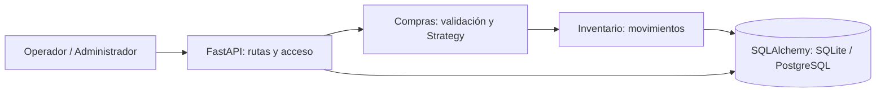
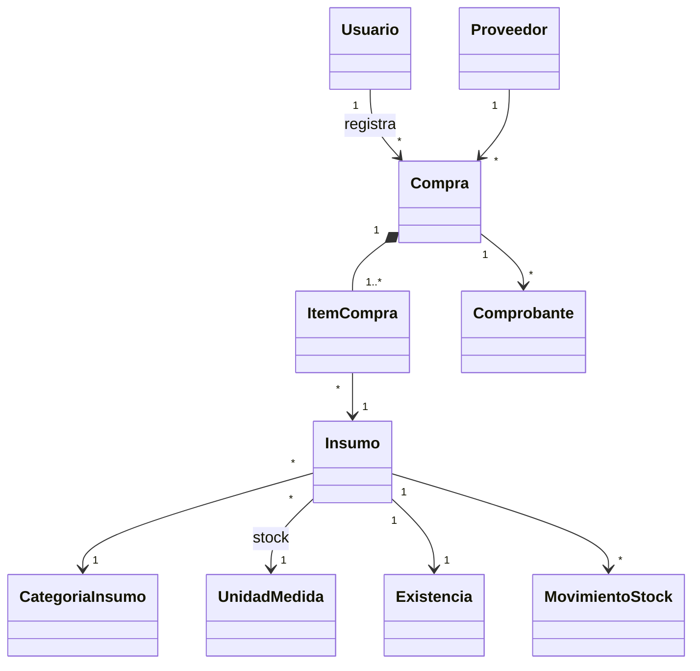
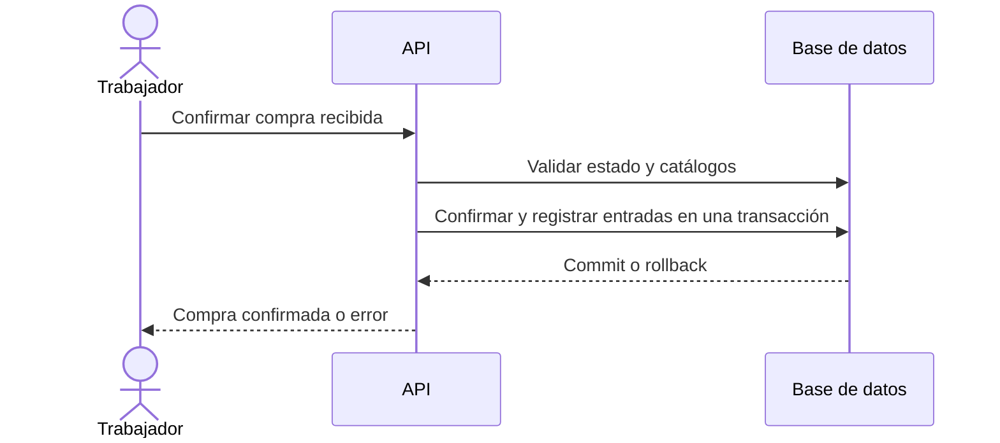
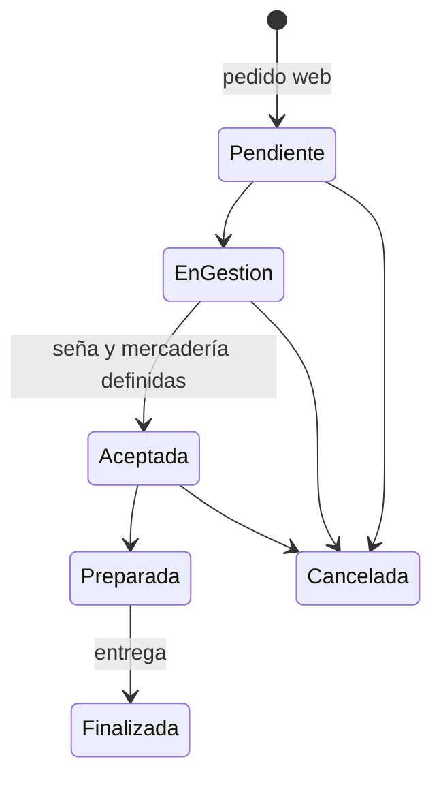

# WALOS

## 1. Descripción

Gestión de un emprendimiento de bocaditos y tortas para mascotas.

## 2. Alcance

| RF | Función | Estado |
|---|---|---|
| 01 | Sesiones, usuarios y roles. | Implementado |
| 02 | Alta, consulta, edición y baja lógica de proveedores. | Implementado |
| 03 | Categorías, unidades e insumos. | Implementado |
| 04 | Compras, comprobantes, recepción y anulación. | Implementado |
| 05 | Existencias de insumos y ajustes trazables. | Implementado |
| 06 | Producción, lotes, ubicaciones y ventas. | Planificado |
| 07 | Pedidos web y reservas con seña. | Planificado |
| 08 | Promociones. | Planificado |
| 09 | Gastos, costos y resumen mensual. | Planificado |

**Actores:** operador registra catálogos y compras; administrador también gestiona usuarios, edita/desactiva proveedores, da bajas lógicas, anula compras y ajusta stock. Cliente: futuro canal web. La API actual no incluye interfaz.

## 3. Reglas

- Una compra nace como borrador. Confirmarla implica mercadería recibida: compra, entradas y movimientos se guardan juntos. No se admiten recepciones parciales/diferidas en esta etapa.
- Referencia y usuario identifican una solicitud; repetirla no duplica registros. Confirmar o anular tampoco repite movimientos.
- Cantidades positivas, unidades compatibles y nombres no vacíos. Strategy elige conversión directa o por contenido de presentación; la cantidad incorporada y el precio quedan históricos.
- Una anulación conserva compra y comprobantes. Si revertir genera stock negativo, se rechaza y requiere revisión. Los ajustes registran usuario, fecha y motivo.
- Comprar insumos físicos y registrar gastos como alquiler/impuestos son operaciones distintas. Una compra no acredita ni debita dinero.
- **Reservas previstas:** pedido web sin apartar stock → revisión del trabajador → seña verificada y asignación manual de stock o producción → aceptación. La seña debe cubrir materiales; entrega y cobro son hechos distintos. Cancelar libera unidades y requiere resolver la seña.
- **Promociones previstas:** aplicar la oferta válida de menor total, sin acumulación. Un 3x2 entrega tres unidades y cobra dos.

## 4. Calidad

Acceso por rol, contraseñas con hash y HTTPS en despliegue. Stock no negativo, movimientos atómicos e importes en centavos. Meta: operaciones frecuentes en menos de 2 segundos con 10 usuarios simultáneos; respaldo según README.

## 5. Diagramas

### Arquitectura actual

### Modelo actual

### CU: confirmar compra

### Reservas previstas

**Pendiente con WALOS:** vida útil por conservación, logística de entregas y tratamiento de señas/reintegros.
