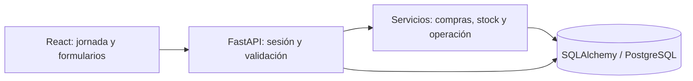
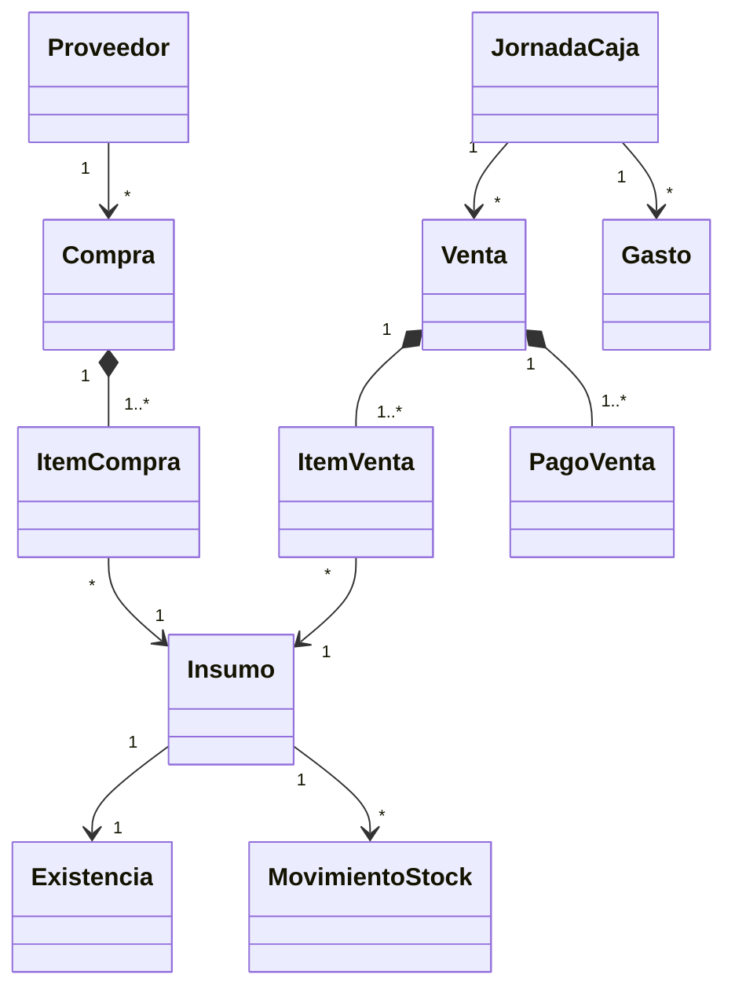
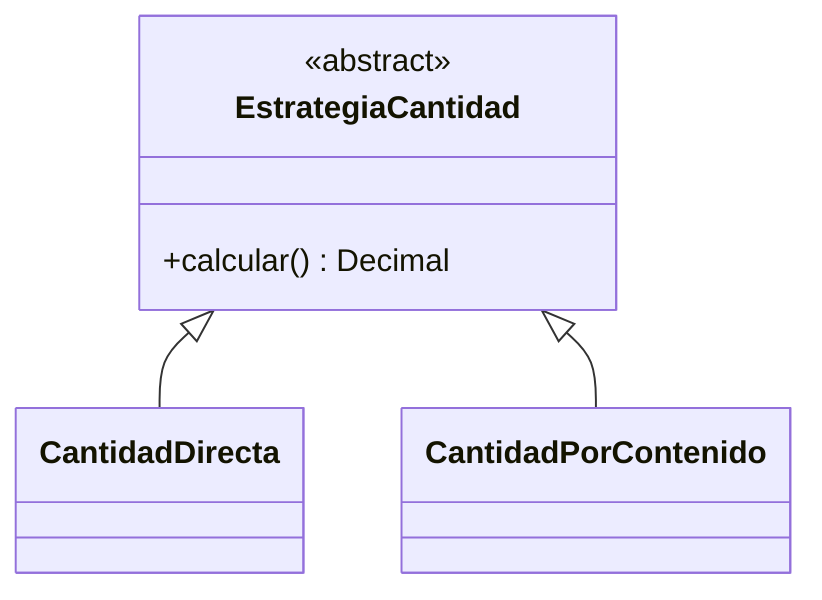

# WALOS

Gestión de una jornada para un emprendimiento de bocaditos y tortas para mascotas: compra → recepción → stock → venta → gasto → cierre. Una empresa, una ubicación y ARS. React en modo API usa PostgreSQL; la demo independiente conserva datos locales.

## 1. Requisitos y endpoints

| RF | Resultado | Endpoints principales |
|---|---|---|
| 01 | Administrador registra usuarios; cada usuario inicia/cierra sesión y consulta su identidad. | `POST /auth/usuarios`, `POST /auth/login`, `GET /auth/me`, `POST /auth/logout` |
| 02 | Registrar y consultar proveedores y artículos con categoría, unidad y precio. | `GET/POST /api/v1/proveedores`, `GET/POST /api/v1/catalogo`, `GET /api/v1/unidades` |
| 03 | Registrar compra en borrador y recibirla una sola vez. | `GET/POST /api/v1/compras`, `GET /api/v1/compras/{identifier}`, `POST /api/v1/compras/{identifier}/recibir` |
| 04 | Consultar existencias/movimientos; administrador registra un conteo absoluto de varios artículos. | `GET /api/v1/stock`, `GET /api/v1/stock/movimientos`, `POST /api/v1/stock/conteos` |
| 05 | Abrir caja, registrar ventas y gastos, y cerrar con efectivo contado y diferencia. | `GET/POST /api/v1/jornadas`, `POST /api/v1/ventas`, `POST /api/v1/gastos`, `POST /api/v1/jornadas/{identifier}/cerrar` |

`GET /api/v1/snapshot` devuelve una vista consistente para la interfaz. Los endpoints anteriores de compras, stock y comprobantes se conservan. Entradas y ejecución interactiva: `/docs`.

## 2. Reglas

- Registrar una compra no mueve stock ni dinero; recibirla exige proveedor activo y actualiza compra, existencias e historial en una transacción. Sin recepción parcial ni stock negativo.
- Las cantidades conservan hasta seis decimales; los importes se guardan en centavos. Los datos históricos desconocidos quedan vacíos; la UI muestra como sólo lectura unidades o precisiones que no puede editar exactamente.
- Venta y gasto requieren jornada abierta. La venta admite descuento y varios pagos declarados; sólo efectivo modifica la caja. Transferencias y billeteras no se verifican. Un cierre con diferencia exige motivo.
- Cada comando conserva su identificador y contenido para reintentos: repetirlo no duplica movimientos; cambiar el contenido devuelve `409`. Conteos, ventas y cierres validan versiones y se confirman completos o se rechazan.
- El servidor valida permisos. Administrador: usuarios, conteos y apertura/cierre; usuarios activos: consultas y operaciones autorizadas. Contraseñas con hash, sesiones de 8 horas; cinco fallos bloquean 15 minutos. Errores: `401`, `403`, `404`, `409`, `422`, `503` según sesión, permiso, existencia, conflicto, validación o disponibilidad.

## 3. Arquitectura

Un mismo contenedor sirve React y API. Alembic versiona el esquema; SQLite permite ejecución local. La interfaz no guarda operaciones comerciales como respaldo local del servidor.

## 4. UML y Strategy

Strategy en [`src/compras/conversiones.py`](../src/compras/conversiones.py): `cantidad_micro()` selecciona `CantidadDirecta` o `CantidadPorContenido`. Ambas implementan `EstrategiaCantidad.calcular()`, separando las reglas de conversión del servicio de compras.

Ejemplo: `2 bolsas × 250 g = 0,5 kg`; la compra directa de `500 g` produce el mismo stock.

## 5. Ejecución y entrega

[README](../README.md) · [Deploy](../DEPLOY.md) · [Presentación](Presentacion-WALOS.pptx). Los tests cubren conversiones, autenticación, compras, stock y jornadas; GitHub Actions ejecuta pruebas y comprueba Docker.

Fuera del piloto: recetas/producción automática, reservas, pagos reales y expansión multiempresa. Los documentos de la demo general describen su propio alcance.
