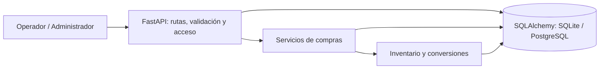
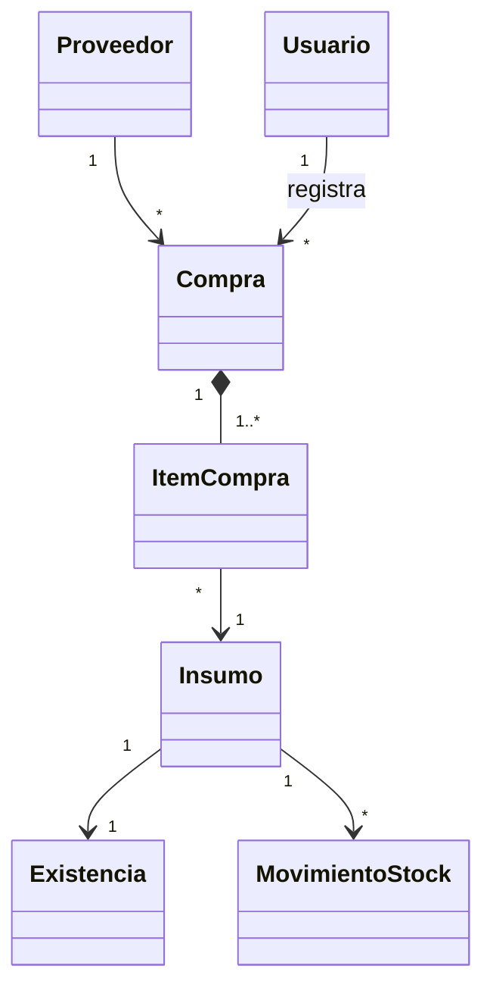
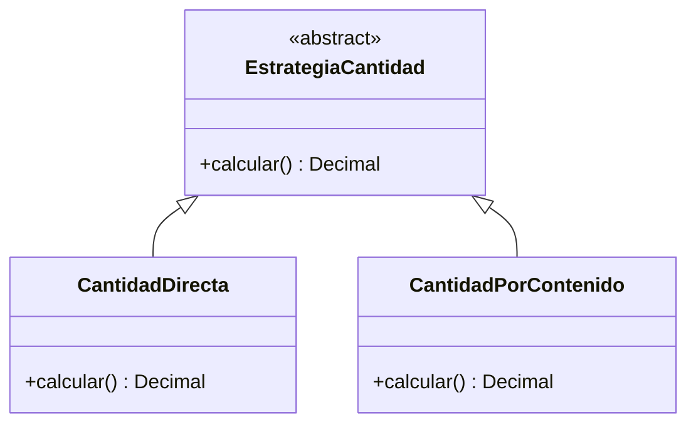

# WALOS API

Gestión de compras e inventario de insumos para un emprendimiento de bocaditos y tortas para mascotas. Esta entrega corresponde a la API; `plataforma-pyme/frontend` es una demo independiente con datos locales.

## 1. Requisitos y casos de uso

Todas las operaciones comerciales requieren sesión. El administrador crea usuarios, edita/desactiva proveedores, desactiva catálogos, anula compras y ajusta stock. El operador consulta y registra catálogos, proveedores y compras.

| RF | Caso de uso y resultado | Endpoints |
|---|---|---|
| 01 | Administrador registra un usuario; el usuario inicia/cierra sesión y consulta su identidad. | `POST /auth/usuarios`, `POST /auth/login`, `GET /auth/me`, `POST /auth/logout` |
| 02 | Registrar y consultar proveedores; el administrador modifica sus datos o aplica baja lógica. | `POST /proveedores`, `GET /proveedores`, `PUT /proveedores/{id}`, `PATCH /proveedores/{id}/desactivar` |
| 03 | Crear/consultar categorías, unidades e insumos. Cada insumo conserva su unidad de stock y comienza con existencia cero. | `POST /categorias`, `GET /categorias`, `POST /unidades`, `GET /unidades`, `POST /insumos`, `GET /insumos`; baja lógica con `PATCH /categorias/{id}/desactivar`, `PATCH /unidades/{id}/desactivar`, `PATCH /insumos/{id}/desactivar` |
| 04 | Registrar una compra en borrador, consultar su detalle, adjuntar comprobantes y confirmar la recepción o anularla conservando el historial. | `POST /compras`, `GET /compras`, `GET /compras/{id}`, `POST /compras/{id}/confirmar`, `POST /compras/{id}/anular`, `POST /compras/{id}/comprobantes`, `GET /compras/{id}/comprobantes`, `GET /compras/{id}/comprobantes/{comprobante_id}` |
| 05 | Consultar existencias y movimientos; el administrador registra ajustes con referencia y motivo. | `GET /stock`, `GET /stock/movimientos`, `POST /stock/ajustes` |

## 2. Reglas

- Confirmar significa mercadería recibida: estado, existencias y movimientos se guardan en una transacción. No hay recepción parcial.
- Repetir una solicitud con el mismo usuario, referencia y contenido no duplica la compra. Confirmar/anular tampoco repite movimientos. Reutilizar la referencia con otro contenido devuelve `409`.
- Las cantidades son positivas y tienen hasta seis decimales. Strategy calcula la cantidad en la unidad de stock; cantidades e importes históricos quedan guardados. Los importes se almacenan en centavos.
- No se permite stock negativo. Anular conserva compra y comprobantes; si no puede revertirse la existencia, devuelve `409`. Una compra no registra un pago.
- Contraseñas con hash, sesiones de 8 horas y bloqueo de 15 minutos tras cinco fallos. Errores: `401` sin sesión, `403` sin permiso, `404` inexistente, `409` conflicto, `422` validación y `503` base no disponible/sin migrar.

## 3. Arquitectura

## 4. UML y Strategy

Modelo principal:

Strategy en [`src/compras/conversiones.py`](../src/compras/conversiones.py): `cantidad_micro()` elige `CantidadDirecta` para unidades compatibles o `CantidadPorContenido` para presentaciones comerciales. Ambas implementan `EstrategiaCantidad.calcular()`. Separa las dos reglas y permite agregar otra conversión sin cambiar el servicio de compras.

Ejemplo: `2 bolsas x 250 g = 0,5 kg` de stock. Comprar `500 g` directamente produce la misma cantidad.

## 5. Verificación y entrega

[`tests/test_api.py`](../tests/test_api.py) comprueba acceso, validaciones, compras y stock. [`tests/test_conversiones.py`](../tests/test_conversiones.py) cubre 18 casos unitarios de conversión. También se prueban migraciones y el flujo con PostgreSQL. La Action [`walos-tests.yml`](../../.github/workflows/walos-tests.yml) ejecuta tests y verifica el arranque Docker.

Ejecución y dependencias: [README](../README.md). Publicación y comprobación: [DEPLOY](../DEPLOY.md). Presentación: [Presentacion-WALOS.pptx](Presentacion-WALOS.pptx).

Fuera de esta API: producción, ventas/caja, pedidos web, reservas con seña, promociones y costos mensuales. Su planificación no implica implementación ni integración con la demo React.
