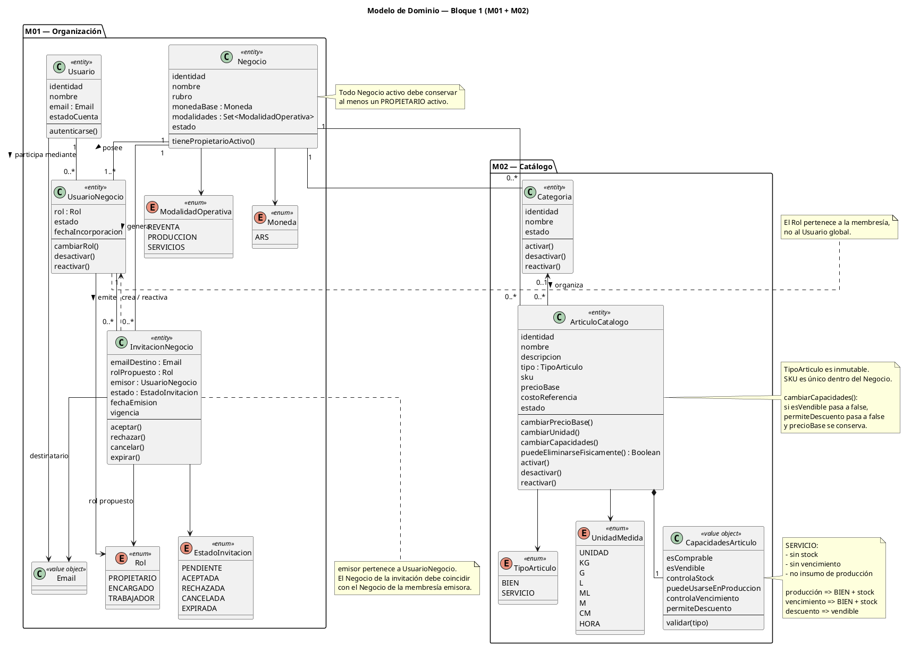

# 01 — Modelo de Dominio del Bloque 1

## 1. Propósito

Este documento define el **Modelo de Dominio conceptual del Bloque 1 — Fundación**, correspondiente a:

```text
M01 — Organización del Negocio
M02 — Catálogo
```

Su objetivo es traducir la especificación funcional congelada a un conjunto coherente de:

- entidades;
- conceptos de valor;
- enumeraciones;
- relaciones;
- cardinalidades;
- comportamientos;
- invariantes de dominio;
- responsabilidades transversales.

Este documento funciona como puente entre:

```text
Especificación funcional
        ↓
Modelo de dominio
        ↓
Decisiones arquitectónicas
        ↓
Modelo relacional
        ↓
Contrato API
        ↓
Implementación
```

Todavía no define:

- tablas;
- columnas;
- claves foráneas;
- índices;
- endpoints;
- schemas HTTP;
- clases ORM;
- estructura de carpetas;
- detalles de persistencia.

---

# 2. Criterio de Modelado

El modelo debe representar conceptos del negocio y no detalles accidentales de implementación.

Por lo tanto:

```text
Concepto funcional importante
→ puede aparecer en el dominio

Detalle de PostgreSQL / FastAPI / React
→ no pertenece a este documento
```

Se utilizan los siguientes estereotipos conceptuales:

```text
<<entity>>
Entidad con identidad propia

<<value object>>
Concepto definido por su valor

<<enum>>
Conjunto cerrado de valores permitidos
```

No debe crearse una clase solamente porque exista un sustantivo en los requisitos.

---

# 3. Vista General del Dominio

El Bloque 1 posee dos áreas principales:

```text
ORGANIZACIÓN
│
├── Usuario
├── Negocio
├── UsuarioNegocio
└── InvitacionNegocio


CATÁLOGO
│
├── Categoria
└── ArticuloCatalogo
```

Ambas áreas se conectan mediante `Negocio`.

Conceptualmente:

```text
Usuario
   │
   ▼
UsuarioNegocio
   │
   ▼
Negocio
   │
   ├── Categorias
   │
   └── ArticulosCatalogo
```

---

# 4. Entidades del Dominio

## 4.1. Usuario

### Estereotipo

```text
<<entity>>
Usuario
```

### Responsabilidad

Representa la identidad global de una persona dentro de la plataforma.

Un Usuario existe independientemente de los Negocios a los que pertenezca.

### Información Conceptual

```text
Usuario
├── identidad
├── nombre
├── email
├── credencial de acceso
└── estado de cuenta
```

### Reglas

Un Usuario puede pertenecer a:

```text
0..N Negocios
```

Un Usuario no posee un Rol global.

El Rol surge de:

```text
UsuarioNegocio
```

### Ejemplo

```text
María

Negocio WALOS
→ PROPIETARIO

Negocio Centro Mascota
→ TRABAJADOR
```

---

## 4.2. Negocio

### Estereotipo

```text
<<entity>>
Negocio
```

### Responsabilidad

Representa la organización, emprendimiento o comercio cuyos datos y operaciones se administran mediante la plataforma.

Constituye el límite principal de aislamiento funcional.

### Información Conceptual

```text
Negocio
├── identidad
├── nombre
├── rubro opcional
├── moneda base
├── modalidades operativas
└── estado
```

### Moneda del MVP

```text
ARS
```

### Modalidades

Una o más:

```text
REVENTA
PRODUCCION
SERVICIOS
```

### Estado durante el Bloque 1

El MVP solo necesita operar con:

```text
ACTIVO
```

No se implementará todavía un flujo funcional de:

```text
cerrar negocio
suspender negocio
eliminar negocio
reactivar negocio
```

El eventual ciclo de vida administrativo del Negocio queda para una evolución posterior.

### Invariante Principal

Todo Negocio activo debe poseer:

```text
>= 1 UsuarioNegocio ACTIVO
con rol PROPIETARIO
```

---

## 4.3. UsuarioNegocio

### Estereotipo

```text
<<entity>>
UsuarioNegocio
```

### Responsabilidad

Representa la participación de un Usuario dentro de un Negocio.

Es el concepto central que resuelve la relación:

```text
Usuario N:M Negocio
```

### Información Conceptual

```text
UsuarioNegocio
├── Usuario
├── Negocio
├── Rol
├── estado
└── fecha de incorporación
```

### Roles

```text
PROPIETARIO
ENCARGADO
TRABAJADOR
```

### Estados

```text
ACTIVO
INACTIVO
```

### Invariantes

Para una misma combinación conceptual:

```text
Usuario + Negocio
```

debe existir una única membresía histórica.

Una reincorporación:

```text
NO crea otra membresía
```

sino:

```text
UsuarioNegocio INACTIVO
        ↓
reactivación
        ↓
UsuarioNegocio ACTIVO
```

El nuevo rol será el establecido por la nueva incorporación.

### Regla del Último Propietario

No puede realizarse una acción que deje:

```text
Negocio activo
+
0 propietarios activos
```

Por lo tanto no se permite degradar ni desactivar al último `PROPIETARIO` activo.

---

## 4.4. InvitacionNegocio

### Estereotipo

```text
<<entity>>
InvitacionNegocio
```

### Responsabilidad

Representa una propuesta formal para incorporar una persona a un Negocio.

La invitación puede existir aunque el destinatario todavía no posea una cuenta.

### Información Conceptual

```text
InvitacionNegocio
├── Negocio
├── email destino
├── rol propuesto
├── emisor : UsuarioNegocio
├── estado
├── fecha de emisión
└── vigencia
```

El `emisor` representa la membresía activa desde la cual se genera la invitación.

Durante el MVP, dicha membresía debe pertenecer al mismo Negocio de la invitación y poseer rol `PROPIETARIO`.

### Rol Propuesto

Durante el MVP:

```text
ENCARGADO
TRABAJADOR
```

No puede utilizarse una invitación inicial para asignar:

```text
PROPIETARIO
```

### Estados

```text
PENDIENTE
ACEPTADA
RECHAZADA
CANCELADA
EXPIRADA
```

### Invariante de Identidad

Una invitación solo puede aceptarse cuando:

```text
Usuario.email
=
InvitacionNegocio.email_destino
```

### Canal de Distribución

El canal no forma parte de la identidad de la invitación.

Conceptualmente:

```text
InvitacionNegocio
        ↓
enlace
        ↓
WhatsApp / copiar enlace / otro canal futuro
```

WhatsApp no constituye una entidad del dominio de Organización.

---

## 4.5. Categoria

### Estereotipo

```text
<<entity>>
Categoria
```

### Responsabilidad

Permite organizar los artículos de un Negocio.

### Información Conceptual

```text
Categoria
├── identidad
├── Negocio
├── nombre
└── estado
```

### Estados

```text
ACTIVA
INACTIVA
```

### Invariantes

Cada Categoria pertenece a:

```text
1 Negocio
```

Dentro de un mismo Negocio no pueden existir dos Categorías con nombre funcionalmente equivalente.

Ejemplo:

```text
Snacks
SNACKS
 snacks
```

representan conceptualmente la misma Categoria.

La regla aplica a:

```text
ACTIVAS
+
INACTIVAS
```

Una Categoria INACTIVA existente debe reactivarse en lugar de duplicarse.

### Desactivación

Desactivar una Categoria:

```text
NO desactiva sus artículos
NO modifica sus capacidades
NO altera operaciones existentes
```

### Eliminación

Una Categoria solo puede eliminarse físicamente cuando:

```text
no posee referencias
+
no posee dependencias
```

En particular:

```text
Categoria
+
ArticuloCatalogo ACTIVO asociado
→ NO eliminar
```

y:

```text
Categoria
+
ArticuloCatalogo INACTIVO asociado
→ NO eliminar
```

---

## 4.6. ArticuloCatalogo

### Estereotipo

```text
<<entity>>
ArticuloCatalogo
```

### Responsabilidad

Representa cualquier bien o servicio que el Negocio necesite utilizar comercial u operativamente.

Ejemplos:

```text
Harina
Collar
Snack de pollo
Remera negra M
Maquillaje social
Asesoramiento por hora
```

### Información Conceptual

```text
ArticuloCatalogo
├── identidad
├── Negocio
├── nombre
├── descripción opcional
├── TipoArticulo
├── Categoria opcional
├── UnidadMedida
├── SKU opcional
├── imagen principal opcional
├── precio base
├── costo de referencia opcional
├── CapacidadesArticulo
└── estado
```

### Estados

```text
ACTIVO
INACTIVO
```

### Invariante de Tipo

El Tipo:

```text
BIEN
SERVICIO
```

es inmutable después de la creación.

No se permite:

```text
BIEN → SERVICIO
SERVICIO → BIEN
```

Si nunca fue utilizado:

```text
eliminar
+
crear correctamente
```

Si posee historia:

```text
desactivar
+
crear nuevo artículo
```

La entidad debe poder determinar conceptualmente si una eliminación física es válida:

```text
puedeEliminarseFisicamente()
```

El resultado solo puede ser verdadero cuando el artículo:

```text
no posee historia operativa
+
no posee referencias
+
no posee dependencias que deban conservarse
```

La forma técnica de consultar esas dependencias se definirá posteriormente.

---

# 5. Conceptos de Valor y Enumeraciones

## 5.1. Email

### Estereotipo

```text
<<value object>>
Email
```

Representa una dirección de correo válida utilizada como identidad funcional del Usuario durante el MVP.

Participa especialmente en:

```text
Usuario
InvitacionNegocio
```

La estrategia técnica de normalización se definirá posteriormente.

---

## 5.2. Rol

### Estereotipo

```text
<<enum>>
Rol
```

Valores:

```text
PROPIETARIO
ENCARGADO
TRABAJADOR
```

El Rol pertenece a:

```text
UsuarioNegocio
```

No pertenece directamente a `Usuario`.

---

## 5.3. ModalidadOperativa

### Estereotipo

```text
<<enum>>
ModalidadOperativa
```

Valores iniciales:

```text
REVENTA
PRODUCCION
SERVICIOS
```

Un Negocio posee una o más modalidades simultáneamente.

Conceptualmente:

```text
Negocio.modalidades
→ conjunto de 1..N ModalidadOperativa
```

Las modalidades:

```text
adaptan UX
priorizan navegación
orientan onboarding
```

pero no bloquean permanentemente funcionalidades del dominio.

---

## 5.4. EstadoInvitacion

### Estereotipo

```text
<<enum>>
EstadoInvitacion
```

Valores:

```text
PENDIENTE
ACEPTADA
RECHAZADA
CANCELADA
EXPIRADA
```

---

## 5.5. TipoArticulo

### Estereotipo

```text
<<enum>>
TipoArticulo
```

Valores:

```text
BIEN
SERVICIO
```

Es inmutable para un ArticuloCatalogo una vez creado.

---

## 5.6. UnidadMedida

### Estereotipo

```text
<<enum>>
UnidadMedida
```

Durante el MVP representa un catálogo normalizado y global del sistema.

Valores iniciales:

```text
UNIDAD
KG
G
L
ML
M
CM
HORA
```

No pertenece a un Negocio particular.

El Propietario no crea ni modifica unidades durante el MVP.

### Bienes

Un BIEN requiere selección explícita.

### Servicios

Un SERVICIO recibe inicialmente:

```text
UNIDAD
```

pero puede utilizar otra unidad válida, por ejemplo:

```text
HORA
```

---

## 5.7. CapacidadesArticulo

### Estereotipo

```text
<<value object>>
CapacidadesArticulo
```

Agrupa conceptualmente las capacidades operativas de un ArticuloCatalogo.

```text
CapacidadesArticulo
├── es_comprable
├── es_vendible
├── controla_stock
├── puede_usarse_en_produccion
├── controla_vencimiento
└── permite_descuento
```

Esta agrupación pertenece al modelo conceptual.

No obliga a utilizar posteriormente:

```text
una tabla independiente
una clase ORM independiente
un objeto persistido independiente
```

La representación técnica se decidirá durante el Modelo Relacional.

---

## 5.8. Moneda

### Estereotipo

```text
<<enum>>
Moneda
```

Durante el MVP:

```text
ARS
```

Se mantiene como concepto explícito para evitar que los importes pierdan su significado monetario.

El soporte multimoneda queda fuera del MVP.

---

# 6. Reglas de Capacidades de ArticuloCatalogo

## 6.1. Servicio

Si:

```text
tipo = SERVICIO
```

entonces:

```text
controla_stock = False
controla_vencimiento = False
puede_usarse_en_produccion = False
```

---

## 6.2. Vencimiento

Si:

```text
controla_vencimiento = True
```

entonces:

```text
tipo = BIEN
controla_stock = True
```

---

## 6.3. Producción

Si:

```text
puede_usarse_en_produccion = True
```

entonces:

```text
tipo = BIEN
controla_stock = True
```

---

## 6.4. Descuento

Si:

```text
permite_descuento = True
```

entonces:

```text
es_vendible = True
```

Si:

```text
es_vendible
True → False
```

entonces la modificación de capacidades debe preservar atómicamente la consistencia:

```text
es_vendible = False
permite_descuento = False
precio_base = se conserva
```

Conceptualmente, `ArticuloCatalogo.cambiarCapacidades()` debe aplicar esta regla como una única transición válida del dominio.

No debe existir un estado intermedio observable donde:

```text
es_vendible = False
permite_descuento = True
```

---

## 6.5. Uso Operativo

Un artículo ACTIVO debe poseer al menos uno:

```text
es_comprable = True

o

es_vendible = True

o

puede_usarse_en_produccion = True
```

---

# 7. Precio y Costo

## 7.1. Precio Base

Si:

```text
es_vendible = True
```

debe existir:

```text
precio_base >= 0
```

Se permite:

```text
precio_base = 0
```

para:

- muestras;
- cortesías;
- bonificaciones;
- artículos promocionales.

---

## 7.2. Conservación del Precio

Si:

```text
es_vendible
True → False
```

el precio base:

```text
NO se elimina
```

queda temporalmente sin efecto operativo.

La misma transición debe ajustar:

```text
permite_descuento = False
```

sin modificar `precio_base`.

Por lo tanto, la deshabilitación de venta afecta capacidades operativas, pero no borra información comercial útil.

Si posteriormente vuelve a habilitarse la venta, el precio almacenado puede utilizarse nuevamente como referencia y ser revisado por el Propietario.

---

## 7.3. Costo de Referencia

Es opcional.

Cuando existe:

```text
costo_referencia >= 0
```

No representa necesariamente costo histórico, último costo ni costo contable.

---

# 8. SKU

El SKU es opcional.

Cuando existe:

```text
SKU
→ único dentro del Negocio
```

La unicidad considera:

```text
artículos ACTIVOS
+
artículos INACTIVOS
```

Por lo tanto:

```text
Articulo A
SKU = REM-01
INACTIVO

Articulo B
SKU = REM-01
→ inválido
```

El SKU solamente queda disponible nuevamente cuando el artículo original puede eliminarse físicamente y efectivamente se elimina.

---

# 9. UnidadMedida e Historia Operativa

La UnidadMedida puede modificarse mientras el artículo no posea historia operativa dependiente de cantidades.

Conceptualmente:

```text
ArticuloCatalogo
        ↓
¿posee historia cuantitativa?
        │
        ├── No → unidad modificable
        │
        └── Sí → unidad protegida
```

La existencia de historia operativa será una condición derivada de módulos consumidores como:

```text
M03 Compras
M04 Inventario
M05 Ventas
M07 Producción
```

M02 debe consultar conceptualmente esa condición antes de permitir el cambio.

No se define todavía:

```text
un atributo persistente obligatorio
tiene_historia_operativa
```

La implementación concreta se decidirá posteriormente.

---

# 10. Relaciones y Cardinalidades

## Usuario ↔ UsuarioNegocio

```text
Usuario
1
│
│
0..N
UsuarioNegocio
```

Un Usuario puede poseer ninguna, una o múltiples membresías.

---

## Negocio ↔ UsuarioNegocio

```text
Negocio
1
│
│
1..N
UsuarioNegocio
```

Todo Negocio activo posee al menos una membresía activa de propietario.

---

## Negocio ↔ InvitacionNegocio

```text
Negocio
1
│
│
0..N
InvitacionNegocio
```

---

## UsuarioNegocio ↔ InvitacionNegocio

Una invitación es emitida por un Usuario actuando dentro de un Negocio.

Conceptualmente:

```text
UsuarioNegocio
1
│
│ emite
│
0..N
InvitacionNegocio
```

La membresía emisora debe poseer permisos suficientes.

Durante el MVP:

```text
Rol = PROPIETARIO
```

La relación directa entre `Negocio` e `InvitacionNegocio` se conserva porque la invitación pertenece explícitamente a un Negocio y debe poder comprenderse como parte de su contexto.

Al mismo tiempo, `UsuarioNegocio` identifica a la membresía responsable de emitirla.

Por ello existe la siguiente invariante:

```text
InvitacionNegocio.negocio
=
InvitacionNegocio.emisor.negocio
```

Conceptualmente:

```text
Negocio A
   │
   ├── UsuarioNegocio del Propietario A
   │          │
   │          └── emite
   │                 ↓
   └──────── InvitacionNegocio del Negocio A
```

No es válido:

```text
UsuarioNegocio del Negocio A
        ↓
emite invitación para Negocio B
```

La forma concreta de garantizar esta consistencia pertenece al Modelo Relacional y a la capa de aplicación, no a este modelo conceptual.

---

## InvitacionNegocio → UsuarioNegocio

Una invitación aceptada puede:

```text
crear
o
reactivar
```

un `UsuarioNegocio`.

No se trata necesariamente de una relación estructural persistente entre ambas entidades.

Es una consecuencia de dominio.

---

## Negocio ↔ Categoria

```text
Negocio
1
│
│
0..N
Categoria
```

---

## Negocio ↔ ArticuloCatalogo

```text
Negocio
1
│
│
0..N
ArticuloCatalogo
```

---

## Categoria ↔ ArticuloCatalogo

```text
Categoria
0..1
│
│
0..N
ArticuloCatalogo
```

Desde la perspectiva del artículo:

```text
Categoria
→ opcional
```

---

## ArticuloCatalogo ↔ CapacidadesArticulo

```text
ArticuloCatalogo
1
◆────────1
CapacidadesArticulo
```

Las capacidades forman parte del concepto del artículo y no poseen identidad propia.

---

## ArticuloCatalogo ↔ UnidadMedida

```text
ArticuloCatalogo
N
│
│
1
UnidadMedida
```

---

# 11. Invariantes Principales del Bloque 1

## Organización

### INV-ORG-001

Todo Negocio activo conserva al menos un Propietario activo.

### INV-ORG-002

El Rol pertenece a UsuarioNegocio.

### INV-ORG-003

Un Usuario puede existir sin Negocio.

### INV-ORG-004

Desactivar una membresía no desactiva la cuenta global.

### INV-ORG-005

Una reincorporación reutiliza la membresía histórica.

### INV-ORG-006

Una invitación solamente puede ser aceptada por el email destinatario.

### INV-ORG-007

Solo una invitación PENDIENTE y vigente puede aceptarse.

### INV-ORG-008

Toda operación de Negocio exige:

```text
Usuario autenticado
+
Negocio autorizado
+
Membresía activa
+
Rol
+
permiso específico del módulo
```

### INV-ORG-009

Las modalidades adaptan la experiencia pero no funcionan como restricciones rígidas.

### INV-ORG-010

Toda `InvitacionNegocio` debe pertenecer al mismo Negocio que la membresía `UsuarioNegocio` que la emite.

Conceptualmente:

```text
InvitacionNegocio.negocio
=
UsuarioNegocioEmisor.negocio
```

No puede emitirse una invitación para un Negocio utilizando una membresía perteneciente a otro.

---

## Catálogo

### INV-CAT-001

ArticuloCatalogo y Categoria pertenecen a un único Negocio.

### INV-CAT-002

La Categoria asignada a un artículo debe pertenecer al mismo Negocio.

### INV-CAT-003

TipoArticulo es inmutable.

### INV-CAT-004

SERVICIO nunca controla stock.

### INV-CAT-005

SERVICIO nunca controla vencimiento.

### INV-CAT-006

SERVICIO no participa como insumo productivo.

### INV-CAT-007

Vencimiento implica BIEN + stock.

### INV-CAT-008

Producción implica BIEN + stock.

### INV-CAT-009

Descuento implica artículo vendible.

### INV-CAT-010

Deshabilitar venta deshabilita descuentos dentro de la misma transición de dominio y conserva el precio base.

Conceptualmente:

```text
es_vendible = False
→ permite_descuento = False
→ precio_base se conserva
```

### INV-CAT-011

Artículo vendible requiere precio_base >= 0.

### INV-CAT-012

Costo de referencia informado debe ser >= 0.

### INV-CAT-013

SKU informado es único por Negocio entre activos e inactivos.

### INV-CAT-014

Categorías equivalentes no pueden duplicarse dentro del Negocio.

### INV-CAT-015

Categoria inactiva no desactiva sus artículos.

### INV-CAT-016

Una Categoria referenciada por artículos activos o inactivos no puede eliminarse físicamente.

### INV-CAT-017

Un ArticuloCatalogo solo puede eliminarse físicamente si no posee historia operativa, referencias ni dependencias que deban conservarse.

Si existe cualquiera de ellas:

```text
eliminación física
→ prohibida

desactivación
→ permitida según reglas del módulo
```

### INV-CAT-018

UnidadMedida con historia cuantitativa no puede cambiar su significado.

---

# 12. Responsabilidad Transversal de Trazabilidad

La trazabilidad no se modelará todavía como una entidad universal obligatoria.

Conceptualmente, toda modificación relevante debe poder responder:

```text
¿Quién?
¿Cuándo?
¿Qué hizo?
```

Ejemplos del Bloque 1:

```text
cambio de rol
desactivación de membresía
promoción a propietario
creación de artículo
edición relevante de artículo
activación/desactivación
cambio de precio base
```

Esto se considera una:

```text
responsabilidad transversal
```

La estrategia técnica podrá resolverse posteriormente mediante:

- información de autoría en entidades;
- registro de eventos;
- historial de cambios;
- auditoría técnica;

o una combinación apropiada.

Este documento no obliga todavía a crear:

```text
Entidad Auditoria
```

para todas las operaciones.

---

# 13. Permisos y Modelo de Dominio

El dominio diferencia:

```text
Rol
```

de:

```text
Permiso concreto
```

M01 determina:

```text
UsuarioNegocio.rol
```

Cada módulo determina:

```text
qué operaciones permite ese Rol
```

Ejemplo:

```text
ENCARGADO

M02
├── consultar catálogo          Sí
├── activar artículo            Sí
├── desactivar artículo         Sí
├── editar artículo             No
├── cambiar precio_base         No
└── gestionar categorías        No
```

No se crea por ahora una entidad:

```text
Permiso
```

ni un sistema configurable de RBAC dinámico.

Eso sería complejidad innecesaria para el MVP.

---

# 14. Diagrama UML Conceptual

El siguiente diagrama representa el Modelo de Dominio del Bloque 1.



---

# 15. Lectura Simplificada del UML

La parte de Organización se interpreta así:

```text
Usuario
   │
   │ participa
   ▼
UsuarioNegocio
   │
   │ pertenece
   ▼
Negocio
```

`UsuarioNegocio` contiene el Rol.

Por eso:

```text
Usuario
≠
Rol
```

y:

```text
UsuarioNegocio
→ Rol
```

---

La parte de Catálogo:

```text
Negocio
   │
   ├── Categoria
   │
   └── ArticuloCatalogo
             │
             ├── TipoArticulo
             ├── UnidadMedida
             └── CapacidadesArticulo
```

El artículo no necesita convertirse en:

```text
Producto
Insumo
MateriaPrima
Servicio
ProductoTerminado
```

El comportamiento surge de:

```text
Tipo
+
Capacidades
```

---

# 16. Elementos que NO Deben Crearse en el Bloque 1

No forman parte del Modelo de Dominio actual:

```text
Producto
MateriaPrima
Insumo
ProductoTerminado

StockUbicacion
Lote
MovimientoInventario

Proveedor
Compra

Cliente
Venta
Pago

SesionCaja
MovimientoCaja

Receta
Produccion
```

Aparecerán cuando se diseñen los módulos correspondientes.

Tampoco se crean todavía:

```text
Permiso
Auditoria universal
ListaPrecio
VarianteProducto
AtributoDinamico
```

salvo que una necesidad posterior demuestre que son necesarios.

---

# 17. Límites de Responsabilidad

## M01

Es responsable de:

```text
identidad
negocios
membresías
roles
invitaciones
modalidades
contexto autorizado
```

No administra el Catálogo.

---

## M02

Es responsable de:

```text
categorías
artículos
tipos
unidades
capacidades
precio base
costo de referencia
estado del artículo
```

No administra:

```text
stock real
compras
ventas
producción
```

---

# 18. Dependencias entre M01 y M02

M02 depende conceptualmente de M01 porque todo catálogo pertenece a:

```text
Negocio
```

y toda acción sobre el catálogo requiere:

```text
Usuario
+
UsuarioNegocio
+
Rol
+
permiso definido por M02
```

Por lo tanto:

```text
M01
   ↓
provee identidad y contexto

M02
   ↓
aplica reglas específicas del catálogo
```

M01 no debe conocer internamente las reglas del Catálogo.

---

# 19. Decisiones Técnicas que Permanecen Abiertas

Este modelo no decide todavía:

```text
UUID vs otro identificador

tablas y nombres de columnas

índices

restricciones SQL

implementación de unicidad

normalización exacta de email

normalización exacta de SKU

normalización exacta de nombres de Categoria

precisión monetaria

precisión de cantidades

hash de contraseña

JWT / sesiones

forma de transportar Negocio activo

Service Layer

Repository

eventos de dominio

auditoría técnica

almacenamiento de imágenes
```

Estas decisiones se resolverán en las siguientes etapas.

---

# 20. Criterios de Aceptación del Modelo de Dominio

El Modelo de Dominio del Bloque 1 se considera válido cuando:

1. `Usuario` representa una cuenta global independiente de los Negocios.
2. `UsuarioNegocio` representa correctamente la relación N:M.
3. El Rol pertenece a `UsuarioNegocio`.
4. Un Negocio puede poseer múltiples Propietarios.
5. El modelo protege la existencia de al menos un Propietario activo.
6. `Negocio.modalidades` representa conceptualmente un conjunto de una o más `ModalidadOperativa`.
7. `InvitacionNegocio` puede existir sin que exista previamente el Usuario destinatario.
8. La invitación se vincula funcionalmente por email.
9. `InvitacionNegocio` identifica explícitamente a la membresía `UsuarioNegocio` emisora.
10. Toda `InvitacionNegocio` pertenece al mismo Negocio que su membresía emisora.
11. WhatsApp no forma parte de la identidad del Usuario ni de la Invitación.
12. Las modalidades operativas pertenecen al Negocio.
13. Las modalidades no bloquean permanentemente funcionalidades.
14. Cada Categoria pertenece a un Negocio.
15. Cada ArticuloCatalogo pertenece a un Negocio.
16. La Categoria de un artículo pertenece al mismo Negocio.
17. La Categoria es opcional.
18. `TipoArticulo` distingue BIEN de SERVICIO.
19. El Tipo del artículo es inmutable.
20. `CapacidadesArticulo` representa los usos operativos sin crear jerarquías rígidas.
21. Un SERVICIO no puede controlar stock, vencimiento ni utilizarse como insumo de producción.
22. Producción exige BIEN con stock.
23. Vencimiento exige BIEN con stock.
24. Descuento exige que el artículo sea vendible.
25. Deshabilitar venta ajusta `permite_descuento = False` dentro de la misma transición.
26. Deshabilitar venta conserva `precio_base`.
27. El precio base admite cero.
28. SKU es único dentro de cada Negocio considerando activos e inactivos.
29. UnidadMedida es un concepto normalizado global.
30. Los Servicios reciben `UNIDAD` como valor inicial.
31. Las unidades con historia cuantitativa quedan protegidas.
32. Las Categorías inactivas no desactivan sus artículos y una Categoria referenciada por artículos activos o inactivos no puede eliminarse físicamente.
33. `ArticuloCatalogo` solo puede eliminarse físicamente cuando no posee historia operativa, referencias ni dependencias que deban conservarse.
34. Los permisos concretos permanecen bajo responsabilidad de cada módulo y la trazabilidad se reconoce como responsabilidad transversal sin sobrediseñar una entidad universal.
35. El modelo no introduce conceptos pertenecientes a módulos posteriores.

---

# 21. Estado del Documento

Una vez revisado y aprobado, el estado esperado será:

```text
BLOQUE 1 — FUNDACIÓN

Especificación Funcional
├── M01 Organización     ✅ CONGELADO
└── M02 Catálogo         ✅ CONGELADO

Diseño Técnico
└── Modelo de Dominio    ✅ CONGELADO
```

El siguiente paso será:

```text
DECISIONES ARQUITECTÓNICAS
NECESARIAS PARA BLOQUE 1
```

y posteriormente:

```text
MODELO RELACIONAL
```
