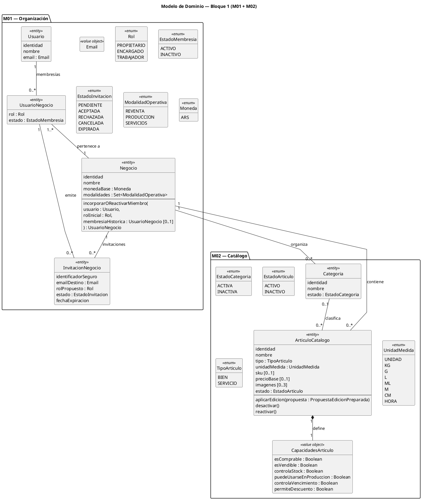

# 01 — Modelo de Dominio del Bloque 1

> **Estado documental:** versión sincronizada y auditada transversalmente — congelada como referencia de implementación del Bloque 1.

## 1. Propósito

Este documento define el **Modelo de Dominio conceptual del Bloque 1 — Fundación**, correspondiente a:

```text
M01 — Organización del Negocio
M02 — Catálogo
```

Su objetivo es traducir las especificaciones funcionales congeladas a un modelo coherente y estable de:

- entidades;
- Value Objects;
- enumeraciones;
- relaciones;
- cardinalidades;
- comportamientos relevantes;
- estados;
- invariantes;
- guardias contextuales;
- límites entre módulos;
- responsabilidades transversales.

Este documento funciona como puente entre:

```text
Especificación funcional
        ↓
Modelo de dominio
        ↓
Diagramas detallados
        ↓
Decisiones arquitectónicas / ADRs
        ↓
Modelo relacional
        ↓
Contrato API
        ↓
UX
        ↓
Implementación
        ↓
Tests
```

Todavía no define:

- tablas;
- columnas;
- claves foráneas;
- índices;
- endpoints;
- schemas HTTP;
- clases ORM;
- estructura de carpetas;
- estrategia de transacciones;
- estrategia de locking/concurrencia;
- Repository;
- Unit of Work;
- almacenamiento físico de archivos.

## 1.1. Jerarquía Documental

Para interpretar o implementar el Bloque 1 debe respetarse:

```text
Especificación funcional del módulo
        ↓
Modelo de Dominio del Bloque 1
        ↓
Guía semántica del diagrama detallado
        ↓
Diagrama UML detallado
        ↓
Arquitectura / ADRs
        ↓
Implementación
```

Para M01:

```text
modulos/M01-organizacion-negocio.md
        ↓
01-modelo-dominio-bloque-1.md
        ↓
02-m01-organizacion-clases.md
        ↓
02-m01-organizacion-clases.puml
```

Para el ciclo de vida específico de `InvitacionNegocio`:

```text
modulos/M01-organizacion-negocio.md
        ↓
01-modelo-dominio-bloque-1.md
        ↓
04-m01-estados-invitacion.md
        ↓
04-m01-estados-invitacion.puml
```

El diagrama de clases y el diagrama de estados son vistas complementarias:

```text
02
→ estructura y responsabilidades

04
→ ciclo de vida de InvitacionNegocio
```

Para M02:

```text
modulos/M02-Catalogo.md
        ↓
01-modelo-dominio-bloque-1.md
        ↓
03-m02-catalogo-clases.md
        ↓
03-m02-catalogo-clases.puml
```

Si dos fuentes se contradicen, la contradicción debe resolverse antes de implementar.

Una IA no debe seleccionar silenciosamente la interpretación que resulte más conveniente para generar código.

## 1.2. Uso Esperado por IA y Desarrollo

Una IA puede utilizar este documento para:

- comprender responsabilidades;
- identificar invariantes;
- proponer arquitectura;
- derivar modelo relacional;
- diseñar contratos de API;
- derivar tests;
- revisar código;
- detectar violaciones del dominio.

Pero no debe:

- traducir cada clase conceptual a una tabla;
- crear un Repository por cada entidad automáticamente;
- convertir cada método conceptual en un endpoint;
- asumir que un método mostrado es la lista exhaustiva de operaciones permitidas;
- asumir que un `enum` debe persistirse como enum nativo de base de datos;
- asumir límites de Aggregate Roots que todavía no fueron definidos;
- inventar datos de M03/M04/M05/M07 dentro de M02.

La implementación debe preservar las invariantes aunque la representación técnica final sea diferente del UML conceptual.

---

# 2. Criterio de Modelado

El modelo representa conceptos y reglas del negocio, no detalles accidentales de implementación.

Por lo tanto:

```text
Concepto funcional importante
→ puede aparecer en el dominio

Detalle de PostgreSQL / FastAPI / React
→ no pertenece a este documento
```

Se utilizan los siguientes estereotipos conceptuales:

```text
<<entity>>
Entidad con identidad estable

<<value object>>
Concepto definido por su valor y sin identidad independiente

<<enum>>
Conjunto cerrado de valores admitidos por el dominio
```

No debe crearse una clase solamente porque exista un sustantivo en los requisitos.

## 2.1. Identidad de Dominio

El atributo conceptual:

```text
identidad
```

representa una identidad estable del concepto.

No define todavía:

```text
UUID
integer autoincremental
ULID
otro mecanismo
```

Las claves funcionales como:

```text
email
SKU
nombre de Categoria
```

no deben confundirse automáticamente con la identidad técnica persistente.

En particular:

```text
ArticuloCatalogo.identidad
≠ SKU

Categoria.identidad
≠ nombre
```

por lo que modificar SKU o nombre no cambia la identidad histórica de la entidad.

## 2.2. Métodos Conceptuales

Los métodos mostrados en el modelo:

- expresan comportamiento relevante;
- ayudan a ubicar responsabilidades;
- no representan una API pública automática;
- no son necesariamente exhaustivos;
- no determinan todavía la capa concreta donde se implementarán.

La ausencia de:

```text
cambiarNombre()
```

en una vista simplificada no implica que el nombre sea inmutable si la especificación funcional permite editarlo.

Cuando un comportamiento necesita información externa a la entidad, el UML puede mostrar la intención conceptual sin resolver todavía cómo se obtiene dicha información.

## 2.3. Validaciones Locales y Contextuales

Debe distinguirse:

### Validación local

Puede resolverse utilizando el estado del propio concepto.

Ejemplos:

```text
SERVICIO no controla stock
permite_descuento implica es_vendible
precio informado no puede ser negativo
```

### Validación contextual

Necesita conocer otras entidades, módulos o información concurrente.

Ejemplos:

```text
SKU único dentro del Negocio
nombre de Categoria único dentro del Negocio
último PROPIETARIO activo
membresía histórica única
Categoria y ArticuloCatalogo del mismo Negocio
historia cuantitativa
dependencias de stock / lotes / recetas
eliminación física segura
```

Una validación contextual previa utilizada por UX no constituye por sí sola una garantía de dominio.

La validación relevante y la mutación deben confirmarse de manera consistente dentro de la operación que realiza el cambio.

La estrategia técnica se definirá posteriormente.

## 2.4. Estado de Dominio vs. Borrado Técnico

Estados como:

```text
ACTIVO
INACTIVO
```

son estados funcionales.

No deben interpretarse automáticamente como:

```text
soft_deleted = true/false
```

ni confundirse con eliminación física.

La eliminación física es una operación excepcional y separada.

## 2.5. Estado Actual vs. Historia

M01 y M02 mantienen principalmente el **estado actual** de sus conceptos.

Cuando un módulo transaccional necesite conservar cómo era cierta información en el momento de una operación, dicho módulo deberá preservar los valores históricos necesarios.

Ejemplo:

```text
precioBase actual de ArticuloCatalogo
≠ precio aplicado en una Venta histórica
```

Este principio evita reconstruir el pasado consultando únicamente el estado actual.

---

# 3. Vista General del Dominio

El Bloque 1 posee dos áreas principales:

```text
ORGANIZACIÓN
│
├── Usuario
├── Negocio
├── UsuarioNegocio
└── InvitacionNegocio


CATÁLOGO
│
├── Categoria
└── ArticuloCatalogo
```

Ambas áreas se conectan mediante `Negocio`.

Conceptualmente:

```text
Usuario
   │
   ▼
UsuarioNegocio
   │
   ▼
Negocio
   │
   ├── Categorias
   │
   └── ArticulosCatalogo
```

---

# 4. Entidades del Dominio

## 4.1. Usuario

### Estereotipo

```text
<<entity>>
Usuario
```

### Responsabilidad

Representa la identidad global de una persona dentro de la plataforma.

Un `Usuario` existe independientemente de los Negocios a los que pertenezca y puede poseer:

```text
0..N membresías
```

La pertenencia a un Negocio no modifica la identidad global del Usuario.

### Información Conceptual

```text
Usuario
├── identidad
├── nombre
├── email : Email
├── estado de cuenta
└── fecha de registro
```

La gestión técnica de credenciales no forma parte de esta entidad conceptual.

Por lo tanto, este modelo no incorpora como atributos de dominio:

```text
contraseña
hash de contraseña
JWT
refresh token
OAuth
MFA
```

La autenticación forma parte funcionalmente de M01, pero su implementación técnica pertenece a Arquitectura / IAM.

### Reglas

Un Usuario no posee un Rol global.

El Rol surge exclusivamente de:

```text
UsuarioNegocio
```

Desactivar una membresía:

```text
UsuarioNegocio
ACTIVO → INACTIVO
```

no debe:

- desactivar la cuenta global;
- afectar otras membresías;
- eliminar al Usuario;
- modificar operaciones históricas.

### Ejemplo

```text
María

Negocio WALOS
→ PROPIETARIO

Negocio Centro Mascota
→ TRABAJADOR
```

---

## 4.2. Negocio

### Estereotipo

```text
<<entity>>
Negocio
```

### Responsabilidad

Representa la organización, emprendimiento o comercio cuyos datos y operaciones se administran mediante la plataforma.

Constituye el límite principal de aislamiento funcional y concentra las reglas que requieren conocer el contexto organizacional completo.

### Información Conceptual

```text
Negocio
├── identidad
├── nombre
├── rubro opcional
├── moneda base
└── modalidades operativas
```

### Moneda del MVP

```text
ARS
```

Durante el Bloque 1 no se define cambio de moneda base.

### Modalidades

Un Negocio posee un conjunto de:

```text
1..N ModalidadOperativa
```

Valores del MVP:

```text
REVENTA
PRODUCCION
SERVICIOS
```

Las modalidades:

```text
adaptan UX
priorizan navegación
orientan onboarding
```

pero no funcionan como restricciones rígidas del dominio.

### Ciclo Administrativo del Negocio durante el Bloque 1

El Bloque 1 no define todavía un ciclo formal de estados administrativos para `Negocio`.

No se introduce en esta etapa:

```text
EstadoNegocio
ACTIVO
INACTIVO
CERRADO
SUSPENDIDO
ELIMINADO
```

ni operaciones como:

```text
cerrarNegocio()
suspenderNegocio()
reactivarNegocio()
eliminarNegocio()
```

Mientras no exista una especificación funcional posterior que defina ese ciclo, una IA no debe inventarlo a partir del uso coloquial de expresiones como “Negocio activo”.

Las reglas organizacionales vigentes se aplican a todo Negocio existente administrado por la plataforma.

### Invariante Principal

Todo Negocio debe poseer:

```text
>= 1 UsuarioNegocio ACTIVO
con rol PROPIETARIO
```

Las operaciones que puedan alterar esa condición deben validar la invariante dentro de la misma operación que produce el cambio.

Conceptualmente:

```text
desactivarMiembro(...)
cambiarRolMiembro(...)
```

no pueden dejar al Negocio sin Propietarios activos.

### Creación Válida del Negocio

Crear un Negocio no consiste únicamente en crear la entidad `Negocio`.

Una creación válida produce conceptualmente y de forma atómica:

```text
Negocio nuevo
+
UsuarioNegocio del creador
+
EstadoMembresia = ACTIVO
+
Rol = PROPIETARIO
```

Nunca debe resultar de una creación válida:

```text
Negocio
+
0 Propietarios activos
```

Este documento no decide todavía si esta coordinación se implementará mediante Factory, Application Service, Domain Service u otro patrón.

### Gestión Conceptual de Membresías

Las mutaciones de membresía que pueden afectar invariantes organizacionales se expresan desde el contexto del Negocio:

```text
desactivarMiembro(miembro)
cambiarRolMiembro(miembro, nuevoRol)
incorporarOReactivarMiembro(usuario, rolInicial, membresiaHistorica)
```

`cambiarRolMiembro(..., PROPIETARIO)` representa conceptualmente la promoción explícita a Propietario.

La incorporación inicial mediante invitación solo admite:

```text
ENCARGADO
TRABAJADOR
```

---

## 4.3. UsuarioNegocio

### Estereotipo

```text
<<entity>>
UsuarioNegocio
```

### Responsabilidad

Representa la participación contextual de un Usuario dentro de un Negocio.

Es el concepto central que resuelve la relación:

```text
Usuario N:M Negocio
```

### Información Conceptual

```text
UsuarioNegocio
├── Usuario
├── Negocio
├── rol : Rol
├── estado : EstadoMembresia
└── fecha de incorporación
```

### Roles

```text
PROPIETARIO
ENCARGADO
TRABAJADOR
```

### Estados

```text
ACTIVO
INACTIVO
```

No deben inventarse desde este modelo estados adicionales como:

```text
PENDIENTE
SUSPENDIDO
ELIMINADO
BLOQUEADO
```

sin modificar previamente la especificación funcional.

### Invariante de Membresía Histórica Única

Para una misma combinación conceptual:

```text
Usuario + Negocio
```

debe existir una única membresía histórica.

Una reincorporación:

```text
NO crea otra membresía
```

sino:

```text
UsuarioNegocio INACTIVO
        ↓
reactivación
        ↓
UsuarioNegocio ACTIVO
```

El nuevo rol será el establecido por la nueva incorporación.

Si la membresía ya se encuentra:

```text
ACTIVA
```

la operación de incorporación no debe:

```text
crear otra membresía
reactivar
modificar silenciosamente el rol existente
```

La operación debe rechazarse o informar que el Usuario ya pertenece activamente al Negocio.

### Mutaciones y Protección de Invariantes

`UsuarioNegocio` puede responder consultas conceptuales sobre sí misma, por ejemplo:

```text
estaActiva()
esPropietario()
```

pero no debe exponer públicamente mutadores que permitan saltarse reglas que dependen del conjunto de miembros del Negocio.

Por lo tanto, este modelo no asigna a `UsuarioNegocio` operaciones públicas como:

```text
cambiarRol()
desactivar()
reactivar()
```

cuando dichas mutaciones deban proteger la invariante del último Propietario.

### Regla del Último Propietario

No puede realizarse una acción que deje:

```text
Negocio
+
0 propietarios activos
```

Por lo tanto no se permite degradar ni desactivar al último `PROPIETARIO` activo.

---

## 4.4. InvitacionNegocio

### Estereotipo

```text
<<entity>>
InvitacionNegocio
```

### Responsabilidad

Representa una propuesta formal para incorporar una persona a un Negocio.

Puede existir aunque el destinatario todavía no posea una cuenta.

La entidad protege su propio ciclo de vida, vigencia temporal e identidad destinataria cuando corresponde.

No debe consultar directamente repositorios ni decidir autorización organizacional contextual.

### Información Conceptual

```text
InvitacionNegocio
├── Negocio
├── identificadorSeguro
├── emailDestino : Email
├── rolPropuesto : Rol
├── emisor : UsuarioNegocio
├── estado : EstadoInvitacion
├── fechaEmision
└── fechaExpiracion
```

`fechaExpiracion` reemplaza al atributo ambiguo `vigencia`.

Debe cumplirse:

```text
fechaExpiracion > fechaEmision
```

La fecha concreta se fija al emitir la invitación y no cambia retroactivamente si luego cambia la política general de duración.

### Estados

```text
PENDIENTE
ACEPTADA
RECHAZADA
CANCELADA
EXPIRADA
```

`PENDIENTE` es el único estado con transiciones de dominio salientes.

Los otros cuatro son terminales:

```text
ACEPTADA
RECHAZADA
CANCELADA
EXPIRADA
```

Una entidad en estado terminal permanece históricamente persistida.

Estado terminal no significa eliminación física.

### Estado Persistido vs. Vigencia Temporal

`PENDIENTE` no implica por sí solo que la invitación siga vigente.

Puede existir temporalmente:

```text
estado = PENDIENTE
+
estaVigente(ahora) = false
```

si la expiración se materializa de manera diferida.

La regla temporal conceptual es:

```text
estaVigente(ahora)
⇔
ahora < fechaExpiracion
```

Por lo tanto:

```text
ahora == fechaExpiracion
→ no vigente

ahora > fechaExpiracion
→ no vigente
```

La representación técnica del tiempo, reloj y zonas horarias pertenece a Arquitectura.

La futura implementación debe utilizar un instante `ahora` coherente durante cada operación dependiente del tiempo.

### Emisión Válida

El `emisor` es la membresía desde la cual se genera la invitación.

Durante el MVP debe cumplirse:

```text
emisor.estado = ACTIVO
emisor.rol = PROPIETARIO
emisor.negocio = invitacion.negocio

rolPropuesto ∈ {ENCARGADO, TRABAJADOR}

estado inicial = PENDIENTE
```

Además, como guardias contextuales de la emisión:

```text
destinatario sin UsuarioNegocio ACTIVO
+
sin otra InvitacionNegocio PENDIENTE y vigente
funcionalmente equivalente para:
Negocio + emailDestino
```

Estas condiciones requieren información externa a la instancia aislada de `InvitacionNegocio`.

No implican que la entidad deba consultar repositorios.

No puede utilizarse una invitación inicial para asignar:

```text
PROPIETARIO
```

La promoción a Propietario es una acción explícita posterior de gestión de membresías.

### Identidad del Destinatario

Durante el MVP, aceptar o rechazar una invitación requiere que:

```text
Usuario.email
=
InvitacionNegocio.emailDestino
```

se interprete mediante la equivalencia funcional definida por el Value Object `Email`.

No debe introducirse automáticamente en el dominio un atributo técnico:

```text
emailNormalizado
```

La normalización necesaria para persistencia, búsquedas o índices se decidirá posteriormente.

Poseer el enlace de invitación no constituye autorización suficiente.

### Aceptación

Una aceptación válida requiere:

```text
estado = PENDIENTE
+
estaVigente(ahora)
+
Email del Usuario autenticado equivalente a emailDestino
```

La operación local de la entidad puede expresarse conceptualmente mediante:

```text
puedeSerAceptadaPor(email, ahora)
aceptarPara(email, ahora)
```

`aceptarPara(...)` debe volver a validar las invariantes locales.

Nunca debe confiar en una preconsulta anterior como garantía definitiva.

La ausencia de membresía ACTIVA es una guardia contextual que debe revalidarse al confirmar la aceptación.

Si el Usuario ya posee `UsuarioNegocio ACTIVO` en el Negocio:

```text
NO aceptar
NO crear otra membresía
NO reactivar
NO cambiar rol silenciosamente
```

La modificación de rol pertenece a:

```text
Negocio.cambiarRolMiembro(...)
```

### Aceptación y Membresía

`InvitacionNegocio` no crea ni reactiva directamente `UsuarioNegocio`.

El Caso de Uso coordina:

```text
InvitacionNegocio
PENDIENTE → ACEPTADA

        +

Negocio.incorporarOReactivarMiembro(
    usuario,
    rolPropuesto,
    membresiaHistorica
)
```

La incorporación produce:

```text
si no existe membresía histórica:
→ crear UsuarioNegocio ACTIVO

si existe UsuarioNegocio INACTIVO:
→ reactivar la misma membresía
→ aplicar rolPropuesto
```

La operación completa debe ser funcionalmente atómica:

```text
Invitación ACEPTADA
+
membresía creada/reactivada
```

o:

```text
ninguna modificación confirmada
```

Nunca debe persistirse `ACEPTADA` si la incorporación/reactivación correspondiente no pudo confirmarse.

La estrategia técnica de atomicidad se define en Arquitectura.

### Rechazo

La transición:

```text
PENDIENTE → RECHAZADA
```

requiere:

```text
estado = PENDIENTE
+
estaVigente(ahora)
+
Email del Usuario autenticado equivalente a emailDestino
```

`RECHAZADA` representa una decisión explícita del destinatario.

No crea, reactiva ni modifica membresías.

Conceptualmente puede expresarse mediante:

```text
rechazarPara(email, ahora)
```

### Cancelación

La transición:

```text
PENDIENTE → CANCELADA
```

no requiere vigencia temporal.

La autorización contextual exige:

```text
UsuarioNegocio ACTIVO
+
rol = PROPIETARIO
+
mismo Negocio
```

La entidad puede proteger localmente la transición mediante:

```text
cancelar()
```

validando que su estado actual sea `PENDIENTE`.

No necesita recibir el actor para decidir la autorización organizacional.

Por lo tanto, una invitación:

```text
PENDIENTE + no vigente
```

puede cancelarse mientras la expiración todavía no haya sido materializada.

### Expiración

La transición:

```text
PENDIENTE → EXPIRADA
```

requiere:

```text
!estaVigente(ahora)
```

Conceptualmente puede existir:

```text
expirar(ahora)
```

para materializar la transición.

Esto no obliga a utilizar:

```text
cron
scheduler
background worker
```

La expiración puede materializarse posteriormente mediante evaluación bajo demanda, proceso programado u otra estrategia equivalente.

### Cancelación vs. Expiración

Una invitación:

```text
PENDIENTE
+
no vigente
```

puede estar expuesta concurrentemente a:

```text
cancelar()
```

y:

```text
expirar(ahora)
```

Solo una transición puede confirmarse.

La segunda operación debe encontrar que el estado ya no es `PENDIENTE`.

La estrategia técnica de concurrencia se definirá posteriormente.

### Unicidad de Invitación Pendiente

Regla funcional:

> Para una misma combinación `Negocio + Email funcionalmente equivalente` puede existir como máximo una invitación `PENDIENTE` y vigente.

Si existe una invitación `PENDIENTE` y vigente equivalente:

```text
NO crear otra.
```

La UX puede ofrecer:

```text
reenviar
compartir nuevamente
copiar enlace
cancelar
```

Si existe una invitación `PENDIENTE` pero no vigente, no debe bloquear permanentemente una nueva emisión.

Conceptualmente, una nueva emisión puede coordinar consistentemente:

```text
PENDIENTE vencida → EXPIRADA
+
crear nueva PENDIENTE
```

La implementación deberá proteger esta invariante frente a concurrencia.

### Reenvío

Reenviar o compartir nuevamente:

```text
NO crea otra InvitacionNegocio
NO cambia estado
NO cambia rolPropuesto
NO cambia fechaExpiracion
```

No se modela como transición de estado.

El canal de distribución es externo al ciclo de vida.

Si se desea modificar `rolPropuesto`:

```text
cancelar la invitación existente
+
emitir una nueva
```

No editar silenciosamente el rol de una invitación ya emitida.

### Canal de Distribución

El canal no forma parte de la identidad ni del ciclo de vida de la invitación.

Conceptualmente:

```text
InvitacionNegocio
        ↓
identificador / enlace seguro
        ↓
WhatsApp / copiar enlace / otro canal futuro
```

WhatsApp no constituye una entidad del dominio de Organización.

La estrategia concreta del identificador seguro queda abierta:

```text
UUID
token aleatorio
hash almacenado
rotación
otra alternativa
```

Poseer el enlace no reemplaza autenticación ni coincidencia de identidad.

### Guardias Locales y Contextuales

Ejemplos de guardias locales:

```text
estado = PENDIENTE
estaVigente(ahora)
Email equivalente a emailDestino
transición permitida
```

Ejemplos de guardias contextuales:

```text
emisor PROPIETARIO ACTIVO
mismo Negocio
existencia de otra PENDIENTE
membresía ACTIVA del destinatario
unicidad contextual
```

La entidad protege sus invariantes locales.

El Caso de Uso aporta autorización, contexto, consultas externas y coordinación entre entidades.

Una prevalidación utilizada por UX no sustituye la revalidación al confirmar.

---

## 4.5. Categoria

### Estereotipo

```text
<<entity>>
Categoria
```

### Responsabilidad

Permite organizar los artículos de un Negocio.

Categoria no determina:

```text
precio
promoción
stock
producción
```

Su responsabilidad es clasificatoria.

### Información Conceptual

```text
Categoria
├── identidad
├── Negocio
├── nombre
└── estado : EstadoCategoria
```

### Estados

```text
ACTIVA
INACTIVA
```

### Invariantes

Cada Categoria pertenece exactamente a un Negocio.

Su nombre es funcionalmente único dentro de ese Negocio considerando tanto categorías `ACTIVAS` como `INACTIVAS`.

La equivalencia funcional debe ser compartida por validación, búsqueda y persistencia, pero la normalización técnica exacta permanece abierta.

Una Categoria `INACTIVA`:

- continúa existiendo;
- conserva asociaciones existentes;
- no desactiva los artículos asociados;
- no modifica capacidades;
- no recalcula precios;
- no reescribe historia;
- no admite nuevas asociaciones ni nuevas reasignaciones hacia ella.

La reactivación:

```text
INACTIVA → ACTIVA
```

reutiliza la misma entidad y conserva sus asociaciones.

### Eliminación física

La elegibilidad para eliminación física es contextual.

No se modela `puedeEliminarseFisicamente()` como una decisión autosuficiente de la entidad, porque la confirmación puede requerir conocer artículos asociados y otras dependencias externas.

La eliminación solo puede confirmarse cuando no existan asociaciones o dependencias que deban conservarse, revalidando la condición al confirmar.

---

## 4.6. ArticuloCatalogo

### Estereotipo

```text
<<entity>>
ArticuloCatalogo
```

### Responsabilidad

Representa cualquier bien o servicio que el Negocio necesite utilizar comercial u operativamente.

No administra los hechos operativos producidos por módulos consumidores:

```text
esComprable              ≠ Compra
esVendible               ≠ Venta
controlaStock             ≠ stock actual
controlaVencimiento       ≠ vencimiento concreto
puedeUsarseEnProduccion   ≠ Receta / Producción
```

### Información Conceptual

```text
ArticuloCatalogo
├── identidad
├── Negocio
├── nombre
├── descripcion [0..1]
├── tipo : TipoArticulo
├── Categoria [0..1]
├── unidadMedida : UnidadMedida
├── sku [0..1]
├── imagenes [0..3]
├── precioBase [0..1]
├── costoReferencia [0..1]
├── capacidades : CapacidadesArticulo
└── estado : EstadoArticulo
```

Si existen imágenes, exactamente una debe identificarse como principal.

### Identidad e inmutabilidad

La identidad es estable.

`nombre` y `sku` no son identidad.

`TipoArticulo` es estrictamente inmutable durante el MVP:

```text
BIEN ↛ SERVICIO
SERVICIO ↛ BIEN
```

### Estados

```text
ACTIVO
INACTIVO
```

Un artículo `ACTIVO` debe poseer al menos un uso operativo:

```text
esComprable
OR esVendible
OR puedeUsarseEnProduccion
```

Un artículo `INACTIVO` puede conservar cero usos operativos.

### Edición administrativa

La edición genérica se expresa conceptualmente mediante:

```text
aplicarEdicion(propuesta : PropuestaEdicionPreparada)
```

`PropuestaEdicionPreparada` es un parameter object conceptual aceptado por Domain. No es DTO HTTP, no posee identidad ni ciclo de vida propio, no se persiste por sí mismo y no implica dependencia `Domain -> Application`.

La edición:

- puede ejecutarse sobre `ACTIVO` e `INACTIVO`;
- modifica configuración vigente hacia futuro;
- no cambia `EstadoArticulo`;
- no modifica identidad ni `TipoArticulo`;
- valida la configuración resultante completa antes de consolidar mutaciones;
- se confirma todo-o-nada.

Por lo tanto:

```text
editar ACTIVO   → permanece ACTIVO
editar INACTIVO → permanece INACTIVO
```

Un `ACTIVO` debe continuar cumpliendo el uso operativo mínimo.

Un `INACTIVO` debe respetar las invariantes intrínsecas, pero no necesita satisfacer todavía el uso operativo mínimo.

### Categoria

Si el artículo posee Categoria:

```text
ArticuloCatalogo.negocio
=
Categoria.negocio
```

Una nueva asociación o reasignación requiere Categoria `ACTIVA` del mismo Negocio.

Una Categoria ya asociada que posteriormente quede `INACTIVA` conserva la asociación y no bloquea por sí sola una reactivación.

### Nombre y SKU

El nombre es funcionalmente único por Negocio considerando artículos `ACTIVOS` e `INACTIVOS`.

El SKU:

- es opcional;
- ausencia canónica = `null`;
- vacío/espacios se normalizan a `null`;
- es único por Negocio considerando `ACTIVOS` e `INACTIVOS`;
- no se libera al desactivar.

### Precio y costo

Si:

```text
esVendible = true
```

entonces:

```text
precioBase != null
precioBase >= 0
```

`precioBase = 0` satisface la invariante estructural; su semántica comercial definitiva se difiere a Ventas/Promociones.

Si `costoReferencia` existe:

```text
costoReferencia >= 0
```

### Desactivación

`desactivar()` produce:

```text
ACTIVO → INACTIVO
```

y conserva identidad, nombre, SKU, configuración, referencias e historia.

No altera stock, lotes ni movimientos de M04.

### Reactivación

`reactivar()` produce:

```text
INACTIVO → ACTIVO
```

Es un Caso de Uso separado de la edición.

Opera sobre la configuración vigente ya confirmada y no recibe un payload libre de edición.

La entidad protege las invariantes locales necesarias para `ACTIVO`; Application coordina las guardias contextuales externas.

Si la configuración no es activable:

```text
EditarArticulo
→ permanece INACTIVO
→ corregir configuración

ReactivarArticulo
→ ACTIVO
```

### Eliminación física

Hard delete:

- no es `EstadoArticulo`;
- no genera `ELIMINADO`;
- no es una transición;
- no se decide mediante un método autosuficiente de la entidad.

En el MVP requiere:

```text
PROPIETARIO
+
ArticuloCatalogo INACTIVO
+
sin historia relevante
+
sin referencias
+
sin dependencias que deban conservarse
```

La ausencia de dependencias debe revalidarse al confirmar.

Hard delete confirmado libera el nombre funcional y el SKU.

---

# 5. Conceptos de Valor y Enumeraciones

## 5.1. Email

### Estereotipo

```text
<<value object>>
Email
```

Representa una dirección de correo válida utilizada funcionalmente por:

```text
Usuario
InvitacionNegocio
```

Durante el MVP, el Email participa en dos invariantes importantes:

```text
1. identidad principal de Usuario;
2. vinculación funcional del destinatario de una InvitacionNegocio.
```

La igualdad funcional de Email debe ser consistente en todo el sistema.

Por ejemplo, si dos representaciones son consideradas equivalentes para registrar un Usuario, deben ser consideradas equivalentes también para:

```text
aceptar/rechazar invitaciones
detectar invitaciones pendientes equivalentes
consultar membresías por destinatario
```

No deben existir dos reglas de normalización distintas según el módulo.

La estrategia técnica exacta permanece abierta:

```text
case folding
Unicode normalization
collation
representación persistida
índice funcional
otra alternativa
```

No asumir reglas específicas de proveedores como Gmail (`+tags`, puntos, etc.) salvo decisión explícita posterior.

Una IA no debe introducir automáticamente un atributo de dominio:

```text
emailNormalizado
```

aunque la persistencia pueda necesitar una representación normalizada o índice auxiliar.

Durante el MVP debe preservarse además la unicidad funcional global de `Usuario.email`.

La UI puede prevalidar disponibilidad, pero la persistencia debe ser la última línea de defensa frente a registros concurrentes equivalentes.

---

## 5.2. Rol

### Estereotipo

```text
<<enum>>
Rol
```

Valores:

```text
PROPIETARIO
ENCARGADO
TRABAJADOR
```

El Rol pertenece a:

```text
UsuarioNegocio
```

No pertenece directamente a Usuario.

Los permisos concretos asociados a cada Rol se definen en cada módulo funcional.

---

## 5.3. EstadoMembresia

### Estereotipo

```text
<<enum>>
EstadoMembresia
```

Valores del MVP:

```text
ACTIVO
INACTIVO
```

Representa el estado de participación de un UsuarioNegocio.

No debe confundirse con:

```text
EstadoInvitacion
estado de cuenta del Usuario
estado administrativo futuro del Negocio
```

---

## 5.4. ModalidadOperativa

### Estereotipo

```text
<<enum>>
ModalidadOperativa
```

Valores iniciales:

```text
REVENTA
PRODUCCION
SERVICIOS
```

Un Negocio posee una o más modalidades simultáneamente.

Las modalidades:

```text
adaptan UX
priorizan navegación
orientan onboarding
```

pero no bloquean permanentemente funcionalidades del dominio.

---

## 5.5. EstadoInvitacion

### Estereotipo

```text
<<enum>>
EstadoInvitacion
```

Valores:

```text
PENDIENTE
ACEPTADA
RECHAZADA
CANCELADA
EXPIRADA
```

Una invitación nueva se crea conceptualmente en:

```text
PENDIENTE
```

El detalle de sus transiciones pertenece al diagrama de estados específico de M01.

---

## 5.6. EstadoCategoria

### Estereotipo

```text
<<enum>>
EstadoCategoria
```

Valores:

```text
ACTIVA
INACTIVA
```

No debe confundirse inactividad con eliminación física.

---

## 5.7. EstadoArticulo

### Estereotipo

```text
<<enum>>
EstadoArticulo
```

Valores:

```text
ACTIVO
INACTIVO
```

No se introducen en el MVP:

```text
BORRADOR
ARCHIVADO
ELIMINADO
SUSPENDIDO
```

sin modificar previamente la especificación funcional.

---

## 5.8. TipoArticulo

### Estereotipo

```text
<<enum>>
TipoArticulo
```

Valores:

```text
BIEN
SERVICIO
```

Es inmutable para un ArticuloCatalogo una vez creado.

---

## 5.9. UnidadMedida

### Estereotipo

```text
<<enum>>
UnidadMedida
```

Durante el MVP representa un catálogo normalizado y global del sistema.

Valores iniciales:

```text
UNIDAD
KG
G
L
ML
M
CM
HORA
```

No pertenece a un Negocio particular.

El Propietario no crea ni modifica unidades durante el MVP.

### Bienes

Un BIEN requiere selección explícita.

### Servicios

Un SERVICIO recibe inicialmente:

```text
UNIDAD
```

pero puede utilizar otra unidad válida, por ejemplo:

```text
HORA
```

---

## 5.10. CapacidadesArticulo

### Estereotipo

```text
<<value object>>
CapacidadesArticulo
```

Agrupa conceptualmente la configuración de usos permitidos de ArticuloCatalogo.

```text
CapacidadesArticulo
├── es_comprable
├── es_vendible
├── controla_stock
├── puede_usarse_en_produccion
├── controla_vencimiento
└── permite_descuento
```

No posee identidad independiente.

Se interpreta como configuración completa y debe reemplazarse como un conjunto válido, no mediante setters aislados que generen estados intermedios inválidos.

Esta agrupación conceptual no obliga a utilizar posteriormente:

```text
una tabla independiente
una clase ORM independiente
un objeto persistido independiente
```

La representación técnica se decidirá durante el Modelo Relacional.

---

## 5.11. Moneda

### Estereotipo

```text
<<enum>>
Moneda
```

Durante el MVP:

```text
ARS
```

Los importes de M02 utilizan la moneda base del Negocio.

ArticuloCatalogo no posee moneda propia.

El soporte multimoneda queda fuera del MVP.

---

# 6. Reglas de Capacidades de ArticuloCatalogo

Las capacidades expresan **elegibilidad/configuración**.

No representan los hechos operativos producidos por otros módulos.

```text
es_comprable
≠ Compra

es_vendible
≠ Venta

controla_stock
≠ cantidad de stock

controla_vencimiento
≠ fecha concreta de vencimiento

puede_usarse_en_produccion
≠ Receta / Producción
```

## 6.1. Servicio

Si:

```text
tipo = SERVICIO
```

entonces:

```text
controla_stock = False
controla_vencimiento = False
puede_usarse_en_produccion = False
```

---

## 6.2. Vencimiento

Si:

```text
controla_vencimiento = True
```

entonces:

```text
tipo = BIEN
controla_stock = True
```

El vencimiento concreto pertenece posteriormente a existencias/lotes de M04.

---

## 6.3. Producción

Si:

```text
puede_usarse_en_produccion = True
```

entonces:

```text
tipo = BIEN
controla_stock = True
```

Las recetas, consumos y producciones pertenecen a M07.

---

## 6.4. Descuento

Si:

```text
permite_descuento = True
```

entonces:

```text
es_vendible = True
```

Si:

```text
es_vendible
True → False
```

la misma transición debe producir:

```text
es_vendible = False
permite_descuento = False
precio_base = se conserva
```

No debe existir un estado observable:

```text
es_vendible = False
permite_descuento = True
```

---

## 6.5. Habilitar Venta

Si:

```text
es_vendible
False → True
```

la transición solo puede confirmarse cuando:

```text
precio_base existe
+
precio_base >= 0
```

Esta validación pertenece a la configuración completa del ArticuloCatalogo y no únicamente a CapacidadesArticulo.

---

## 6.6. Uso Operativo

Un artículo ACTIVO debe poseer al menos uno:

```text
es_comprable = True

o

es_vendible = True

o

puede_usarse_en_produccion = True
```

Un artículo INACTIVO puede poseer los tres en False.

---

## 6.7. Capacidades Comerciales

Se consideran comerciales o de habilitación futura:

```text
es_comprable
es_vendible
permite_descuento
```

Pueden cambiar aunque exista historia operativa.

El cambio afecta operaciones futuras y no reescribe el pasado.

---

## 6.8. Capacidades Estructurales

Se consideran estructurales:

```text
controla_stock
controla_vencimiento
puede_usarse_en_produccion
```

Su modificación puede requerir información de módulos consumidores.

La regla NO es:

```text
si alguna vez hubo historia
→ bloquear para siempre
```

La regla es:

```text
si la transición resulta incompatible
con dependencias existentes
o altera significado histórico que debe preservarse
→ bloquear
```

M04 y M07 completarán las condiciones específicas relacionadas con stock, lotes, recetas y producción.

---

## 6.9. Consistencia Estructural vs. Tolerancia Operativa

M02 nunca admite configuraciones estructurales inválidas.

Sin embargo, módulos operativos posteriores podrán definir políticas excepcionales como:

```text
stock negativo temporal
ajuste posterior
advertencia operativa
```

si corresponde.

Por lo tanto:

```text
inconsistencia operativa temporal
≠
configuración estructural inválida
```

---

# 7. Precio y Costo

## 7.1. Precio Base

`precio_base` representa la referencia comercial actual.

Si:

```text
es_vendible = True
```

debe existir:

```text
precio_base >= 0
```

Se permite:

```text
precio_base = 0
```

para casos como:

- muestras;
- cortesías;
- bonificaciones;
- artículos promocionales.

Un precio negativo es inválido.

Los importes utilizan:

```text
Negocio.monedaBase
```

Durante el MVP:

```text
ARS
```

ArticuloCatalogo no posee moneda independiente.

## 7.2. Historia del Precio

Modificar:

```text
precio_base
```

no modifica operaciones históricas.

Los módulos transaccionales que utilicen el artículo deben conservar el valor realmente aplicado cuando sea necesario para interpretar posteriormente la operación.

M02 no debe reconstruir una Venta histórica utilizando el precio actual del catálogo.

## 7.3. Conservación al Deshabilitar Venta

Si:

```text
es_vendible
True → False
```

el precio base:

```text
NO se elimina
```

y queda temporalmente sin efecto operativo.

La misma transición ajusta:

```text
permite_descuento = False
```

Si posteriormente vuelve a habilitarse la venta, el valor almacenado puede utilizarse como referencia siempre que siga cumpliendo la validación vigente.

## 7.4. Costo de Referencia

Es opcional.

Cuando existe:

```text
costo_referencia >= 0
```

No representa necesariamente:

- último costo;
- costo promedio;
- costo contable;
- costo histórico definitivo.

Modificarlo no reescribe costos históricos preservados por otros módulos.

## 7.5. Representación Numérica Futura

Este documento no define todavía precisión o escala concretas.

Sin embargo, la implementación deberá:

- utilizar representación decimal exacta para dinero;
- evitar Float binario para importes monetarios;
- mantener soporte para cantidades fraccionarias.

La precisión concreta se decidirá en Diseño Técnico / Modelo Relacional.

---

# 8. SKU

El SKU es opcional.

No constituye la identidad técnica de ArticuloCatalogo.

Cuando existe:

```text
SKU
→ único dentro del Negocio
```

La unicidad considera los SKU **actualmente asignados** a artículos:

```text
ACTIVOS
+
INACTIVOS
```

Ejemplo:

```text
Articulo A
SKU = REM-01
INACTIVO

Articulo B
SKU = REM-01
→ inválido
```

## 8.1. Política de Modificación

### A → B

```text
SKU actual = A
nuevo SKU = B
```

Debe:

1. validar contextual y consistentemente que `B` esté disponible;
2. confirmar la modificación;
3. liberar `A` después de confirmar el cambio.

### A → null

Quitar el SKU:

```text
A → sin SKU
```

libera `A` después de confirmar la operación.

### null → B

Debe validarse que `B` esté disponible antes de confirmar.

### A → A

Es un:

```text
no-op
```

y no produce cambio.

## 8.2. Historia

El SKU actual:

```text
NO es la identidad del ArticuloCatalogo
```

Modificarlo no cambia la identidad del artículo.

M02 no mantiene durante el MVP un historial universal de SKUs anteriores.

Si un módulo transaccional necesita preservar el SKU utilizado o mostrado en una operación histórica, deberá conservar el valor que necesite dentro de su propio modelo.

Si en una evolución futura se requiere reservar códigos históricos:

```text
se modelará explícitamente
historial / alias de SKU
```

y no se inferirá desde este modelo.

## 8.3. Concurrencia Conceptual

La verificación:

```text
¿B está disponible?
```

realizada para UX no garantiza por sí sola la unicidad al guardar.

La operación que confirma el nuevo SKU debe volver a garantizar la unicidad de forma consistente con la mutación.

La implementación técnica se definirá posteriormente.

---

# 9. UnidadMedida e Historia Operativa

`UnidadMedida` define el significado de la configuración cuantitativa vigente del artículo.

La unidad actual puede modificarse para operaciones futuras, siempre que se respeten las invariantes intrínsecas de M02 y las guardias adicionales que futuros módulos consumidores puedan definir.

Los hechos históricos NO se reinterpretan utilizando la unidad actual.

Los módulos transaccionales deben conservar, cuando corresponda:

```text
unidad original
cantidad original
precio transaccional original
otros snapshots necesarios
```

Por lo tanto:

```text
UnidadMedida actual
≠ necesariamente UnidadMedida histórica
```

La mera existencia de historia no congela permanentemente la UnidadMedida vigente.

No debe agregarse automáticamente a ArticuloCatalogo un atributo:

```text
tieneHistoriaOperativa : Boolean
```

Las dependencias y guardias operativas concretas se definirán al diseñar M03/M04/M05/M07.

Las conversiones históricas continúan fuera del alcance del MVP.

---

# 10. Relaciones y Cardinalidades

## Usuario ↔ UsuarioNegocio

```text
Usuario
1
│
│
0..N
UsuarioNegocio
```

Un Usuario puede poseer ninguna, una o múltiples membresías.

La membresía contiene el Rol contextual del Usuario dentro de cada Negocio.

---

## Negocio ↔ UsuarioNegocio

```text
Negocio
1
│
│
1..N
UsuarioNegocio
```

Todo Negocio posee al menos una membresía ACTIVA con rol PROPIETARIO mientras no exista un ciclo formal de cierre/eliminación.

Para una misma combinación:

```text
Usuario + Negocio
```

existe una única membresía conceptual histórica.

La reincorporación reutiliza esa membresía.

---

## Negocio ↔ InvitacionNegocio

```text
Negocio
1
│
│
0..N
InvitacionNegocio
```

Una invitación pertenece explícitamente a un Negocio.

---

## UsuarioNegocio ↔ InvitacionNegocio

Una invitación es emitida por un Usuario actuando dentro de un Negocio.

Conceptualmente:

```text
UsuarioNegocio
1
│
│ emite
│
0..N
InvitacionNegocio
```

Durante el MVP, la membresía emisora debe cumplir:

```text
EstadoMembresia = ACTIVO
Rol = PROPIETARIO
```

Además:

```text
InvitacionNegocio.negocio
=
InvitacionNegocio.emisor.negocio
```

La consistencia debe garantizarse en la operación que confirma la emisión.

---

## Aceptación de InvitacionNegocio y UsuarioNegocio

Una invitación aceptada puede provocar como consecuencia del Caso de Uso:

```text
crear UsuarioNegocio
o
reactivar UsuarioNegocio histórico
```

Esta consecuencia NO representa una asociación estructural obligatoria entre `InvitacionNegocio` y `UsuarioNegocio`.

La coordinación pertenece al comportamiento dinámico del Caso de Uso.

Conceptualmente:

```text
Caso de Uso Aceptar Invitación
        │
        ├── revalida guardias contextuales
        │
        ├── InvitacionNegocio.aceptarPara(email, ahora)
        │
        └── Negocio.incorporarOReactivarMiembro(
                usuario,
                rolPropuesto,
                membresiaHistorica
            )
```

Antes de confirmar debe revalidarse que el Usuario no posea ya una membresía `ACTIVA`.

La operación completa debe preservar atomicidad funcional:

```text
InvitacionNegocio = ACEPTADA
+
UsuarioNegocio creada/reactivada
```

o:

```text
ninguna modificación confirmada
```

No agregar automáticamente una FK estructural desde InvitacionNegocio hacia la membresía resultante solo porque ambas participan del mismo Caso de Uso.

---

## Negocio ↔ Categoria

```text
Negocio
1
│
│
0..N
Categoria
```

Cada Categoria pertenece exactamente a un Negocio.

---

## Negocio ↔ ArticuloCatalogo

```text
Negocio
1
│
│
0..N
ArticuloCatalogo
```

Cada ArticuloCatalogo pertenece exactamente a un Negocio.

---

## Categoria ↔ ArticuloCatalogo

Desde la perspectiva del artículo:

```text
ArticuloCatalogo
0..1 Categoria
```

Desde la perspectiva de Categoria:

```text
Categoria
0..N ArticuloCatalogo
```

Cuando existe una Categoria:

```text
ArticuloCatalogo.negocio
=
Categoria.negocio
```

Una Categoria INACTIVA puede conservar asociaciones existentes, pero no acepta nuevas asociaciones o reasignaciones.

---

## ArticuloCatalogo ↔ CapacidadesArticulo

```text
ArticuloCatalogo
1
◆────────1
CapacidadesArticulo
```

Las capacidades forman parte del concepto del artículo y no poseen identidad propia.

---

## ArticuloCatalogo ↔ UnidadMedida

```text
ArticuloCatalogo
N
│
│
1
UnidadMedida
```

UnidadMedida pertenece a un catálogo normalizado global del sistema.

---

## Interpretación de Cardinalidades

Las cardinalidades expresan restricciones conceptuales.

No determinan automáticamente:

- dirección de navegación en código;
- foreign keys concretas;
- eager/lazy loading;
- Aggregate Roots;
- cascadas ORM;
- estrategia de borrado.

Esas decisiones pertenecen al Diseño Técnico.

---

# 11. Invariantes Principales del Bloque 1

## Organización

### INV-ORG-001 — Propietario Activo

Mientras no exista un ciclo formal de cierre/eliminación de Negocio, todo Negocio debe conservar al menos un `UsuarioNegocio`:

```text
estado = ACTIVO
rol = PROPIETARIO
```

Ninguna operación puede confirmar un resultado con cero Propietarios activos.

### INV-ORG-002 — Rol Contextual

El Rol pertenece a `UsuarioNegocio`, no al `Usuario` global.

### INV-ORG-003 — Cuenta Global Independiente

Un Usuario puede existir sin Negocio y participar en `0..N` Negocios.

### INV-ORG-004 — Independencia de Membresías

Desactivar una membresía:

```text
ACTIVO → INACTIVO
```

no desactiva la cuenta global, no afecta otros Negocios y no elimina historia.

### INV-ORG-005 — Membresía Histórica Única

Para una misma combinación:

```text
Usuario + Negocio
```

existe una única membresía conceptual histórica.

Una reincorporación reutiliza esa membresía.

Si ya está `ACTIVA`, una incorporación no debe duplicarla ni modificar silenciosamente su rol.

### INV-ORG-006 — Identidad Destinataria

Aceptar o rechazar una invitación requiere que el Email del Usuario autenticado sea funcionalmente equivalente a `emailDestino`.

Poseer el enlace no constituye autorización suficiente.

### INV-ORG-007 — Aceptación Requiere PENDIENTE + Vigencia

Solo una invitación:

```text
estado = PENDIENTE
+
estaVigente(ahora)
```

puede ser aceptada.

### INV-ORG-008 — Contexto Autorizado

Toda operación de Negocio exige conceptualmente:

```text
Usuario autenticado
+
Negocio autorizado
+
UsuarioNegocio ACTIVO
+
Rol
+
permiso específico del módulo
```

### INV-ORG-009 — Modalidades no Restrictivas

Las modalidades adaptan UX, navegación y onboarding, pero no funcionan como restricciones rígidas permanentes del dominio.

### INV-ORG-010 — Emisor del Mismo Negocio

Toda `InvitacionNegocio` pertenece al mismo Negocio que la membresía emisora:

```text
InvitacionNegocio.negocio
=
UsuarioNegocioEmisor.negocio
```

El emisor debe estar `ACTIVO` y poseer rol `PROPIETARIO` al emitir.

### INV-ORG-011 — Creación Atómica del Negocio

Crear un Negocio debe producir funcionalmente:

```text
Negocio
+
UsuarioNegocio del creador
estado = ACTIVO
rol = PROPIETARIO
```

Los resultados se confirman juntos o no se confirma ninguno.

### INV-ORG-012 — Invitaciones Iniciales sin Propiedad

La incorporación inicial mediante invitación solo admite:

```text
ENCARGADO
TRABAJADOR
```

`PROPIETARIO` requiere promoción explícita posterior.

### INV-ORG-013 — Aceptación y Membresía Atómicas

`InvitacionNegocio` no crea directamente membresías.

El Caso de Uso coordina:

```text
InvitacionNegocio → ACEPTADA
+
UsuarioNegocio creada/reactivada
```

Los cambios deben confirmarse juntos o ninguno.

### INV-ORG-014 — PENDIENTE no Implica Vigencia

El estado persistido `PENDIENTE` y la vigencia temporal son conceptos diferentes.

Puede existir temporalmente:

```text
PENDIENTE
+
estaVigente(ahora) = false
```

### INV-ORG-015 — Expiración Determinada al Emitir

Toda InvitacionNegocio posee:

```text
fechaExpiracion > fechaEmision
```

`fechaExpiracion` se fija al emitir.

Cambios posteriores en la política de duración no modifican retroactivamente invitaciones existentes.

### INV-ORG-016 — Límite Temporal

```text
estaVigente(ahora)
⇔
ahora < fechaExpiracion
```

Por lo tanto:

```text
ahora >= fechaExpiracion
→ no vigente
```

### INV-ORG-017 — Unicidad de Invitación Pendiente Vigente

Para:

```text
Negocio + Email funcionalmente equivalente
```

puede existir como máximo una invitación `PENDIENTE` y vigente.

La implementación debe proteger esta invariante frente a concurrencia.

### INV-ORG-018 — Reenvío sin Nuevo Ciclo

Reenviar:

```text
NO crea otra InvitacionNegocio
NO cambia estado
NO cambia rolPropuesto
NO cambia fechaExpiracion
```

Para cambiar rol propuesto se cancela la invitación existente y se emite una nueva.

### INV-ORG-019 — Membresía ACTIVA Impide Reincorporación por Invitación

No debe emitirse ni aceptarse una invitación como mecanismo para reincorporar o cambiar el rol de un Usuario que ya posee `UsuarioNegocio ACTIVO` en ese Negocio.

La ausencia de membresía ACTIVA se revalida al confirmar la aceptación.

### INV-ORG-020 — Cancelación no Requiere Vigencia

Una invitación persistida como `PENDIENTE` puede cancelarse por un Propietario autorizado aunque:

```text
estaVigente(ahora) = false
```

si todavía no fue materializada como `EXPIRADA`.

### INV-ORG-021 — Expiración

Solo puede materializarse:

```text
PENDIENTE → EXPIRADA
```

cuando:

```text
ahora >= fechaExpiracion
```

La forma técnica de detectar/materializar el vencimiento queda abierta.

### INV-ORG-022 — Estados Terminales

```text
ACEPTADA
RECHAZADA
CANCELADA
EXPIRADA
```

no admiten transiciones posteriores de dominio.

### INV-ORG-023 — Email Global Funcionalmente Único

Durante el MVP no deben coexistir dos `Usuario` cuyos Emails sean funcionalmente equivalentes según las reglas del Value Object `Email`.

### INV-ORG-024 — Guardias Contextuales y Concurrencia

Las preconsultas sobre:

```text
último Propietario
membresía existente
invitación pendiente
Email disponible
```

no constituyen garantía definitiva.

La validación relevante y la mutación deben confirmarse dentro de una frontera de consistencia apropiada.

La estrategia técnica se define posteriormente.

---

## Catálogo

### INV-CAT-001 — Pertenencia

Todo ArticuloCatalogo y toda Categoria pertenecen exactamente a un Negocio.

### INV-CAT-002 — Categoria del Mismo Negocio

Si un artículo posee Categoria:

```text
ArticuloCatalogo.negocio
=
Categoria.negocio
```

### INV-CAT-003 — Tipo Inmutable

TipoArticulo es inmutable.

### INV-CAT-004 — Servicio sin Inventario

SERVICIO cumple:

```text
controla_stock = False
controla_vencimiento = False
puede_usarse_en_produccion = False
```

### INV-CAT-005 — Vencimiento

Vencimiento implica:

```text
BIEN + controla_stock
```

### INV-CAT-006 — Producción

Uso en producción implica:

```text
BIEN + controla_stock
```

### INV-CAT-007 — Descuento

```text
permite_descuento = True
→ es_vendible = True
```

### INV-CAT-008 — Deshabilitar Venta

Si:

```text
es_vendible
True → False
```

la misma transición produce:

```text
permite_descuento = False
precio_base se conserva
```

### INV-CAT-009 — Habilitar Venta

Si:

```text
es_vendible
False → True
```

debe cumplirse:

```text
precio_base != null
precio_base >= 0
```

antes de confirmar.

### INV-CAT-010 — Uso Operativo Mínimo

ArticuloCatalogo ACTIVO debe cumplir al menos una:

```text
es_comprable
es_vendible
puede_usarse_en_produccion
```

ArticuloCatalogo INACTIVO puede no cumplir ninguna.

### INV-CAT-011 — Precio Base

Artículo vendible requiere:

```text
precio_base != null
precio_base >= 0
```

El valor cero satisface la invariante estructural; su semántica comercial definitiva permanece abierta.

### INV-CAT-012 — Costo de Referencia

Si existe:

```text
costo_referencia >= 0
```

### INV-CAT-013 — SKU Actual Único

El SKU actual, cuando existe, es único dentro del Negocio considerando artículos ACTIVOS e INACTIVOS.

### INV-CAT-014 — Cambio de SKU

Una modificación:

```text
A → B
```

requiere que B esté disponible al confirmar.

Después de confirmar:

```text
A queda libre
```

Quitar el SKU libera el valor anterior después de confirmar.

### INV-CAT-015 — Nombre de Categoria

No pueden existir Categorías funcionalmente equivalentes dentro del mismo Negocio después de normalización.

La regla considera ACTIVAS e INACTIVAS.

### INV-CAT-016 — Categoria INACTIVA

Desactivar una Categoria:

- no desactiva artículos;
- no cambia capacidades;
- conserva asociaciones existentes;
- impide nuevas asociaciones/reasignaciones hacia ella.

### INV-CAT-017 — Reactivación con Categoria Histórica

Una Categoria históricamente asociada que se encuentre INACTIVA no bloquea la reactivación del ArticuloCatalogo.

### INV-CAT-018 — Eliminación de Categoria

Una Categoria referenciada por cualquier ArticuloCatalogo ACTIVO o INACTIVO no puede eliminarse físicamente.

### INV-CAT-019 — Eliminación de ArticuloCatalogo

En el MVP el hard delete requiere:

```text
PROPIETARIO
+
ArticuloCatalogo INACTIVO
+
sin historia relevante
+
sin referencias
+
sin dependencias que deban conservarse
```

La ausencia de dependencias debe revalidarse al confirmar.

### INV-CAT-020 — UnidadMedida

Un cambio de UnidadMedida no puede alterar el significado de cantidades históricas que deban preservarse.

### INV-CAT-021 — Capacidades Comerciales

Modificar capacidades comerciales puede afectar nuevas operaciones sin reescribir historia anterior.

### INV-CAT-022 — Capacidades Estructurales

Modificar:

```text
controla_stock
controla_vencimiento
puede_usarse_en_produccion
```

requiere validar compatibilidad con dependencias existentes.

La mera existencia de historia no implica bloqueo permanente.

### INV-CAT-023 — Desactivación

Desactivar ArticuloCatalogo conserva:

- identidad;
- SKU actual;
- historia;
- referencias.

M02 no elimina ni modifica existencias administradas por M04.

### INV-CAT-024 — Reactivación

Reactivar reutiliza el mismo ArticuloCatalogo y revalida las invariantes vigentes necesarias para volver a operar.

No reescribe historia.

### INV-CAT-025 — Capacidades no son Hechos

Las capacidades representan elegibilidad/configuración.

No representan Compras, Ventas, stock real, lotes, vencimientos concretos ni recetas.

### INV-CAT-026 — Estado Actual e Historia

M02 mantiene la configuración actual.

Los módulos consumidores preservan los valores históricos necesarios para interpretar sus propias operaciones.

### INV-CAT-027 — Guardias Contextuales

Las validaciones contextuales relevantes y la mutación correspondiente deben confirmarse de manera consistente.

Una preconsulta para UX no sustituye la garantía final.

### INV-CAT-028 — Autorización

Toda mutación de M02 requiere conceptualmente:

```text
Usuario autenticado
+
Negocio autorizado
+
UsuarioNegocio ACTIVO
+
Rol
+
permiso concreto de M02
```

Los métodos de las entidades no autorizan actores por sí mismos.

### INV-CAT-029 — Moneda

Los importes de ArticuloCatalogo utilizan la moneda base del Negocio.

ArticuloCatalogo no posee moneda independiente.

### INV-CAT-030 — Cantidades Fraccionarias

El dominio admite cantidades fraccionarias cuando la UnidadMedida lo requiere.

### INV-CAT-031 — Edición Conserva Estado

Editar un artículo no cambia su EstadoArticulo:

```text
editar ACTIVO   → ACTIVO
editar INACTIVO → INACTIVO
```

Editar INACTIVO nunca reactiva implícitamente.

### INV-CAT-032 — Edición Todo-o-Nada

`aplicarEdicion(...)` valida la configuración resultante completa antes de consolidar mutaciones.

Si alguna invariante local, guardia contextual, unicidad o confirmación de persistencia falla, ningún cambio queda confirmado.

### INV-CAT-033 — Imágenes

ArticuloCatalogo admite:

```text
0..3 imágenes
```

Si existen imágenes, exactamente una debe identificarse como principal.

La representación física del storage permanece abierta.

### INV-CAT-034 — Nombre de ArticuloCatalogo

El nombre es funcionalmente único por Negocio considerando artículos ACTIVOS e INACTIVOS.

Un artículo INACTIVO continúa reservando su nombre.

---

# 12. Responsabilidad Transversal de Trazabilidad e Historia

La trazabilidad no se modelará todavía como una entidad universal obligatoria.

Conceptualmente, toda modificación relevante debe poder responder:

```text
¿Quién?
¿Cuándo?
¿Qué hizo?
```

Ejemplos del Bloque 1:

```text
emisión de invitación
aceptación/rechazo de invitación
cancelación de invitación
materialización de expiración

cambio de rol
desactivación/reactivación de membresía
promoción a propietario

creación de artículo
edición relevante de artículo
cambio de SKU
cambio de capacidades
activación/desactivación
cambio de precio base
```

Esto se considera una responsabilidad transversal.

La estrategia técnica podrá resolverse posteriormente mediante:

- información de autoría;
- registros de cambios;
- eventos;
- auditoría técnica;
- mecanismos específicos por caso;

o una combinación apropiada.

Este documento no obliga todavía a crear:

```text
Entidad Auditoria universal
```

## Estado Actual vs. Valores Históricos

Debe distinguirse:

```text
estado actual
```

de:

```text
información histórica necesaria para una operación pasada
```

Ejemplos:

```text
precioBase actual
≠ precio aplicado en una Venta histórica

SKU actual
≠ necesariamente SKU mostrado/usado en una operación histórica

Categoria actual
≠ necesariamente clasificación histórica requerida por Analítica
```

M02 no mantiene obligatoriamente versiones completas de cada cambio.

Los módulos consumidores deben preservar los valores históricos que necesiten según su propia semántica.

La forma técnica:

```text
snapshot
campos copiados
versionado
otro mecanismo
```

queda abierta.

---

# 13. Permisos, Autorización y Modelo de Dominio

El dominio diferencia:

```text
Rol contextual
```

de:

```text
Permiso concreto de una operación
```

M01 determina:

```text
UsuarioNegocio.rol
```

Cada módulo determina qué operaciones permite ese Rol.

La matriz exhaustiva `Rol → Permiso` para M02 permanece abierta durante el Bloque 1.

No debe inferirse de este documento que una operación concreta pertenece necesariamente a un único Rol.

La autorización estable exige conceptualmente:

```text
Usuario autenticado
+
Negocio identificado
+
UsuarioNegocio ACTIVO
+
permiso conceptual requerido
+
recurso del mismo Negocio
```

Excepción funcional explícitamente cerrada:

```text
hard delete de ArticuloCatalogo
→ requiere PROPIETARIO
```

No se crea durante el MVP una entidad:

```text
Permiso
```

ni un RBAC dinámico configurable.

## Autorización del Caso de Uso

Los métodos del dominio:

```text
ArticuloCatalogo.desactivar()
Categoria.reactivar()
Negocio.cambiarRolMiembro()
```

no determinan por sí mismos si un Usuario está autorizado a ejecutar la acción.

Antes de una mutación, el Caso de Uso debe verificar conceptualmente:

```text
Usuario autenticado
+
Negocio identificado/autorizado
+
UsuarioNegocio ACTIVO
+
Rol
+
permiso concreto del módulo
```

No debe pasarse el Rol como parámetro artificial a cada método de entidad para resolver autorización.

La autorización pertenece al contexto del Caso de Uso.

## Aislamiento entre Negocios

La autorización debe impedir:

```text
Usuario autorizado en Negocio A
→ modificar recurso perteneciente a Negocio B
```

Las entidades y asociaciones deben mantener el Negocio correcto aun cuando un identificador externo sea manipulado.

La estrategia técnica para transportar/resolver el contexto de Negocio se definirá en Arquitectura.

---

# 14. Diagrama UML Conceptual

El siguiente diagrama representa una vista integrada y deliberadamente resumida del Modelo de Dominio del Bloque 1.

Los diagramas detallados específicos continúan siendo la referencia principal para responsabilidades e invariantes finas.

Este UML general:

- no es un modelo ORM;
- no define Aggregate Roots;
- no congela navegabilidad técnica;
- no enumera todos los métodos;
- prioriza relaciones, estados e invariantes centrales.



### Diagramas Detallados Asociados

```text
01-diagrama-general.puml

02-m01-organizacion-clases.md
02-m01-organizacion-clases.puml

03-m02-catalogo-clases.md
03-m02-catalogo-clases.puml

04-m01-estados-invitacion.md
04-m01-estados-invitacion.puml

05-m01-estados-membresia.md
05-m01-estados-membresia.puml

06-m02-estados-articulo.md
06-m02-estados-articulo.puml

secuencias/
├── 01-aceptar-invitacion.puml
└── 02-editar-articulo.puml
```

Estado del conjunto:

```text
Todas las vistas principales están sincronizadas conceptualmente.
Congelación definitiva pendiente únicamente de auditoría transversal del Bloque 1.
```

El diagrama de clases no sustituye los diagramas dinámicos.

---

# 15. Lectura Simplificada del UML

## Organización

```text
Usuario
   │
   ▼
UsuarioNegocio
   │
   ▼
Negocio
```

UsuarioNegocio contiene:

```text
Rol
EstadoMembresia
```

Por eso:

```text
Usuario
≠ Rol global
```

y:

```text
UsuarioNegocio
→ Rol contextual
```

Las mutaciones de membresía que pueden romper invariantes globales del Negocio no deben ejecutarse mediante setters públicos independientes.

---

## Catálogo

```text
Negocio
   │
   ├── Categoria
   │
   └── ArticuloCatalogo
             │
             ├── TipoArticulo
             ├── UnidadMedida
             └── CapacidadesArticulo
```

El artículo no necesita convertirse en:

```text
Producto
Insumo
MateriaPrima
Servicio
ProductoTerminado
```

El comportamiento surge de:

```text
Tipo
+
Capacidades
```

Pero:

```text
Capacidad
≠ hecho operativo
```

Ejemplos:

```text
controlaStock
≠ stock actual

esVendible
≠ Venta

puedeUsarseEnProduccion
≠ Receta
```

M02 define configuración/elegibilidad.

M03/M04/M05/M07 registrarán operaciones y estado operativo.

---

# 16. Elementos que NO Deben Crearse en el Bloque 1

No forman parte del Modelo de Dominio actual:

```text
Producto
MateriaPrima
Insumo
ProductoTerminado

StockUbicacion
Lote
MovimientoInventario

Proveedor
Compra

Cliente
Venta
Pago

SesionCaja
MovimientoCaja

Receta
Produccion
```

Aparecerán cuando se diseñen los módulos correspondientes.

Tampoco se crean todavía:

```text
Permiso
Auditoria universal
ListaPrecio
VarianteProducto
AtributoDinamico
SkuHistorico
CategoriaHistorica
ArticuloVersion
```

salvo que una necesidad posterior demuestre que son necesarios.

No deben agregarse preventivamente para “por si acaso”.

En particular, el hecho de que un módulo futuro necesite historia no obliga a M02 a versionar universalmente ArticuloCatalogo.

---

# 17. Límites de Responsabilidad

## M01

Es responsable de:

```text
identidad global
Negocio
membresías
roles contextuales
invitaciones
modalidades
contexto organizacional autorizado
```

No administra el Catálogo.

La autenticación pertenece funcionalmente al alcance de M01, mientras que credenciales, sesiones y mecanismos técnicos pertenecen a Arquitectura/IAM.

---

## M02

Es responsable de:

```text
categorías
artículos
TipoArticulo
UnidadMedida
CapacidadesArticulo
SKU actual
precio base actual
costo de referencia actual
imagen principal
estado ACTIVO / INACTIVO
reglas de configuración
```

No administra:

```text
stock real
lotes
vencimientos concretos
compras
ventas
pagos
recetas
producción
caja
```

M02 define:

```text
qué puede hacer un artículo
```

Los módulos operativos definen:

```text
qué ocurrió realmente
y qué estado operativo produjo
```

---

# 18. Dependencias entre M01 y M02

M02 depende conceptualmente de M01 porque todo catálogo pertenece a:

```text
Negocio
```

y toda acción sobre el catálogo requiere contexto autorizado.

Conceptualmente:

```text
Usuario autenticado
+
Negocio autorizado
+
UsuarioNegocio ACTIVO
+
Rol
+
permiso definido por M02
```

Por lo tanto:

```text
M01
   ↓
provee identidad y contexto organizacional

M02
   ↓
aplica reglas específicas del catálogo
```

M01 no debe conocer internamente las reglas del Catálogo.

M02 tampoco debe duplicar:

```text
Usuario
UsuarioNegocio
Rol
Negocio
```

como modelos independientes propios.

## Moneda

M02 utiliza:

```text
Negocio.monedaBase
```

para interpretar precioBase y costoReferencia.

ArticuloCatalogo no posee moneda independiente durante el MVP.

## Aislamiento

Toda relación y operación debe impedir cruces como:

```text
ArticuloCatalogo de Negocio A
+
Categoria de Negocio B
```

o:

```text
Usuario autorizado solamente en A
→ modifica catálogo de B
```

La garantía técnica se resolverá durante Arquitectura y Modelo Relacional.

---

# 19. Decisiones Técnicas que Permanecen Abiertas

Este modelo no decide todavía:

```text
UUID vs otro identificador

límites formales de Aggregate Roots

Factory Methods

Domain Events

Domain Services

Service Layer concreto

Repository

Unit of Work

estrategia de transacciones

estrategia de concurrencia

optimistic locking / pessimistic locking

tablas y nombres de columnas

claves foráneas

índices

restricciones SQL

implementación técnica de unicidad

normalización exacta de email

normalización exacta de SKU

normalización exacta de nombres de Categoria

precisión monetaria

precisión de cantidades

hash de contraseña

JWT / sesiones

RequestContext

forma de transportar/resolver el contexto de Negocio seleccionado/autorizado

auditoría técnica

almacenamiento de imágenes

forma concreta de consultar dependencias entre módulos

forma concreta de preservar valores históricos

duración configurable de invitaciones
implementación concreta del reloj
representación técnica de fecha/hora
política de timezone de presentación
materialización definitiva de expiración
estrategia del identificador/token de invitación
hash/rotación del token si correspondiera
```

## 19.1. Restricción de Interpretación

La presencia de métodos conceptuales en UML no obliga a:

```text
una clase ORM equivalente
un Repository por entidad
un agregado por clase
una tabla por concepto
un endpoint por método
```

Los Value Objects tampoco obligan a una tabla propia.

Los enums tampoco obligan a enums nativos de la base.

Estas decisiones se resolverán en Arquitectura, ADRs y Modelo Relacional.

## 19.2. Atomicidad Funcional vs. Implementación Técnica

Cuando el modelo indica que una operación debe ser atómica significa:

```text
o se confirma el cambio completo
o no se confirma ninguna parte
```

No prescribe todavía:

```text
transacción SQL
Unit of Work
lock
Application Service
Domain Service
otro mecanismo
```

Ejemplos funcionalmente atómicos:

```text
crear Negocio + primer PROPIETARIO

aceptar InvitacionNegocio
+ crear/reactivar membresía

deshabilitar venta
+ deshabilitar descuento

validar nuevo SKU
+ cambiar SKU

eliminación
+ revalidación de dependencias
```

## 19.3. Concurrencia y TOCTOU

No debe implementarse una operación contextual sensible únicamente como:

```text
if es_valido():
    guardar_mas_tarde()
```

si entre ambas acciones el estado relevante puede cambiar.

Ejemplos:

- último Propietario activo;
- Email global funcionalmente único;
- emisión concurrente de invitaciones equivalentes;
- aceptación concurrente de una invitación;
- aceptación vs. incorporación paralela por otra vía;
- cancelación vs. expiración;
- SKU único;
- nombre de Categoria único;
- eliminación física;
- cambios estructurales dependientes de stock/recetas.

La garantía técnica se decidirá posteriormente, pero la implementación deberá preservar el resultado funcional bajo concurrencia.

## 19.4. Integridad en Profundidad

La UI puede prevenir errores y mejorar UX.

Pero:

```text
validación frontend
≠ garantía de dominio
```

Las invariantes deben verificarse también del lado autorizado que confirma la operación.

Cuando corresponda, el Modelo Relacional podrá aportar garantías adicionales.

## 19.5. Numéricos

La precisión exacta queda abierta.

Sin embargo:

```text
dinero
→ representación decimal exacta

cantidades
→ soporte fraccionario
```

No utilizar Float binario para dinero.

---

# 20. Guía de Implementación y Lectura para IA

Esta sección resume cómo debe interpretarse este Modelo de Dominio durante las etapas técnicas.

## 20.1. No Traducir Mecánicamente UML a Código

Una IA NO debe asumir:

```text
1 clase UML = 1 tabla

1 método UML = 1 endpoint

1 entidad = 1 Aggregate Root

1 relación UML = relación ORM bidireccional

Value Object = tabla independiente
```

Debe diseñar la representación técnica después de comprender invariantes y casos de uso.

## 20.2. Preservar Identidades

Las identidades de dominio son estables.

No utilizar como identidad técnica mutable:

```text
SKU
nombre de Categoria
nombre de ArticuloCatalogo
Rol
```

Cambiar esos valores no debe crear accidentalmente una nueva identidad.

## 20.3. No Exponer Setters que Salteen Invariantes

Evitar interfaces de dominio como:

```text
miembro.rol = nuevoRol
miembro.estado = INACTIVO

articulo.controlaStock = False
articulo.permiteDescuento = True
```

cuando la modificación requiera validar otras reglas.

Preferir operaciones que representen transiciones completas y válidas.

## 20.4. Capacidades de M02

No agregar a ArticuloCatalogo:

```text
stockActual
fechaVencimiento
recetas
ventas
compras
```

porque una capacidad no es el hecho operativo.

## 20.5. Estado Actual e Historia

No reconstruir operaciones históricas leyendo únicamente:

```text
ArticuloCatalogo actual
Categoria actual
precioBase actual
SKU actual
```

Los módulos consumidores deben preservar los datos históricos que su semántica necesite.

## 20.6. Guardias Contextuales

Antes de confirmar operaciones que dependan del conjunto del Negocio o de otros módulos, resolver las guardias necesarias.

Ejemplos:

```text
SKU disponible
Categoria única
Categoria del mismo Negocio
Categoria ACTIVA para nueva asociación
historia cuantitativa
dependencias estructurales
último Propietario
membresía histórica
invitación PENDIENTE equivalente
membresía ACTIVA del destinatario
```

La preconsulta UX no reemplaza la garantía final.

## 20.7. Autorización

Nunca asumir que poseer el identificador de una entidad autoriza a modificarla.

Toda mutación debe ejecutarse bajo un contexto autorizado:

```text
Usuario
+
Negocio
+
membresía ACTIVA
+
Rol
+
permiso del módulo
```

## 20.8. Estados Inactivos

No tratar automáticamente:

```text
INACTIVO
```

como:

```text
eliminado
```

Los objetos inactivos conservan identidad e historia y pueden ser reactivables según sus reglas.

## 20.9. Errores de Implementación a Evitar

Evitar especialmente:

1. asignar Rol directamente a Usuario;
2. duplicar UsuarioNegocio al reincorporar;
3. utilizar un Boolean `activo` en lugar de `EstadoMembresia`;
4. dejar Negocio sin Propietario activo;
5. inventar `EstadoNegocio` o un ciclo administrativo no definido;
6. usar `vigencia` como atributo ambiguo de InvitacionNegocio;
7. asumir `PENDIENTE == vigente`;
8. aceptar o rechazar una invitación vencida;
9. extender `fechaExpiracion` al reenviar;
10. crear otra InvitacionNegocio al reenviar;
11. modificar `rolPropuesto` de una invitación ya emitida;
12. aceptar invitación para Email diferente;
13. utilizar invitación para cambiar rol de miembro ACTIVO;
14. marcar InvitacionNegocio ACEPTADA sin crear/reactivar membresía;
15. confiar en una preconsulta anterior sin revalidar;
16. consultar Repositories desde InvitacionNegocio;
17. utilizar el identificador seguro como única autorización;
18. permitir dos invitaciones PENDIENTES equivalentes bajo concurrencia;
19. utilizar Categoria de otro Negocio;
20. permitir nueva asociación a Categoria INACTIVA;
21. convertir SERVICIO en artículo con stock;
22. persistir capacidades inválidas mediante setters parciales;
23. activar artículo sin uso operativo;
24. habilitar venta sin precio válido;
25. cambiar UnidadMedida reinterpretando cantidades históricas;
26. bloquear para siempre una capacidad estructural solo porque existe historia;
27. eliminar artículo/categoría después de una consulta obsoleta sin revalidar;
28. reutilizar un SKU que sigue actualmente asignado;
29. tratar SKU como identidad del artículo;
30. reconstruir ventas históricas con precio actual;
31. utilizar Float binario para dinero;
32. confiar únicamente en autorización del frontend;
33. mezclar recursos de Negocios diferentes;
34. tratar `identificadorSeguro` como una decisión cerrada sobre UUID/token/hash;
35. convertir una precondición de UI en la única protección del backend.

## 20.10. Derivación de Tests

Toda invariante numerada debe poder convertirse en uno o más tests.

Los tests deberán cubrir al menos:

```text
caso válido
caso inválido
transición de estado
autorización
aislamiento entre Negocios
concurrencia crítica cuando corresponda
preservación histórica
```

---

## 20.11. Lectura Específica de `InvitacionNegocio`

Una IA debe separar siempre tres niveles:

```text
InvitacionNegocio
→ protege estado, tiempo, identidad destinataria
  y transiciones locales.

Caso de Uso
→ aporta actor autorizado, contexto de Negocio,
  consultas de membresía, unicidad contextual
  y coordinación entre entidades.

Persistencia
→ aporta integridad y última línea de defensa
  frente a carreras cuando corresponda.
```

No transformar automáticamente:

```text
estaVigente(ahora)
```

en una dependencia directa desde la entidad hacia un reloj global.

Una futura implementación puede obtener un único `ahora` desde la capa coordinadora y pasarlo al dominio.

No transformar:

```text
PENDIENTE y vigente única
```

en una decisión SQL concreta desde este documento.

La arquitectura/modelo relacional deberá elegir una garantía técnica que preserve la invariante.

Reenviar:

```text
NO constituye transición
NO crea una entidad nueva
NO extiende fechaExpiracion
```

El canal de distribución permanece fuera del state machine.

---

# 21. Criterios de Aceptación del Modelo de Dominio

El Modelo de Dominio del Bloque 1 se considera válido cuando:

## Organización

1. Usuario representa una identidad global independiente de los Negocios.
2. Usuario puede participar en `0..N` Negocios mediante UsuarioNegocio.
3. El Rol pertenece a UsuarioNegocio.
4. EstadoMembresia se limita a `ACTIVO/INACTIVO` durante el MVP.
5. Para Usuario + Negocio existe una única membresía conceptual histórica.
6. Reincorporar reutiliza la membresía histórica.
7. Una membresía ya ACTIVA no se duplica ni modifica silenciosamente su rol.
8. Todo Negocio conserva al menos un PROPIETARIO ACTIVO mientras no exista un ciclo formal de cierre.
9. Crear Negocio incluye funcionalmente su primer UsuarioNegocio ACTIVO/PROPIETARIO.
10. La incorporación inicial admite ENCARGADO/TRABAJADOR.
11. PROPIETARIO requiere promoción explícita.
12. InvitacionNegocio puede existir antes que el Usuario destinatario.
13. InvitacionNegocio nace PENDIENTE.
14. El emisor es UsuarioNegocio ACTIVO/PROPIETARIO del mismo Negocio.
15. InvitacionNegocio utiliza `fechaEmision` y `fechaExpiracion`.
16. `fechaExpiracion > fechaEmision`.
17. `PENDIENTE` no implica vigencia temporal.
18. `estaVigente(ahora)` equivale a `ahora < fechaExpiracion`.
19. `ahora >= fechaExpiracion` implica no vigente.
20. Aceptar requiere PENDIENTE + vigente + identidad destinataria coincidente.
21. Rechazar requiere PENDIENTE + vigente + identidad destinataria coincidente.
22. Cancelar requiere PENDIENTE pero no requiere vigencia.
23. Expirar requiere PENDIENTE + pérdida de vigencia.
24. ACEPTADA, RECHAZADA, CANCELADA y EXPIRADA son estados terminales.
25. Para Negocio + Email equivalente existe como máximo una PENDIENTE vigente.
26. Reenviar reutiliza la misma InvitacionNegocio.
27. Reenviar no cambia estado, rolPropuesto ni fechaExpiracion.
28. Cambiar rol propuesto requiere cancelar + emitir una nueva invitación.
29. No se emite/acepta invitación para utilizarla como cambio de rol de miembro ACTIVO.
30. La ausencia de membresía ACTIVA se revalida al aceptar.
31. Aceptar invitación + crear/reactivar membresía es funcionalmente atómico.
32. Una membresía histórica INACTIVA se reactiva en lugar de duplicarse.
33. Email posee una única semántica de equivalencia funcional en M01.
34. Usuario.email es funcionalmente único durante el MVP.
35. Poseer el enlace de invitación no sustituye autenticación ni identidad coincidente.
36. WhatsApp y otros canales de distribución no forman parte del ciclo de vida de InvitacionNegocio.
37. El modelo no introduce un EstadoNegocio no especificado.

## Catálogo

38. Cada Categoria pertenece exactamente a un Negocio.
39. Cada ArticuloCatalogo pertenece exactamente a un Negocio.
40. Categoria es opcional.
41. Si existe Categoria, pertenece al mismo Negocio que el artículo.
42. Categoria INACTIVA conserva asociaciones existentes.
43. Categoria INACTIVA no admite nuevas asociaciones.
44. Categoria histórica INACTIVA no bloquea reactivar el artículo.
45. Una Categoria con artículos asociados no puede eliminarse físicamente.
46. TipoArticulo distingue BIEN/SERVICIO y es inmutable.
47. CapacidadesArticulo es Value Object sin identidad propia.
48. Las capacidades se modifican como configuración completa válida.
49. SERVICIO no controla stock ni vencimiento y no es insumo de producción.
50. Vencimiento implica BIEN + stock.
51. Producción implica BIEN + stock.
52. Descuento implica vendible.
53. Deshabilitar venta deshabilita descuento y conserva precio.
54. Habilitar venta exige precioBase válido.
55. Articulo ACTIVO exige uso operativo mínimo.
56. Articulo INACTIVO puede quedar sin uso operativo.
57. precioBase de artículo vendible es >= 0 y cero es válido.
58. costoReferencia opcional es >= 0 cuando existe.
59. SKU actual es único por Negocio entre ACTIVOS e INACTIVOS.
60. Cambiar SKU libera el valor anterior solo después de confirmar el nuevo estado.
61. SKU no constituye identidad técnica del artículo.
62. UnidadMedida es catálogo global normalizado.
63. SERVICIO recibe inicialmente UNIDAD.
64. Cambiar UnidadMedida no puede reinterpretar cantidades históricas.
65. Capacidades comerciales pueden cambiar sin reescribir historia.
66. Capacidades estructurales requieren validar dependencias compatibles.
67. La mera existencia de historia no bloquea necesariamente para siempre una capacidad estructural.
68. Desactivar artículo conserva identidad, historia, referencias y no modifica stock de M04.
69. Reactivar revalida las invariantes necesarias.
70. Eliminar físicamente artículo exige ausencia de historia/referencias/dependencias.
71. M02 representa estado actual y los módulos consumidores preservan su historia necesaria.
72. Las capacidades no se confunden con hechos operativos.
73. Los importes utilizan Negocio.monedaBase.
74. El dominio admite cantidades fraccionarias.

## Transversales

75. Toda mutación respeta contexto autorizado y permiso concreto del módulo.
76. Las validaciones contextuales críticas se revalidan al confirmar la mutación.
77. Las preconsultas UX no sustituyen garantías de dominio.
78. La implementación debe preservar invariantes bajo concurrencia.
79. Trazabilidad es responsabilidad transversal sin imponer una entidad universal.
80. El modelo no introduce como decisiones cerradas ORM, Repository, Unit of Work, Aggregate Roots, locks, transacciones ni mecanismos de expiración.

---

# 22. Estado del Documento

Este documento consolida el modelo conceptual actualizado de:

```text
M01 — Organización del Negocio
M02 — Catálogo
```

y ya incorpora la semántica congelada del Diagrama 4 de `InvitacionNegocio`.

Estado documental después de reemplazar este archivo:

```text
BLOQUE 1 — FUNDACIÓN

Especificación funcional
├── M01-organizacion-negocio.md               ✅ ACTUALIZADO
└── M02-Catalogo.md                           ✅ ACTUALIZADO

Modelo conceptual transversal
└── 01-modelo-dominio-bloque-1.md             ✅ ACTUALIZADO

Modelo estructural
├── 01-diagrama-general.puml                  🟡 REQUIERE SINCRONIZACIÓN M01
├── 01-diagrama-general.png                   🟡 REGENERAR
├── 02-m01-organizacion-clases.md             🟡 REQUIERE SINCRONIZACIÓN
├── 02-m01-organizacion-clases.puml           🟡 REQUIERE SINCRONIZACIÓN
├── 02-m01-organizacion-clases.png            🟡 REGENERAR
├── 03-m02-catalogo-clases.md                 ✅ CONGELADO
├── 03-m02-catalogo-clases.puml               ✅ CONGELADO
└── 03-m02-catalogo-clases.png                ✅ CONGELADO

Modelo dinámico
├── 04-m01-estados-invitacion.md              ✅ CONGELADO
├── 04-m01-estados-invitacion.puml            ✅ CONGELADO
├── 04-m01-estados-invitacion.png             ✅ CONGELADO
├── 05-m01-estados-membresia.puml             ⏳ PENDIENTE
└── 06-m02-estados-articulo.puml              ⏳ PENDIENTE

Secuencias
├── 01-aceptar-invitacion.puml                ⏳ PENDIENTE
└── 02-editar-articulo.puml                   ⏳ PENDIENTE
```

## 22.1. Trabajo Inmediato Pendiente

Antes de avanzar al Diagrama 5 deben sincronizarse:

```text
01-diagrama-general.puml
02-m01-organizacion-clases.md
02-m01-organizacion-clases.puml
```

y regenerar sus PNG.

La sincronización debe incluir especialmente:

```text
vigencia
→ fechaExpiracion

PENDIENTE
≠ vigencia temporal

estaVigente(ahora)

aceptar/rechazar
→ estado + tiempo + Email

cancelar()
→ no exige vigencia

expirar(ahora)

reenviar
→ misma invitación
→ no extiende fechaExpiracion

membresía ACTIVA
→ bloquea reincorporación por invitación

aceptación
→ revalida membresía ACTIVA

guardias contextuales
→ fuera de InvitacionNegocio
```

## 22.2. Suite de Dominio todavía no Finalizada

El Modelo de Dominio conceptual ya puede utilizarse como referencia de análisis y diseño.

Sin embargo, la suite completa del Bloque 1 no se considera finalizada hasta:

1. sincronizar las vistas estructurales M01 restantes;
2. completar `05-m01-estados-membresia.puml`;
3. completar `06-m02-estados-articulo.puml`;
4. completar las secuencias críticas;
5. realizar una revisión transversal final.

Después corresponde avanzar a:

```text
DECISIONES ARQUITECTÓNICAS / ADRs
        ↓
MODELO RELACIONAL
        ↓
CONTRATO API
        ↓
UX
        ↓
IMPLEMENTACIÓN
        ↓
TESTS
```

## 22.3. Regla de Evolución Documental

Cualquier modificación futura que altere:

- entidades;
- Value Objects;
- cardinalidades;
- estados;
- invariantes;
- ciclo de vida de invitaciones;
- membresías;
- política de SKU;
- reglas de capacidades;
- reglas de reactivación;
- permisos;
- límites entre módulos;

debe actualizar primero la especificación funcional correspondiente y luego los artefactos de dominio afectados.

El objetivo es conservar:

```text
especificación funcional
=
modelo conceptual
=
diagramas
=
arquitectura
=
implementación
```

sin fuentes de verdad contradictorias.
