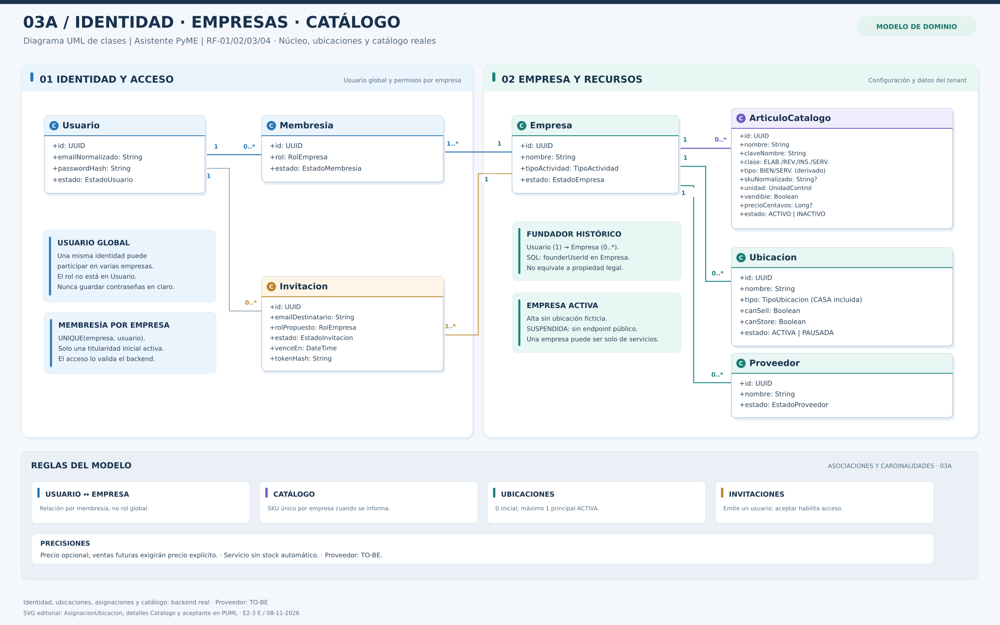
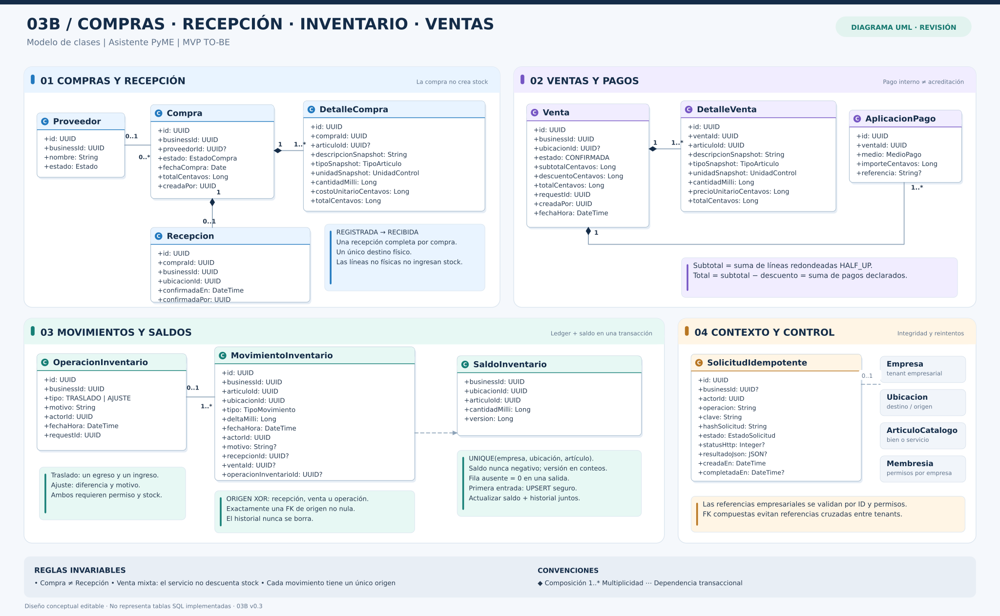
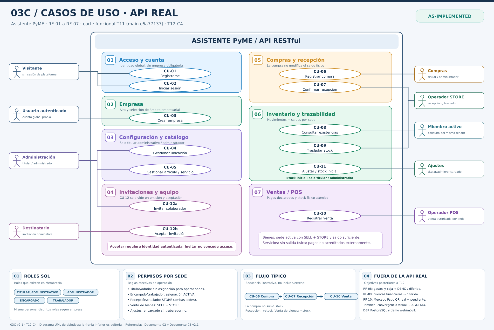

# 03 — Modelo de dominio y diagramas UML

**Proyecto:** Asistente PyME — Plataforma generalista de gestión multiempresa y multirrubro  
**Materia:** Programación 2  
**Versión:** 1.2 — E2-2 C, edición y transiciones de ubicaciones
**Estado:** **MODELO CONCEPTUAL + ANEXO AS-IMPLEMENTED E2-1** — 03A sincronizado con API y esquema SQL; 03B/03C preservados, comerciales pendientes  
**Fecha:** 8 de noviembre de 2026  
**Referencias:** `01_ANALISIS_DE_REQUERIMIENTOS.md` (v0.7), `02_CASOS_DE_USO.md` (v0.8), políticas del frontend DEMO E1-D2.  

> **Criterio de lectura:** AS-IS describe el modelo DEMO ya construido; TO-BE propone el dominio de la futura API FastAPI/SQLAlchemy/PostgreSQL. El diagrama conceptual **no es todavía el esquema SQL implementado**. Las extensiones posteriores aparecen separadas y no se incluyen en el núcleo evaluable.

> **Cierre E2-1 / C.5 — 08/11/2026:** C.1 (98), C.2 (125), C.3 (147), C.4a (171) y **C.4b (195/195 pruebas locales aprobadas; `195 passed in 23.86s`)**. Alembic `e213c4_acceptance (head)`, `No new upgrade operations detected.`; Docker FastAPI/PostgreSQL `healthy` y `/ready` = `ready`/`ok`. GitHub Actions **3/3** corresponde al commit funcional `8cd1674`. C.5 es **exclusivamente documental**; no se reejecutaron pruebas ni cambiaron endpoints, modelos SQL o migraciones. React sigue DEMO; RF-03–RF-07 no tienen backend; transferencia de titularidad, verificación de correo y endurecimiento para producción siguen pendientes.

## 1. Finalidad y alcance

El propósito del modelo de dominio es identificar conceptos comerciales, relaciones, cardinalidades, invariantes y límites transaccionales necesarios para implementar los casos de uso CU-01 a CU-12. Un mismo usuario puede integrar varias empresas y sus datos comerciales deben permanecer aislados por empresa.

**Núcleo propuesto de primera API:** usuarios y autenticación (RF-01), empresas y membresías básicas (RF-02), ubicaciones mínimas (RF-03), catálogo (RF-04), compras y recepciones (RF-05), existencias y movimientos (RF-06), ventas y pagos declarados (RF-07). La invitación real (CU-12) se considera soporte propuesto a confirmar, no requisito de correo electrónico. Este documento diferencia las **relaciones conceptuales UML** de las **claves/índices concretos SQL** que se definirán durante la implementación.

**Fuera del backend MVP:** gastos/caja (RF-08), cuentas financieras (RF-09), QR DEMO/MP real (RF-10), reservas de stock, recepción parcial o multidestino, producción/lotes, conciliación bancaria y el consumo planificado de insumos por servicios. Esas capacidades existen parcialmente como frontend DEMO o se contemplan para versiones futuras; ninguna se declara operativa en la API.

## 2. Vocabulario del dominio

| Término | Significado | Precisión importante |
|---|---|---|
| Usuario | Identidad global autenticable | No pertenece en forma exclusiva a una empresa |
| Empresa | Unidad independiente de gestión (*tenant*) | Sus registros comerciales no se comparten con otras empresas |
| Membresía | Relación Usuario–Empresa con rol y estado | Autorización efectiva se valida en servidor |
| Ubicación | Local, feria, depósito u otro espacio empresarial | Puede vender, almacenar, ambas cosas o ninguna según configuración |
| Artículo de catálogo | Bien físico o servicio | El servicio no genera movimiento físico en el MVP |
| Compra | Registro comercial de adquisición, con líneas y costos | No incrementa existencias al registrarse |
| Recepción | Confirmación de entrada física de una compra | MVP: completa, única y hacia una sola ubicación |
| Movimiento de stock | Hecho histórico de entrada o salida firmado | Inmutable; la corrección requiere un movimiento compensatorio trazado |
| Saldo de stock | Existencia por Empresa–Ubicación–Artículo | Se controla transaccionalmente; debe reconciliar con el historial |
| Venta | Operación comercial confirmada con detalles | El pago registrado es **declarado**, no acreditación bancaria comprobada |
| Aplicación de pago | Importe asignado a un medio de pago en una venta | La suma debe coincidir con el total exacto |
| Idempotencia | Identidad de una operación reintentada | La misma petición no debe generar efectos dobles |

### 2.1 Decisiones funcionales confirmadas

**D-DOM-01 — Compra antes que recepción.** Se puede registrar una compra sin seleccionar ubicación. Solo el acto posterior de recibir físicamente exige una ubicación activa apta para almacenar.

**D-DOM-02 — Recepción en MVP.** Una compra con bienes físicos se recibe **completa, en una única operación y en una única ubicación**. No se admite distribución inicial a varias ubicaciones ni recepción fraccionada. La compra puede permanecer registrada sin recibir durante el tiempo necesario; conserva cantidades y precios acordados. La espera **no se considera stock vendible**.

**D-DOM-03 — Servicios en MVP.** Un servicio puede venderse sin ubicación de almacenamiento y **no descuenta insumos automáticamente**. Las compras de insumos sí pueden registrarse como bienes físicos y recibirse en una ubicación. La vinculación de insumos, su consumo por servicio y la planificación mínima para jornadas laborales serán una segunda versión.

**D-DOM-04 — No crear ubicación ficticia.** Registrar una empresa no genera depósito ni existencias por defecto. Una actividad solo de servicios puede funcionar sin stock. Para recibir bienes o vender bienes físicos se exige configurar la ubicación adecuada.

### 2.2 Convenciones técnicas del diseño

- Los identificadores conceptuales `id`, `businessId`, `userId` y demás son estables. En SQL se propondrán claves foráneas y restricciones que impidan referencias entre empresas; las entidades globales, como Usuario, no necesitan `businessId`.
- Se representan importes en **centavos enteros ARS** (`BIGINT`, con rangos definidos; alternativa `NUMERIC/Decimal`). Ningún cálculo monetario persistido usa `Float`. El frontend DEMO redondea **cada renglón** con `HALF_UP` y el backend deberá reproducir esa política antes de integrarse: `totalLineaCentavos = HALF_UP(cantidadMilli × precioUnitarioCentavos / 1000)`. Para cantidades y precios no negativos, el redondeo `HALF_UP` se aplica al centavo más cercano.
- **Invariantes monetarias obligatorias:** `Compra.totalCentavos = Σ DetalleCompra.totalCentavos`; `Venta.subtotalCentavos = Σ DetalleVenta.totalCentavos`; `Venta.totalCentavos = Venta.subtotalCentavos − Venta.descuentoCentavos`; `Σ AplicacionPago.importeCentavos = Venta.totalCentavos`. No recalcular el subtotal multiplicando cantidades agregadas de varias líneas después de haberlas redondeado. **Las líneas repetidas de un mismo bien se agregan únicamente para comprobar/descontar existencias**, sin alterar sus precios ni totales históricos.
- Si `ArticuloCatalogo.precioCentavos` es `NULL`, el cliente deberá indicar un **precio de venta explícito y válido**; la API recalcula el total y exige venta total estrictamente positiva. **Un renglón puede tener `precioUnitarioCentavos = 0` (bonificación/muestra) dentro de una venta con total positivo; no está habilitada por defecto una venta completa de total cero.** Esta distinción conserva la política actual del frontend y evita confundir precio de línea y total de comprobante. El costo de referencia de catálogo no sustituye el costo histórico del detalle de compra.
- Las cantidades se expresan con **unidad y escala explícitas**. El frontend usa `quantityMilli`/`deltaMilli` enteros (milésimas de unidad), con algunas unidades discretas que obligan múltiplos de 1.000. Se preservará el principio de exactitud en API.
- Una referencia a un artículo o proveedor puede conservar un *snapshot* de nombre, unidad, SKU y costo/precio histórico. Modificaciones posteriores del catálogo no deben reescribir transacciones antiguas.
- Solo las operaciones confirmadas afectan stock. Un error comercial o de permisos deja cero efectos parciales.
- El modelo muestra multiplicidades conceptuales. El esquema SQL, índices, `ON DELETE`, endpoints y permisos finos se precisarán en los Documentos 04 y 05.

## 3. Entidades del núcleo y sus responsabilidades

### 3.1 Identidad y estructura empresarial

| Entidad | Atributos conceptuales mínimos | Responsabilidad / invariantes |
|---|---|---|
| **Usuario** | `id`, `emailNormalizado`, `passwordHash`, `nombre`, `estado`, fechas | Identidad única global; contraseña no reversible; email único normalizado |
| **Empresa** | `id`, `nombre`, `rubro`, `tipoActividad`, `fundadorUserId`, `estado`, fechas | Tenant comercial; estado inicial `ACTIVA`, fundador histórico; no crea stock ni ubicación en el alta. `SUSPENDIDA` es una capacidad de ciclo de vida prevista, **sin endpoint de suspensión comprometido en el MVP** |
| **Membresía** | `id`, `businessId`, `userId`, `rol`, `estado`, fechas | Une una identidad global con una empresa; unicidad `(businessId,userId)`; solo membresía activa y permisos válidos habilitan operaciones |
| **Invitación** (emisión C.3 y aceptación C.4a implementadas en SQL) | `id`, `businessId`, `invitedByUserId`, `emailNormalizado`, `rolPropuesto`, `tokenHash`, `venceEn`, `estado`, fechas | Crear invitación no concede acceso; hash SHA-256, 7 días, único pendiente por empresa+email; aceptar una vez creará/activará membresía en C.4 |
| **Ubicación** | `id`, `businessId`, `nombre`, `tipo` (`LOCAL/FERIA/DEPOSITO/OFICINA/CASA/OTRO`), `dirección?`, `mapUrl?`, `canSell`, `canStore`, `isPrimary`, `estado`, fechas | Tabla `locations` en E2-2 A; capacidades deben verificarse en operaciones posteriores; nunca crear por defecto |

**Titularidad:** al crear Empresa se genera en la misma transacción una Membresía activa con la responsabilidad administrativa inicial; el fundador histórico no se confunde con un socio legal. La transferencia de titularidad queda diferida. Roles definitivos, expiración de invitaciones y permisos se completarán en Documento 04/05.

### 3.2 Catálogo, proveedores y compras

| Entidad | Atributos conceptuales mínimos | Responsabilidad / invariantes |
|---|---|---|
| **ArtículoCatalogo** | `id`, `businessId`, `nombre`, `tipo` (`BIEN`/`SERVICIO`), `subtipo?`, `sku?`, `unidad`, `precioCentavos?`, `costoReferenciaCentavos?`, `estado` | SKU único por empresa cuando se informa; el costo de referencia es informativo y existe en el frontend DEMO; un servicio no crea stock físico |
| **Proveedor** | `id`, `businessId`, `nombre`, `datosContacto`, `estado` | Referencia comercial opcional de una compra |
| **Compra** | `id`, `businessId`, `proveedorId?`, `fechaCompra`, `estado`, `totalCentavos`, `referencia?`, `creadaPor` | Registra adquisición y sus condiciones; **no recibe** mercadería por sí misma |
| **DetalleCompra** | `id`, `compraId`, `articuloId?`, `descripcionSnapshot`, `tipoSnapshot`, `unidadSnapshot`, `cantidadMilli`, `costoUnitarioCentavos`, `totalCentavos` | Línea física, servicio o concepto libre; permite reconstruir qué se compró aunque cambie el catálogo |
| **Recepción** | `id`, `compraId`, `businessId`, `ubicacionId`, `fechaHora`, `confirmadaPor` | Confirma entrada **completa en un destino**; `UNIQUE(compraId)` garantiza **0..1 por compra** en MVP |

Una compra puede contener líneas físicas y líneas administrativas (servicios/conceptos) simultáneamente. Solo las líneas físicas del snapshot originan movimientos al recibir. Una compra sin líneas físicas queda en `CERRADA_SIN_RECEPCION` y no puede tener Recepción; una compra con físicos comienza `REGISTRADA`.

**Compra a futuro / precio acordado:** una compra sin recibir conserva la cantidad y el costo registrado, lo que permite registrar la adquisición antes de la entrega. Esto **no acredita que el proveedor garantice contractualmente el precio** ni crea inventario disponible; no implementamos todavía reservas, pagos anticipados ni calendario de entregas.

### 3.3 Inventario, venta y pago declarado

| Entidad | Atributos conceptuales mínimos | Responsabilidad / invariantes |
|---|---|---|
| **MovimientoInventario** | `id`, `businessId`, `articuloId`, `ubicacionId`, `tipo`, `deltaMilli`, `fechaHora`, `actorId`, `motivo?`, `recepcionId?`, `ventaId?`, `operacionInventarioId?` | Registro histórico firmado e inmutable; **exactamente una referencia de origen** debe estar informada y validada mediante FK y restricción local |
| **OperaciónInventario** | `id`, `businessId`, `tipo` (`TRASLADO`/`AJUSTE`), `fechaHora`, `actorId`, `motivo`, `requestId` | Agrupa movimientos manuales; traslado genera un egreso y un ingreso atómicos |
| **SaldoInventario** | `businessId`, `ubicacionId`, `articuloId`, `cantidadMilli`, `version` | Proyección técnica **bloqueable/actualizable de forma atómica** para evitar sobreventa concurrente; unicidad del trío |
| **Venta** | `id`, `businessId`, `ubicacionId?`, `subtotalCentavos`, `descuentoCentavos`, `totalCentavos`, `estado`, `requestId`, `creadaPor`, `fechaHora` | Operación registrada de forma atómica; no equivale a acreditación bancaria |
| **DetalleVenta** | `id`, `ventaId`, `articuloId`, `descripcionSnapshot`, `tipoSnapshot`, `unidadSnapshot`, `cantidadMilli`, `precioUnitarioCentavos`, `totalCentavos` | Snapshot de cada línea comercial |
| **AplicaciónPago** | `id`, `ventaId`, `medio`, `importeCentavos`, `referencia?` | Asignación declarada; `SUM(importeCentavos) = venta.totalCentavos` |
| **SolicitudIdempotente** | `id`, `businessId?`, `operacion`, `actorId`, `clave`, `hashSolicitud`, `estado`, `statusHttp?`, `resultadoJson?`, `creadaEn`, `completadaEn?` | Garantía de reintentos, resultado y código HTTP; el `businessId` puede ser nulo para una operación personal previa a la existencia de empresa (p. ej., CU-03). Scope, estado intermedio y retención por definir |

**Una fuente de verdad auditable, no dos saldos independientes:** `MovimientoInventario` describe el historial de hechos. `SaldoInventario` es un mecanismo materializado para **sincronización y consulta**; se actualiza en la **misma transacción SQL** que los movimientos y se reconcilia regularmente con su suma. La existencia de la tabla de saldos no habilita edición directa desde la UI. Esta es la solución propuesta, no una tabla ya implementada.

La integridad de `businessId` debe cubrir el trío **Empresa–Ubicación–Artículo** mediante verificaciones de dominio y claves compuestas/restricciones apropiadas en SQL. No basta con guardar `businessId` en una columna si se permite referenciar un artículo de otra empresa.

**Origen de movimientos:** `MovimientoInventario` referencia **una y sólo una** de `Recepcion`, `Venta` u `OperacionInventario` (XOR). Se propone modelar el origen en el esquema SQL mediante **tres FK opcionales**, un `CHECK` local que obligue a exactamente una no nula y FK compuestas por empresa hacia el padre correspondiente. Una simple cadena `referenciaOrigen` no garantiza integridad referencial. Un movimiento histórico no se elimina ni se reasigna.

**Clave de idempotencia:** la identidad de una petición se delimita por operación, actor/ámbito y empresa cuando ya existe. La creación de una empresa ocurre antes de contar con `businessId`: su ámbito puede ser `actorId + operacion + clave`. El `statusHttp` y `resultadoJson` se conservan al completar una operación para replays correctos; la estrategia ante peticiones `EN_PROCESO`, errores transitorios y limpieza se definirá en Documento 05. **No imponer ahora un TTL de 48/72 h:** después del vencimiento no puede reaparecer una venta o recepción duplicada; además del registro de reintentos, cada operación crítica conservará su identificador único de solicitud en el registro comercial o una garantía equivalente.

### 3.4 Relaciones y cardinalidades principales

| Relación | Multiplicidad | Restricción |
|---|---|---|
| Usuario — Membresía — Empresa | Usuario `1 → 0..*` Membresías; Empresa `1 → 1..*` Membresías | Una membresía corresponde a exactamente un usuario y una empresa; uno solo titular administrativo activo inicial |
| Empresa — Ubicación / Artículo / Proveedor | Empresa `1 → 0..*` de cada uno | Cada recurso pertenece a exactamente una empresa |
| Empresa — Compra / Venta | Empresa `1 → 0..*` | Historial asociado al tenant, sin mezcla |
| Proveedor — Compra | Proveedor `0..1` por Compra; Proveedor `1 → 0..*` Compras | Proveedor opcional, pero si existe pertenece a la misma empresa |
| Compra — DetalleCompra | Compra `1 → 1..*` Detalles | Líneas inmutables después de confirmar en MVP |
| Compra — Recepción | Compra `1 → 0..1` Recepción | Solo compra con físicos; única recepción completa, una ubicación |
| Ubicación — Recepción | Ubicación `1 → 0..*` Recepciones | Destino apto para almacenamiento al confirmar |
| Artículo — DetalleCompra | Artículo `0..1` por Detalle | Concepto libre sin artículo; snapshot conserva histórico |
| Venta — DetalleVenta | Venta `1 → 1..*` Detalles | Cada línea corresponde a un artículo de la empresa |
| Venta — AplicaciónPago | Venta `1 → 1..*` Aplicaciones | Importes positivos cuya suma concilia exactamente |
| Venta — Ubicación | Venta `0..1` Ubicación | `null` solo si la venta es de servicios sin bienes físicos |
| Empresa + Ubicación + Artículo — SaldoInventario | `0..1` saldo por trío | Exclusivo de bienes físicos, nunca negativo |
| Recepción / Venta / OperaciónInventario — Movimiento | Origen `1 → 0..*` movimientos | Cada movimiento posee un origen verificable; transferencias y ajustes quedan agrupados |
| Empresa — Invitación | Empresa `1 → 0..*` Invitaciones | Aceptación no crea doble membresía |

**Nota UML:** las relaciones entre clases expresan vínculos conceptuales; las FK físicas se reflejan en el esquema relacional. En `03A`, la asociación «Usuario fundador → Empresa» representa el dato que en SQL se almacenará como `fundadorUserId`: se evita duplicarlo dentro del recuadro conceptual. `03B` incluye algunos identificadores de vínculo con fines técnicos, indicados de forma consistente con sus asociaciones.

**Baja lógica:** catálogos, ubicaciones y proveedores pasan a `INACTIVO`/`PAUSADA`, no a eliminación física si existen referencias históricas. Evitar cascadas destructivas sobre movimientos, ventas, compras y snapshots; desactivar no reescribe los hechos pasados. Un artículo inactivo no puede venderse en una operación nueva. Una empresa podría incorporar `SUSPENDIDA` para bloquear operaciones nuevas en una etapa posterior; en el primer MVP nace `ACTIVA` y no se exige construir un panel de suspensión.

## 4. Estados y transiciones permitidas

### 4.1 Compra

| Estado | Origen / transición | Regla |
|---|---|---|
| `REGISTRADA` | Alta con al menos un bien físico recepcionable | No altera stock; puede esperar recepción |
| `RECIBIDA` | `REGISTRADA` → recepción completa en una ubicación | Crea entradas físicas y confirma estado juntos |
| `CERRADA_SIN_RECEPCION` | Alta de compra con solo servicios/conceptos | Estado administrativo final, cero entradas físicas |
| `CANCELADA` | Desde `REGISTRADA`, solo si la operación se implementa | No crea saldos; cancelación futura opcional en API MVP |

Una compra `RECIBIDA`, `CERRADA_SIN_RECEPCION` o `CANCELADA` no puede recepcionarse. Una segunda solicitud de recepción con misma clave/carga devuelve el primer resultado; una con clave nueva debe fallar por estado/unicidad. No se registra estado `PARCIALMENTE_RECIBIDA` en MVP.

### 4.2 Ubicación, catálogo y venta

- **Ubicación:** `ACTIVA ↔ PAUSADA` (reactivación solo si se define endpoint); una ubicación pausada conserva historial, pero no se admite como destino operativo nuevo. `canSell` y `canStore` se verifican durante la transacción.
- **Artículo:** `ACTIVO ↔ INACTIVO`; desactivar no elimina historial ni las referencias existentes. Las ventas no pueden confirmar bienes inactivos.
- **Venta:** estado MVP `REGISTRADA`/`CONFIRMADA` según contrato; se persiste **solo al confirmar**, cuando ya se validaron pagos y stock. El carrito es un borrador de interfaz, no una Venta persistida. Devolución, reembolso y anulación posterior quedan diferidos; no dibujar transiciones todavía inexistentes.
- **Invitación (soporte):** `PENDIENTE → ACEPTADA / RECHAZADA / CANCELADA / EXPIRADA`. Ninguna invitación pendiente es una membresía activa.

## 5. Operaciones transaccionales y prueba de concurrencia

### 5.1 Recepción completa: CU-06 y CU-07

1. Registrar Compra, DetalleCompra y precio/cantidad histórica. Si tiene físicos: `REGISTRADA`. **SaldoInventario no cambia**.
2. Más adelante elegir una Ubicación del **mismo** negocio, activa y con `canStore=true`.
3. Abrir transacción: comprobar membresía y permisos, bloquear Compra `REGISTRADA` o hacer transición condicional equivalente, validar unicidad de recepción.
4. Calcular entradas para **todos** los renglones físicos del snapshot; actualizar saldos afectados, crear Recepción y MovimientosInventario.
5. Cambiar Compra a `RECIBIDA`, confirmar idempotencia y hacer **commit conjunto**. Si falla cualquier validación: rollback completo.
6. No aceptar recepción parcial ni más de una ubicación: son extensiones posteriores.

### 5.2 Venta con stock: CU-10

1. El usuario selecciona empresa, ubicación de venta y artículos; puede combinar bienes y servicios, con precios y pagos declarados.
2. El servidor recalcula subtotales, descuento y pagos con aritmética exacta; suma cantidades repetidas de un mismo bien físico.
3. Abre transacción y comprueba nuevamente membresía, estados de artículos y capacidades de ubicación. Obtiene control de concurrencia **para cada trío Empresa–Ubicación–Artículo afectado**.
4. Si hay stock suficiente para **todos** los bienes, descuenta saldos y crea la Venta, Detalles, AplicacionesPago, MovimientosInventario e idempotencia en **un mismo commit**. Un servicio genera línea comercial, no salida de insumo.
5. Si falta stock en una sola línea, rechaza **toda** la venta sin guardar pagos, comprobante ni movimientos.
6. El segundo pedido concurrente por una única unidad recibe rechazo controlado; no hay saldos negativos.

**Implementación PostgreSQL a evaluar en E2:** actualizar condicionalmente `SaldoInventario.cantidadMilli` (`WHERE cantidadMilli >= solicitado`) dentro de la transacción, o bloquear filas con `SELECT ... FOR UPDATE` antes de verificar y restar. Para operaciones multiartículo, aplicar orden estable de bloqueo. `MovimientoInventario` no sustituye este control.

**Arranque en frío — fila de saldo inexistente:** `SELECT ... FOR UPDATE` **no bloquea** un saldo que no existe. Por ello se definen comportamientos distintos:

1. **Salida o venta con saldo inexistente:** interpretarlo como disponibilidad **cero** y rechazar por stock insuficiente. **No es obligatorio insertar una fila con cero para intentar la salida**; una actualización condicional sin filas afectadas también rechaza correctamente.
2. **Primera entrada (recepción o ajuste positivo):** crear o incrementar el saldo de forma segura y concurrente, por ejemplo `INSERT ... ON CONFLICT (business_id, ubicacion_id, articulo_id) DO UPDATE SET cantidad_milli = saldos_inventario.cantidad_milli + EXCLUDED.cantidad_milli, version = saldos_inventario.version + 1`, junto con el movimiento correspondiente, **en el mismo commit**. Alternativamente, insertar cero con `ON CONFLICT DO NOTHING` y después bloquear/actualizar la fila dentro de la transacción. **No usar un patrón de leer e insertar sin manejar conflictos.**
3. **Control de concurrencia:** la clave única compuesta, `CHECK (cantidad_milli >= 0)` y el bloqueo/actualización condicionada son complementarios. Un conflicto real de SQL o un deadlock debe traducirse a manejo controlado según el contrato; nunca confirmar saldo sin movimiento o viceversa.
4. **Pruebas:** venta inicial sin saldo (rechazo), dos entradas concurrentes sobre saldo ausente (suma correcta), dos ventas concurrentes sobre una unidad (una sola confirmación) y venta simultánea con recepción/traslado (sin negativo ni pérdida de movimientos).

La estrategia concreta se cerrará al implementar SQLAlchemy/Alembic y se validará con PostgreSQL real, no solamente SQLite.

### 5.3 Claves únicas, aislamiento y restricciones SQL propuestas

Las siguientes son **restricciones recomendadas del futuro esquema PostgreSQL**, no SQL ya implementado ni una obligación de fijar hoy los nombres físicos:

| Tabla lógica | Restricción | Para qué sirve |
|---|---|---|
| `articulos_catalogo` | `UNIQUE (business_id, sku_normalizado)` si no es `NULL` | SKU puede repetirse entre empresas; un mismo SKU normalizado no se repite dentro de una empresa. PostgreSQL permite múltiples `NULL` en un índice único común, o puede declararse un índice parcial. |
| `membresias` | `UNIQUE (business_id, user_id)` | Un usuario no obtiene dos membresías de la misma empresa. |
| `saldos_inventario` | `UNIQUE (business_id, ubicacion_id, articulo_id)` y `CHECK (cantidad_milli >= 0)` | Controlar cada saldo y bloquear por recurso correcto. |
| `recepciones` | `UNIQUE (compra_id)` | Una única recepción completa por compra en el MVP. |
| `movimientos_inventario` | `CHECK (num_nonnulls(recepcion_id, venta_id, operacion_inventario_id) = 1)` | Cada movimiento tiene exactamente un origen verificable. |
| `solicitudes_idempotentes` y registros comerciales | Unicidad por ámbito + actor + operación + clave; identificador persistente del comando; tratamiento explícito de `business_id IS NULL` | Reintentos no crean segunda operación, incluso si se archiva una respuesta. |
| Relaciones de recursos empresariales | FK compuestas `(business_id, articulo_id)` / `(business_id, ubicacion_id)` hacia claves únicas correspondientes (por ejemplo, `(business_id, id)` en las tablas referenciadas) | Impedir mezclar recursos de empresas distintas, también a nivel de base de datos. |

**Precisión:** `CHECK` solo puede verificar columnas de su propia fila; **no** puede consultar que el artículo y la ubicación de otra tabla pertenezcan a la empresa. Para esto se proponen **claves foráneas compuestas** (además de la verificación de autorización en el servicio). El índice parcial y los nombres SQL exactos se concretarán en la migración de Alembic.

**Caso borde de idempotencia sin empresa:** una restricción `UNIQUE(business_id, actor_id, operacion, clave)` de PostgreSQL permite por defecto varias filas con `business_id = NULL`; por eso **no garantiza por sí sola** la unicidad para crear empresa (CU-03). En PostgreSQL 15+ puede utilizarse `UNIQUE NULLS NOT DISTINCT` o definir **dos índices únicos parciales**: uno por `(business_id, actor_id, operacion, clave)` para solicitudes empresariales y otro por `(actor_id, operacion, clave)` cuando `business_id IS NULL`. Su elección y manejo ante solicitudes simultáneas quedan para el contrato SQL de E2. Referencia: [PostgreSQL 16 — restricciones únicas](https://www.postgresql.org/docs/16/ddl-constraints.html#DDL-CONSTRAINTS-UNIQUE-CONSTRAINTS).

**Solicitud concurrente con la misma clave:** no basta con leer una fila con estado `EN_PROCESO`; la operación debe impedir dos ejecuciones efectivas mediante transacción/índice y ofrecer una respuesta controlada o espera definida. El HTTP preciso (por ejemplo, conflicto temporal) se especificará en Documento 05; **429 no se adopta automáticamente** por tratarse de un reintento simultáneo.

### 5.4 Ajustes y traslados: CU-09 y CU-11

- **Traslado:** dos movimientos (egreso en origen e ingreso en destino) y dos saldos actualizados en **una transacción**. No transfiere entre empresas ni permite origen = destino.
- **Ajuste justificado:** actualiza un saldo e inserta un movimiento con motivo obligatorio; no altera retrospectivamente ventas/recepciones. Para un **conteo absoluto** debe verificarse `version` del saldo observado y rechazar un conteo obsoleto.
- **Idempotencia:** clave y hash de petición asociados a empresa/actor/operación; repetición idéntica recupera el resultado, distinta carga con misma clave produce conflicto sin efectos adicionales.

### 5.5 Prueba ET-03: dos usuarios venden la última unidad

| Preparación | Ejecución | Resultado obligatorio |
|---|---|---|
| Usuario A y B con membresía autorizada en Empresa E, Ubicación U vendible, Bien P con saldo **1** | Dos clientes HTTP y **dos transacciones reales independientes** contra PostgreSQL; peticiones concurrentes, claves diferentes | **1 venta confirmada, 1 error controlado por falta de stock, saldo final 0, 1 salida física y ningún pago/comprobante parcial del intento rechazado** |

Esto se prueba con `pytest` e integración FastAPI/PostgreSQL (por ejemplo, `httpx.AsyncClient` y `asyncio.gather`) usando **sesiones DB independientes**, sin simular dos personas ni depender de que un clic manual coincida en milisegundos. Es una prueba de **integración/concurrencia**, adicional a los diez tests **unitarios** exigidos por la cátedra. Para robustez, repetir el test y ejecutar variantes de transferencias y ajustes concurrentes.

## 6. Diagramas UML editables

Los archivos fuente se preparan en `diagramas/`. En el diagrama de casos de uso, **CU-12 se representa en dos subflujos (CU-12a invita y CU-12b acepta)** porque cada actor persigue un objetivo distinto; ambos remiten a la especificación unificada CU-12 del Documento 02. **Los actores operativos representan roles efectivos de la membresía en la empresa seleccionada, no subclases permanentes de Usuario.** Si el invitado todavía no posee cuenta, realiza CU-01 y CU-02 antes de aceptar CU-12b; la aceptación exige identidad autenticada. Las vistas de clases se dividen para evitar un gráfico ilegible. Los tipos y cardinalidades siguen este documento; el modelo SQL definitivo puede refinar clases técnicas sin cambiar las reglas comerciales.

### 6.1 Clases: identidad, empresa y catálogo

**Lectura detallada:** [Guía 03A — entidades, cardinalidades y recorridos](diagramas/03A_EXPLICACION_IDENTIDAD_EMPRESAS_CATALOGO.md). **Fuentes:** [SVG editorial](diagramas/03A_IDENTIDAD_EMPRESAS_CATALOGO_REDISENADO.svg) · [PlantUML](diagramas/03A_CLASES_IDENTIDAD_Y_CATALOGO.puml).

### 6.2 Clases: compras, inventario y ventas

**Lectura detallada:** [Guía 03B — operaciones, dinero, stock e idempotencia](diagramas/03B_EXPLICACION_COMPRAS_INVENTARIO_VENTAS.md). **Fuentes:** [SVG editorial](diagramas/03B_COMERCIO_INVENTARIO_REDISENADO.svg) · [PlantUML](diagramas/03B_CLASES_COMERCIO_E_INVENTARIO.puml).

### 6.3 Casos de uso: actores externos y límite del sistema

**Lectura detallada:** [Guía 03C — actores, objetivos y recorridos CU-01 a CU-12](diagramas/03C_EXPLICACION_CASOS_DE_USO.md). **Fuentes:** [SVG editorial](diagramas/03C_CASOS_DE_USO_REDISENADO.svg) · [PlantUML](diagramas/03C_CASOS_DE_USO.puml).

**Distinción de fuentes:** los SVG reproducen exactamente las láminas visuales revisadas y se visualizan desde GitHub. Las fuentes `.puml` son editables y permiten regenerar los diagramas mediante PlantUML, pero el motor redistribuye los elementos. **03A conserva en PlantUML la asociación completa de fundador; 03B simplifica visualmente asociaciones entre paneles**, documentadas por identificadores y reglas de integridad. No se deben interpretar los paneles editoriales como clases ni asumir que todo vínculo SQL esté dibujado.

**Criterio académico:** el sistema no aparece como actor de sus propios casos de uso. Los actores se conectan a objetivos; los pasos internos detallados quedan en Documento 02. PlantUML conserva el diagrama completamente editable.

## 7. Evoluciones válidas, expresamente diferidas

### 7.1 Compras a futuro y recepciones parciales/multidestino

El registro anticipado de compras permite conocer cantidades **pendientes de recepción** y costos acordados, pero **no aumenta el stock físico ni disponible**. La compra puede quedar registrada hasta su entrega; los conceptos "pedido a proveedor", "pago anticipado" y "reserva de precio" requieren contratos y estados adicionales si se implementan.

Para una segunda versión se propone extender Compra ↔ Recepción desde `0..1` a `0..*`, añadir `cantidadRecibidaMilli`/`cantidadPendienteMilli` por línea mediante detalle de recepción, y estados como `PARCIALMENTE_RECIBIDA`. Cada entrega podrá tener ubicación propia y fecha; una entrega podrá dividirse entre múltiples destinos **solo si se define una regla explícita** (p. ej., múltiples recepciones por destino o líneas de recepción por ubicación). El total recibido de cada línea nunca podrá superar lo comprado. **No modelar esta complejidad como si ya estuviera en el MVP**.

### 7.2 Insumos y planificación para servicios

**Necesidad funcional identificada:** un negocio ofrece un servicio (por ejemplo, baño de perros) que requiere shampoo y acondicionador. Aunque la venta del servicio no debe descontar automáticamente stock en el MVP, el responsable desea saber si tiene insumos suficientes **antes de comenzar la jornada** y, luego, justificar qué cantidad realmente utilizó.

En una **segunda versión** podrían introducirse los siguientes conceptos, que **no son clases del diagrama MVP**:

| Concepto futuro | Responsabilidad |
|---|---|
| `RequerimientoInsumoServicio` | Asociar Servicio a Bien/Insumo y cantidad teórica por prestación; unidad compatible |
| `StockMinimoOperativo` | Configurar umbral de insumos por Empresa–Ubicación–Artículo, eventualmente asociado a servicios ofrecidos (ejemplo: mantener 10 unidades de cada producto antes del turno) |
| `ConsumoInsumoServicio` | Registrar consumo real, motivo, fecha, servicio prestado y movimientos de stock asociados; nunca tratarlo automáticamente como robo o merma |
| `ControlDiarioDeInsumos` | Comparar stock inicial/final, reposiciones, consumos justificados y diferencias pendientes de investigar |

**Separación conceptual importante:** cantidad requerida por servicio ≠ mínimo operativo para una jornada ≠ cantidad efectivamente consumida. Si un baño usa 100 ml de shampoo y se desea iniciar con 10 unidades en la ubicación, son dos reglas diferentes. No crear descontroles automáticos basados solo en "vender servicio". Las compras y recepciones de shampoo/acondicionador como **bienes físicos** sí forman parte del MVP y elevan stock al recepcionarse.

En el MVP, CU-11 permite registrar **ajustes justificados** de inventario según su contrato, pero eso **no equivale** a conciliación diaria ni a un vínculo automático entre servicios vendidos e insumos consumidos. La funcionalidad específica de consumo por servicio y sus reportes queda diferida.

## 8. Trazabilidad de entidades a requerimientos y casos de uso

| Grupo de entidades | Requerimiento | Casos de uso |
|---|---|---|
| Usuario | RF-01 | CU-01, CU-02 |
| Empresa, Membresía, Invitación | RF-02 | CU-03, CU-12 (soporte propuesto) |
| Ubicación | RF-03 | CU-04, CU-07, CU-09, CU-10, CU-11 |
| ArtículoCatalogo | RF-04 | CU-05, CU-06, CU-10 |
| Proveedor, Compra, DetalleCompra, Recepción | RF-05 | CU-06, CU-07 |
| SaldoInventario, MovimientoInventario, OperaciónInventario | RF-06 | CU-07, CU-08, CU-09, CU-10, CU-11 |
| Venta, DetalleVenta, AplicaciónPago | RF-07 | CU-10 |
| SolicitudIdempotente | RN-03 / RNF-02 | CU-07, CU-09, CU-10, CU-11; recomendada también CU-06 |

## 9. Decisiones aún abiertas para aprobación técnica

| ID | Decisión pendiente | Recomendación actual |
|---|---|---|
| D03-01 | Restricción de unicidad y normalización de SKU | Índice único por `(businessId, skuNormalizado)` solo cuando SKU no nulo |
| D03-02 | Tipos y escala de cantidades monetarias/físicas | Centavos enteros + milésimas exactas, con límites documentados |
| D03-03 | Permisos de membresía y roles concretos | Mínimos por operación, comprobados por API; no mezclar cargo laboral con autorización |
| D03-04 | Mecanismo SQL contra sobreventa | Saldo bloqueable/actualización condicional + ledger, con prueba de concurrencia y arranque en frío en PostgreSQL |
| D03-05 | Persistencia y origen referencial de movimientos | FK comprobables a origen comercial u operación de stock; no un `sourceId` polimórfico sin garantía de integridad |
| D03-06 | Alcance exacto de invitación en primera API | Si se incluye CU-12, aceptación por token y pertenencia real; sin correo automático |
| D03-07 | Manejo de imágenes | `imageKey`/URL opcional por ficha; almacenamiento binario compartido diferido |
| D03-08 | Estado de Venta e idempotencia y retención | Venta confirmada como único estado comercial MVP; replay y retención sin duplicar operaciones definidos en Documento 05 |
| D03-09 | Estado de empresa | Alta inicial `ACTIVA`; eventual suspensión prevista pero sin caso de uso ni endpoint comprometidos para la primera API |
| D03-10 | Moneda, unidad y líneas repetidas | Redondeo `HALF_UP` por renglón; subtotal es suma de renglones, se agregan cantidades repetidas solo para validar inventario |

## 10. Condiciones de aprobación

**Aprobación documental:** el modelo y las tres láminas se incorporan como base conceptual de entrega, manteniendo AS-IS/TO-BE separados. Las decisiones de diseño SQL, permisos específicos, endpoints, validaciones Pydantic y pruebas reales se fijarán y evidenciarán durante E2 y los Documentos 04–06. Se comprobará que los RF y CU permanezcan alineados con recepción completa, sin stock anticipado ni consumo automático de insumos por servicios. **Esta aprobación no certifica código backend implementado ni tests de API ejecutados.**

## 11. Cambios de la versión 0.2 respecto de 0.1

- Se alinearon texto y diagramas en costo de referencia, estado inicial de empresa, datos de auditoría, saldos e idempotencia.
- Se aclararon los actores dinámicos por membresía y el recorrido de invitación de una persona aún no registrada.
- Se explicitó el redondeo por renglón y la conciliación exacta de pagos.
- Se separó el control de un saldo inexistente en **ventas** del alta concurrente de saldo por **recepciones/ajustes positivos**.
- Se propusieron restricciones SQL que evitan cruces entre empresas y una única referencia de origen por movimiento.
- Se mantuvieron como diferidos: recepción parcial/multidestino, servicios con consumo automático, suspensión administrativa real, QR y conciliación externa.
- **No se declara implementación ni ejecución de pruebas de API o validación gráfica PlantUML.**
## 12. Revisión documental v0.3 y láminas aprobadas

- Se incorporan las **tres láminas vectoriales 03A/03B/03C**, sus fuentes PlantUML y una explicación individual extensa por diagrama.
- Se aclara el precio cero **por línea** frente al total positivo de la venta; los importes y redondeos por renglón permanecen exactos.
- Se incorpora el caso de **idempotencia con `business_id = NULL`** y su efecto en los índices únicos de PostgreSQL.
- Se conserva sin alterar el diseño visual aprobado; las diferencias deliberadas entre SVG editorial y PUML se describen en cada guía.
- No se extiende el MVP con recepción parcial, servicios con consumo automático, cobros reales ni procesos de suspensión de empresas.

## 13. Correspondencia conceptual ↔ esquema implementado (actualizado C.5; corte inicial E2-1.3C.1)

| Concepto de 03A | Implementación SQLAlchemy/PostgreSQL actual | Matiz |
|---|---|---|
| Usuario | `users`, UUID global, email normalizado UNIQUE, hash Argon2id generado por servicio | No tiene `business_id` ni rol global |
| Sesión técnica | `auth_sessions`: usuario, `token_hash`, vencimiento/revocación | Infraestructura técnica; no convierte sesión en membresía |
| Empresa | `businesses`: nombre, categoría, tipo de actividad, `founder_user_id`, estado y fechas | Fundador histórico ≠ titular legal |
| Membresía | `memberships`: empresa, usuario, rol, estado, puesto opcional | UNIQUE por empresa/usuario; índice parcial limita a uno el titular activo |
| Idempotencia del alta | `business_creation_requests` con PK compuesta `actor_user_id, idempotency_key` | El PK ya es UNIQUE; no duplicar constraint; respuesta previa por hash canónico |
| Invitación | `business_invitations`: FK de empresa e invitador, destinatario por correo y aceptante opcional, hash/expiración y auditoría de aceptación | Emisión/aceptación reales; solo aceptación autenticada genera/reactiva membresía |

En C.5 se sincronizó **03A** con las relaciones reales de invitador y aceptante, sin añadir sesiones, idempotencia ni políticas RBAC como clases empresariales. La nota previa correspondía al corte histórico C.1, antes de existir el circuito de invitaciones. **03B no se rehace**. La política pure-function `has_business_permission` no es una clase persistente del UML de dominio; se documenta en 04/05. Se exige verificar la pertenencia real de cada Membresía a la Empresa consultada al aplicar la política en endpoints; el rol de otra empresa no autoriza esta.

## 14. Correspondencia E2-1.3C.2 con modelo y UML

La edición del perfil de Empresa reutiliza exactamente `users`, `auth_sessions`, `businesses` y `memberships` vigentes. **No altera columnas, FK, cardinalidades, migraciones ni estados**; por eso no es correcto rehacer los diagramas 03A o 03B en este corte. El campo `businesses.founder_user_id` permanece histórico e inmutable por la nueva API; las atribuciones se comprueban por rol de la membresía vigente, no por fundador ni rol global.

El servicio de escritura bloquea con SQL las filas de identidad/sesión y el par empresa/membresía del mismo tenant. La matriz de permisos implementada en C.1 es una **política de aplicación**, no entidad persistente del modelo; en C.2 empieza a decidir realmente la autorización de una operación HTTP. El modelo conceptual 03A se revisará al cerrar el bloque funcional E2-1 y cuando se incorpore invitación/membresía completa.

**Validación C.2:** por ejecutar (el último control local verificado corresponde a 98 pruebas de C.1). Contrato y escenarios detallados en Documento 02 v0.5 y Documento 05 v0.2.

## 15. Correspondencia C.3: `business_invitations` y UML 03A

La tabla real `business_invitations` implementa la **entidad Invitación ya prevista conceptualmente** en 03A. Incluye identificador UUID, FK de empresa, FK del invitador, correo normalizado, rol propuesto, huella única SHA-256, estado, expiración y fechas. La migración `e213c3_invitations` depende de `e213b_business_creation`. Se incorporó un índice UNIQUE parcial `uq_business_invitations_pending_email` sobre `(business_id,email_normalizado)` cuando estado `PENDIENTE` y restricciones CHECK para rol, estado, correo y huella.

**Relaciones:** cada invitación pertenece a una empresa, tiene un usuario invitador identificado y **no se vincula aún a un miembro invitado**. La invitación puede dirigirse a un correo sin cuenta global existente. El modelo de `Membership` y su unicidad `(business_id,user_id)` no cambió. Crear la invitación no concede permisos ni crea una segunda titularidad. En C.4 se concretará la aceptación con identidad autenticada y transición de estado.

**UML:** en el corte intermedio C.3 se conservó 03A. En C.5 se revisaron fuente PlantUML y SVG editorial: emisor obligatorio, aceptante opcional y destinatario por email, no por FK previa a Usuario. No se altera 03B (dominio comercial). El hash evita persistir el token en claro pero no sustituye TLS ni controles de entrega del secreto. El estado `PENDIENTE` con fecha pasada no implica vigencia: `expires_at` será obligatorio durante la aceptación.

## 16. C.4a — Correspondencia entidad Invitación y alta de Membresía

La invitación conceptual de 03A incorpora dos atributos técnicos de auditoría en la entidad real: `accepted_by_user_id` (FK opcional a Usuario) y `accepted_at` (fecha de aceptación). La migración aditiva `e213c4_acceptance` añade ambas columnas, FK y restricción de coherencia con `status=ACEPTADA`. **Relaciones:** Invitación sigue perteneciendo a una Empresa, fue emitida por un Usuario y, si está aceptada, conserva la identidad global de quien la consumió; la cuenta destinataria se identifica por correo normalizado. Una Membresía conecta exactamente un Usuario con una Empresa. Ninguna invitación pendiente concede acceso; el estado ACEPTADA y la membresía ACTIVA se confirman conjuntamente.

Al aceptar se crea una nueva Membresía si no existía, o se reactiva la misma fila INACTIVA con rol operativo de la invitación. La PK/UNIQUE por empresa y usuario impide duplicados; se protege la titularidad administrativa histórica en una membresía inactiva. **No cambian las cardinalidades Empresa–Membresía ni el 03B.** 03A se actualizó en C.5; C.4a se validó con 171 pruebas locales y CI aprobado.

## 17. C.4b — Administración de Membresía sin modificar UML estructural

Los métodos de lista y edición de equipo **reutilizan** `Membership` y `User` con los atributos existentes: `business_id`, `user_id`, `role`, `status`, `job_title`, `created_at`, `updated_at`. La relación conceptual Usuario–Membresía–Empresa y su UNIQUE `(business_id,user_id)` permanece intacta, así como el índice parcial de único titular administrativo activo. La prohibición de cambiar una Membresía de rol TITULAR (activa o inactiva) es **invariante de aplicación adicional**, no una nueva tabla o asociación UML.

`members.read` autoriza a titular/administrador a consultar la composición del equipo; `members.manage` autoriza solo al titular a actualizar **roles operativos** y estado de colaboradores. No se concede capacidad de convertir a otro usuario en titular ni de eliminar el único titular activo. El fundador es un hecho histórico, no la fuente de autorización. No se regeneran los SVG/PlantUML 03A y 03B en este corte, porque no cambia cardinalidad; el cierre E2-1 revisará el 03A contra las tablas reales y dejará toda modificación estructural posterior trazada.

**Evidencia:** CI 3/3 del código C.4b y **195/195 pruebas locales**; Alembic sin deriva y contenedores Docker saludables. Sin migración nueva: Alembic debe permanecer en `e213c4_acceptance`.

## 18. C.5 — Conciliación final de 03A con modelos PostgreSQL

- **Usuario–Membresía–Empresa:** unicidad `(business_id, user_id)` y permisos por membresía ACTIVA del tenant. El usuario no tiene rol global.
- **Titular:** creación transaccional con titular inicial; el índice `uq_memberships_one_active_owner` impone **como máximo uno** activo, no garantiza por sí solo la existencia de un titular. C.4b impide modificar titulares actuales o históricos; transferencia diferida.
- **Invitación:** cada registro tiene un invitador obligatorio `invited_by_user_id`, un destinatario **por `email_normalizado` (sin FK de usuario previo)** y un `accepted_by_user_id` opcional hasta aceptación. El CHECK exige aceptante y fecha `accepted_at` conjuntamente solo en ACEPTADA; token guardado exclusivamente como SHA-256.
- **Aceptación:** confirma membresía única y consumo de invitación en una transacción; equipo C.4b reutiliza tablas sin migración nueva.
- **Límite conceptual:** Ubicación, Artículo y Proveedor siguen TO-BE; sesiones, idempotencia y permisos son soporte técnico, no asociaciones comerciales adicionales. 03B y 03C permanecen intactos.

**Evidencia:** pruebas Windows 195/195, CI 3/3 del código `8cd1674`, Alembic `e213c4_acceptance (head)` sin cambios, API y PostgreSQL `healthy`. C.5 solo actualiza documentación y diagramas.

## 19. E2-2 A — Correspondencia Ubicación ↔ SQL (sin alterar 03A/03B/03C)

**E2-2 A — persistencia de Ubicaciones (08/11/2026):** se publicó `Location`/`locations` con FK obligatoria `business_id → businesses.id` (`RESTRICT`), seis tipos, `can_sell`/`can_store` independientes, campos de referencia opcionales, `ACTIVA/PAUSADA`, `is_primary`, índice parcial que permite como máximo una principal activa por tenant y CHECK que impide principal pausada. Migración aditiva `20261108_0008_business_locations.py` (`e22a_locations`, descendiente de `e213c4_acceptance`). La empresa continúa iniciándose **sin ubicaciones**. **No hay todavía rutas HTTP de ubicaciones**, ni inventario/compra/venta conectado, ni permisos de ubicación; esos cambios pertenecen a E2-2 B/C y bloques siguientes. El CI del código del corte se verificó en `300fa6f` (GitHub Actions [run 42491816481](https://github.com/Jorge10192/TP-Programacion2-UNSAM-2C2026/actions/runs/42491816481)): resultado `success`. La validación local Windows del nuevo corte aún se requiere; los 195 tests anteriores correspondían a E2-1.

**Cardinalidad:** `Business (1) — (0..*) Location`; `Location.business_id` no nulo, FK `RESTRICT`. `is_primary` con índice `uq_locations_one_active_primary` asegura a lo sumo una ubicación principal ACTIVA por empresa, no exige que exista una. `ck_locations_primary_active` exige principal solo ACTIVA; para pausar la principal, el futuro servicio actualizará `status` e `is_primary=false` atómicamente, sin restaurar el rol principal por reactivar. `can_sell`/`can_store` son booleanos independientes; ambos falsos se admiten para espacios administrativos. No hay entidad de asignación de miembros por ubicación aún, ni referencias físicas de inventario/ventas. **03A sigue expresando el dominio conceptual anterior y se conciliará al cerrar E2-2; 03B y 03C no se modifican.**

### E2-2 A.1 — Nuevo tipo CASA (08/11/2026)

Se incorporó `CASA` como sexto tipo de ubicación, sin cambiar el contrato de capacidades independientes `can_sell` y `can_store`, ni los estados `ACTIVA`/`PAUSADA`. Una casa puede vender, almacenar, ambas actividades o ninguna (domicilio administrativo). **No se crean direcciones ni ubicaciones automáticamente** y no se presupone habilitación comercial. La migración nueva `e22b_location_casa`, descendiente de `e22a_locations`, amplía `ck_locations_kind` sin reescribir la migración anterior ni alterar filas existentes; impide su reversión mientras queden filas CASA. La DEMO React admite CASA en el selector y en validación/lectura del almacenamiento local, pero sigue separada de la API. CI del código `b50bf200`: **backend 217/217 pruebas, Alembic sin deriva y Docker 3/3** ([run backend](https://github.com/Jorge10192/TP-Programacion2-UNSAM-2C2026/actions/runs/42492475011)); **frontend 2/2, incluido E2E de escritorio y móvil** ([run frontend](https://github.com/Jorge10192/TP-Programacion2-UNSAM-2C2026/actions/runs/42492474999)). Resultado Windows anterior de E2-2 A: 212 pruebas; **validación local de A.1 pendiente**. CRUD HTTP y permisos por ubicación siguen para E2-2 B/C. E2-1/03B/03C no se alteran.

## 20. E2-2 B — Aplicación real del modelo Location

**Estado E2-2 B (08/11/2026):** se publicaron tres rutas reales para ubicaciones bajo `/api/v1/businesses/{business_id}/locations` (`POST` 201, `GET` lista 200, `GET /{location_id}` 200). La creación valida DTO sin campos protegidos, revalida identidad/sesión, bloquea la empresa y membresía del actor, exige tenant `ACTIVA` y rol `TITULAR_ADMINISTRATIVO` o `ADMINISTRADOR`, y confirma una única transacción. Una primera ubicación recibe `is_primary=true`; las posteriores no la reemplazan. Los miembros activos de cualquier rol reconocido pueden consultar las ubicaciones propias, incluso con empresa suspendida; una empresa suspendida no permite crear. Empresa ajena o membresía inactiva devuelve 404; rol sin permiso 403; sesión inválida 401; empresa suspendida al crear 409; cuerpo incorrecto 422. `CASA` y Google Maps HTTPS validado están incluidos. **No hay PATCH/DELETE, ni pausa/reactivación, cambio de principal, asignación individual de personal o consumo comercial de ubicaciones todavía.** La DEMO permanece independiente. Backend sin migración nueva respecto de `e22b_location_casa`.

**Correspondencia de capas:** `LocationService` revalida actor/sesión/empresa/membresía; `LocationRepository` usa `Location.business_id` en todas las lecturas de la colección/detalle y evita que el UUID de otra empresa funcione como atajo de acceso. Bloquear la empresa serializa la decisión de qué ubicación nace como principal; el índice parcial SQL conserva la protección final. No hay alteración de columnas ni migración respecto del head `e22b_location_casa`. 03A conserva la relación conceptual Empresa–Ubicación; 03B/03C no se modifican en este corte.

**Evidencia de CI:** commit funcional `bdd2c84653dafb976c8cd6b49d8c2d577cc345de`; [GitHub Actions E2-2 B](https://github.com/Jorge10192/TP-Programacion2-UNSAM-2C2026/actions/runs/42493624747) **3/3** (Python 3.12 y 3.14 con PostgreSQL, Docker), **277 pruebas aprobadas**, `e22b_location_casa (head)` y Alembic sin deriva. La salida local de Windows aportada previamente para **E2-2 A.1** fue **217 passed in 23.90s**. Posteriormente E2-2 B **fue validado en Windows con `277 passed in 31.22s`**, Alembic sin deriva y Docker saludable; E2-2 C agrega nuevas pruebas por verificar localmente. La revisión de E2-1 por el compañero sigue anclada en el commit entregado.

## 21. E2-2 C — Transiciones operativas de Location

**E2-2 C (08/11/2026) — operaciones reales sobre ubicaciones:** `PATCH /api/v1/businesses/{business_id}/locations/{location_id}` permite editar únicamente `name`, `kind`, `address`, `map_url`, `can_sell` y `can_store` (campos opcionales en el cuerpo, pero se rechazan `null`, cuerpos vacíos, valores inválidos y campos protegidos). `PATCH /{location_id}/status` recibe solo `ACTIVA` o `PAUSADA`: pausar revoca `is_primary` en la misma transacción y reactivar **no** recupera la titularidad de ubicación automáticamente. `PUT /{location_id}/primary` designa una ubicación `ACTIVA`, desmarca la anterior y marca la elegida dentro del **mismo tenant y de una transacción única**, serializada por bloqueo de empresa y protegida con el índice SQL `uq_locations_one_active_primary`. La operación sobre una ubicación ya principal no realiza cambios adicionales. Titular/administrador con membresía ACTIVA pueden administrar; encargado/trabajador solo consultan. Empresa `SUSPENDIDA` admite lectura pero no cambios; recurso ajeno/inexistente 404, rol sin permiso 403, sesión inválida 401, estado incompatible 409 y cuerpo inválido 422. No se habilitó DELETE ni se crearon tablas nuevas.

**Invariantes SQL conservados:** FK `Location.business_id`, `ck_locations_primary_active` e índice parcial `uq_locations_one_active_primary` permanecen iguales. El repositorio hace `SELECT ... FOR UPDATE` dentro del tenant y, para el cambio de principal, desmarca y hace flush antes de promover; el servicio mantiene una única transacción de negocio y rollback frente a excepciones. La lógica no requiere nuevas tablas ni versiones Alembic. Las relaciones del UML 03A siguen siendo referencia conceptual y se armonizarán al cierre de E2-2; los diagramas 03B y 03C no se modifican.

**Evidencia:** código funcional `7abafd8208965cd99b0116e02ffc5240d23f218f`, [GitHub Actions E2-2 C](https://github.com/Jorge10192/TP-Programacion2-UNSAM-2C2026/actions/runs/42495567321) **3/3 exitoso**, 325/325 pruebas en Python 3.12 y 3.14 con PostgreSQL, Alembic `e22b_location_casa (head)` sin deriva y Docker correcto. Windows había validado previamente E2-2 B (`277 passed in 31.22s`, `/ready` = `ready`/`ok`). **Los 325 tests todavía deben reproducirse en Windows para dar por cerrado localmente E2-2 C.** La integración React/API, la asignación individual de miembros a ubicaciones, control de existencias al quitar `can_store`, recepciones/ventas y gestión de cajas operativas son trabajos futuros; no se atribuyen a este incremento. E2-1 y UML 03B/03C no fueron modificados.
