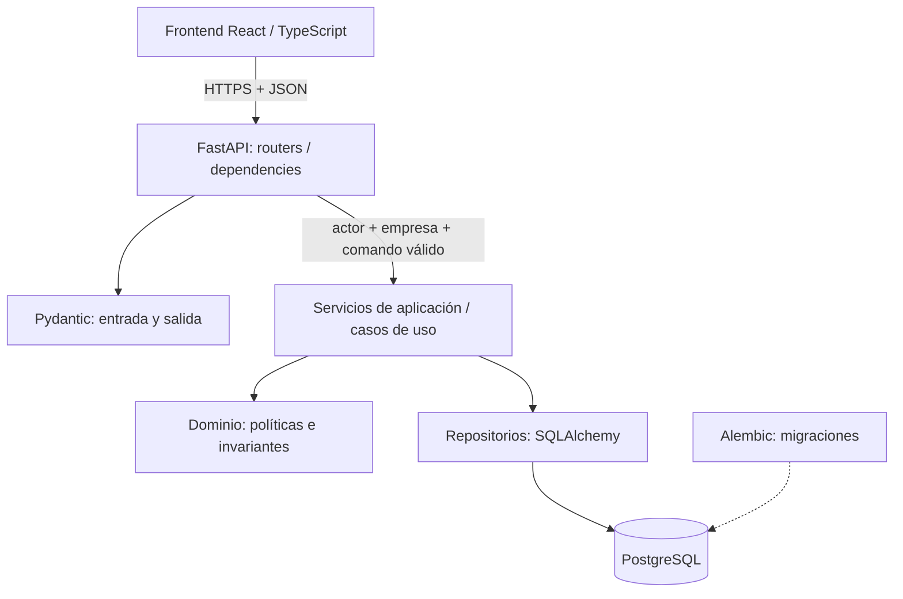
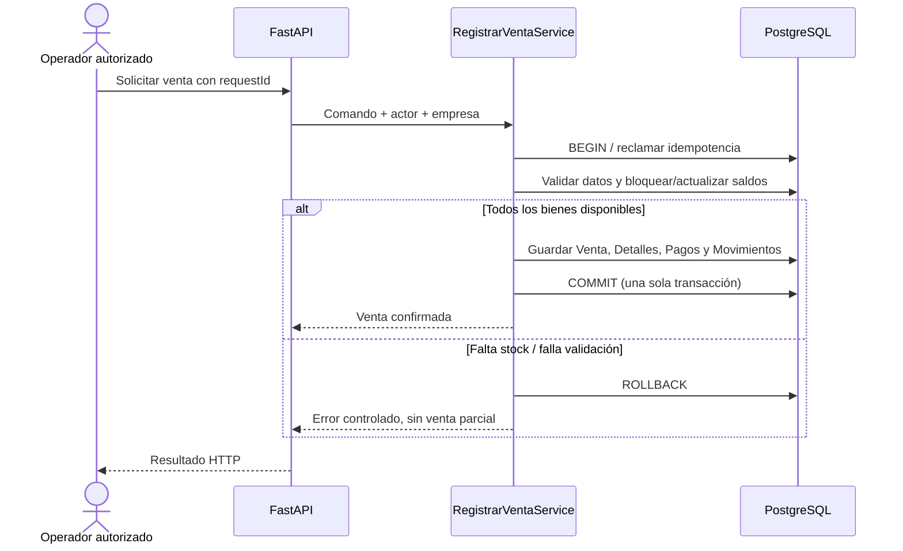

# 04 — Arquitectura del sistema y patrones de diseño

**Proyecto:** Asistente PyME — plataforma generalista de gestión multiempresa y multirrubro  
**Materia:** Programación 2  
**Versión:** 1.7 — E2-3 C, estado reversible de catálogo (527 pruebas CI)
**Estado:** **PROPUESTA BASE + ANEXO DE COMPONENTES BACKEND REALMENTE IMPLEMENTADOS** — aprobación académica del equipo pendiente  
**Fecha:** 8 de noviembre de 2026  
**Base de contraste:** `main` del repositorio `Jorge10192/TP-Programacion2-UNSAM-2C2026`, commit `764ba20674f14621e381a4e9753017070943f2e3` (frontend y documentos 01–03). Esta referencia de commit documenta el **baseline histórico** previo a E2; el estado implementado actual se registra en el anexo E2 de este documento.  
**Documentos vinculados:** [01 — Requerimientos](01_ANALISIS_DE_REQUERIMIENTOS.md) · [02 — Casos de uso](02_CASOS_DE_USO.md) · [03 — Modelo de dominio y UML](03_MODELO_DE_DOMINIO_Y_UML.md).

> **Alcance y lectura obligatoria.** **AS-IS** indica funcionalidades verificables en el frontend DEMO; **TO-BE** identifica decisiones y arquitectura que deberán implementarse en FastAPI; **DIFERIDO** representa evolución posterior. Los esquemas, carpetas, interfaces, fragmentos Python y endpoints propuestos en este documento **no son código de backend existente ni pruebas de backend ejecutadas**. Esta versión se somete a revisión antes de subirla a GitHub.

> **Cierre E2-1 / C.5 — 08/11/2026:** C.1 (98), C.2 (125), C.3 (147), C.4a (171) y C.4b **195/195 pruebas locales aprobadas** (`195 passed in 23.86s`). Alembic `e213c4_acceptance (head)`, sin nuevas operaciones; API y PostgreSQL Docker `healthy`, `/ready` = `ready`/`ok`. CI **3/3** del commit funcional `8cd1674`. C.5 es exclusivamente documental, no implica nuevos tests, migraciones o endpoints. React continúa DEMO; RF-03–RF-07 siguen pendientes.

## Resumen de decisiones de esta revisión

**Se mantiene el diseño del proyecto y su alcance.** La propuesta es un **monolito modular FastAPI + PostgreSQL**, no microservicios. **Repository** continúa como patrón principal previsto para el backend; **Observer** está presente en el frontend como mecanismo de suscripción; **Factory y Decorator** se documentan con ejemplos y pruebas de aplicación posibles. Adapter acompaña la migración futura; no confundir propuestas con implementaciones.

Esta revisión precisa nueve decisiones importantes:

1. **ORM síncrono de SQLAlchemy 2.x → endpoints FastAPI `def`**, sin ejecutar llamadas bloqueantes directamente en un endpoint `async def`; sesiones cortas y nunca compartidas entre solicitudes concurrentes.
2. **Una transacción por comando crítico**. Los repositorios preparan consultas y escrituras, pero **no ejecutan `commit()`**. La unidad de trabajo/servicio controla un único commit o rollback.
3. **Saldo inexistente = cero para salidas; primer ingreso = UPSERT atómico**. No se crearán saldos a cero para todas las combinaciones de artículos y ubicaciones.
4. **PostgreSQL 16 propuesto para Docker de desarrollo**, que soporta `UNIQUE NULLS NOT DISTINCT`; las FKs compuestas necesitan claves únicas compatibles en las tablas padre.
5. **Renglones bonificados de precio cero permitidos, total final de venta positivo** durante el MVP ya acordado. El descuento del contrato será **un importe fijo de centavos enteros**; porcentaje, si existe como ayuda visual, se convierte explícitamente antes de enviarlo.
6. **DTO de salida desacoplado del ORM**: el backend no devuelve objetos SQLAlchemy asociados a sesiones que ya se cerraron. Los mapeos serán explícitos pero sencillos; no hace falta un framework adicional.
7. **Cambio de empresa protegido contra respuestas obsoletas**: consultas con ámbito empresarial, cancelación cuando sea posible y descarte por contexto/versión aunque llegue una respuesta tardía. Un fallo de red no debe activar escritura DEMO silenciosa.
8. **Propiedad inequívoca de la sesión en cada comando**: el servicio abre su transacción mediante una fábrica de sesiones; la autorización empresarial y las escrituras críticas utilizan ese mismo contexto, sin reutilizar una sesión ORM entre dependencias, hilos o solicitudes.
9. **Contratos mínimos de calidad antes de programar**: error estructurado, esquema monetario exacto, versionado API, migraciones comprobables, pruebas unitarias y de integración PostgreSQL claramente separadas; las interfaces/patrones se implementarán cuando aporten valor.

**Al preparar la base v0.4 todavía no se habían ejecutado pruebas de backend**; el anexo E2 al final registra la implementación y resultados locales posteriores, sin atribuirlos a aquel commit.

> **Estado vigente E2-2 (08/11/2026):** RF-03/CU-04 y E2-2 A/A.1/B/C/D implementados, con ubicaciones, asignaciones de colaboradores, autorización por tenant y política operacional reutilizable. **371/371 pruebas en Windows (47.57s)**; `e22d_assignments (head)`; Alembic sin operaciones pendientes; Docker FastAPI/PostgreSQL `healthy` y `/ready` = `ready/ok`. [CI del código E2-2 D: 3/3 y 371 pruebas en Python 3.12 y 3.14](https://github.com/Jorge10192/TP-Programacion2-UNSAM-2C2026/actions/runs/42497556047). **No** existe todavía integración React–API ni operaciones comerciales de compras/stock/ventas que consuman la política; corresponden a bloques posteriores. Los párrafos de cortes previos que mencionan validaciones o funciones «pendientes» se conservan como **histórico**, no como estado actual. El TP integral no se declara terminado.


## 1. Propósito y criterios de diseño

Este documento explica **cómo se construirá** la primera API de Asistente PyME y cómo convivirá con el frontend que ya funciona. Complementa el Documento 01 (qué necesita el sistema), el Documento 02 (qué objetivos cumplen sus actores) y el Documento 03 (qué entidades y reglas componen el dominio). No reemplaza al futuro Documento 05, que fijará contratos HTTP verificables, ni al Documento 06, que reunirá pruebas y evidencias de despliegue.

La plataforma es **multiempresa y multirrubro**. WALOS es únicamente una empresa ficticia o de ejemplo; no condiciona las entidades ni los permisos del producto. Una persona puede pertenecer a varias empresas, con distintas responsabilidades, y las operaciones de cada empresa deben permanecer aisladas en el servidor.

**Objetivos arquitectónicos:**

1. Cumplir la consigna académica mediante una **API RESTful en FastAPI** con autenticación segura, **SQLAlchemy**, base de datos SQL persistente, **Docker**, al menos **diez pruebas unitarias de API**, **GitHub Actions**, despliegue y un patrón de diseño **realmente aplicado y justificado**.
2. Proteger los invariantes del dominio: dinero exacto, compra distinta de recepción, stock sin negativos, una recepción completa por compra, pagos declarados exactos y reintentos que no dupliquen operaciones.
3. Sustituir el almacenamiento DEMO **de manera progresiva**, sin perder la posibilidad de seguir mostrando el frontend anterior mientras la API crece.
4. Priorizar **claridad, trazabilidad y tests** por encima de una arquitectura distribuida prematura. No se requieren microservicios, colas, Redis ni una nube específica para validar el MVP.
5. Evitar un segundo origen de verdad: **cuando un módulo utilice la API, los datos de negocio de ese módulo deberán venir del servidor**; no se mezclarán automáticamente con registros locales del navegador.

### 1.1 Estado de los documentos

- **Estado vigente C.5:** 01 v0.8, 02 v0.9, 03 v0.9, 04 v1.0 y 05 v0.6. Las decisiones iniciales se conservan como **historial de arquitectura**; no deben interpretarse como fotografía actual de `main`. El 03B sigue siendo conceptual para módulos aún no implementados.

## 2. Arquitectura existente — AS-IS: frontend DEMO

### 2.1 Tecnologías y archivos constatados

| Componente | Estado real en `main` | Evidencia en el repositorio |
|---|---|---|
| Interfaz | **React + TypeScript + Vite**, SPA | `plataforma-pyme/frontend/package.json` y `src/App.tsx` |
| Navegación | History API con `history.pushState`, `popstate`, rutas en `App.tsx` y registro `navigation.ts` | `src/App.tsx`, `src/app/navigation.ts` |
| Estado empresarial DEMO | Estado compartido y suscripción React mediante **`useSyncExternalStore`** | `src/data/demo/demoStore.ts` y `useDemoSnapshot()` |
| Persistencia comercial | `localStorage`, clave versionada `asistente-pyme.e1a2.demo.v1`; datos por empresa en el snapshot | `src/data/demo/demoStore.ts` |
| Imágenes DEMO | `IndexedDB`, blobs optimizados y aislados por clave de empresa/ficha | `src/data/demo/imageStorage.ts`, `imagePolicy.ts` |
| Reglas funcionales | Funciones/políticas TypeScript para catálogo, compras, inventario, ventas, equipo, caja, cuentas y QR ficticio | `src/data/demo/*Policy.ts` |
| Calidad de frontend | Build TypeScript/Vite, lint oxlint, tests Node y E2E con Playwright Chromium escritorio/móvil | `frontend/package.json`, `frontend/tests/`, `frontend/e2e/`, `.github/workflows/plataforma-pyme-frontend.yml` |
| Backend/API | **FastAPI/SQLAlchemy/PostgreSQL reales para RF-01/RF-02** | `backend/app/`, `backend/alembic/`, `backend/tests/`; frontend React permanece DEMO desconectado |

**Corrección frente a documentos históricos:** no hay evidencias de **React Router**, **Zustand** ni de un `AppGateway`/`ApiGateway` implementado en este estado. **Sí existe el objeto exportado `demoGateway`** dentro de `demoStore.ts`; todavía no hay una interfaz común de adaptadores DEMO/API. Esos nombres figuran en propuestas E0/ADR, **no** describen el runtime actual. En el **frontend DEMO** no hay autenticación ni autorización de servidor, pagos reales ni sincronización multiusuario; **en el backend E2 sí hay** autenticación, permisos empresariales, SQLAlchemy y migraciones.

### 2.2 Estructura real simplificada

```text
plataforma-pyme/
├── frontend/
│   ├── src/
│   │   ├── App.tsx                 # composición y navegación actual
│   │   ├── app/                    # menú, enlaces, shell y tipos UI
│   │   ├── features/               # pantallas por área de negocio
│   │   └── data/demo/
│   │       ├── demoStore.ts        # estado compartido y comandos DEMO
│   │       ├── *Policy.ts          # validaciones/reglas locales
│   │       └── imageStorage.ts     # fotos en IndexedDB
│   ├── tests/                      # tests de políticas
│   └── e2e/                        # Playwright separado
├── docs/                           # historial técnico E0/E1 y ADR
└── entrega-programacion-2/         # documentación académica
```

El flujo efectivo de hoy es **pantalla React → funciones del `demoStore`/políticas locales → `localStorage` o `IndexedDB` → actualización de React**. Para proteger el estado DEMO se aplican validaciones TypeScript, pero **un navegador no ofrece aislamiento ni permisos de backend confiables**. Los datos locales no son transacciones compartidas entre usuarios.

### 2.3 Lo que ya funciona frente al recorte de API

El frontend incorpora perfiles y empresas ficticias, ubicaciones, equipo e invitaciones simuladas, catálogo, proveedores, compras, recepción completa, movimientos/stock, ventas con pagos declarados y también gastos, caja, cuentas financieras y QR ilustrativo. La API académica **no está obligada a replicar de inmediato todas esas pantallas**.

Las imágenes se guardan localmente; el QR es **DEMO no escaneable y no acredita dinero**. Los E2E actuales no son evidencia de autenticación o concurrencia PostgreSQL, y los tests del frontend **no sustituyen** las diez pruebas unitarias exigidas al backend.

## 3. Arquitectura objetivo — TO-BE

### 3.1 Estilo y decisiones de alcance

Se propone un **monolito modular**: una aplicación FastAPI organizada por áreas de dominio, con una sola base PostgreSQL y migraciones Alembic. Las peticiones HTTP ingresan a routers; los casos de uso se ejecutan mediante servicios; los repositorios encapsulan las consultas SQLAlchemy; las entidades y políticas definen reglas comerciales. La **transacción de base de datos es el límite de consistencia** para las operaciones que modifican varias tablas.

**Tecnologías previstas:** Python (versión compatible a fijar en E2), FastAPI, Pydantic, SQLAlchemy 2.x, Alembic, **PostgreSQL 16** como objetivo de entorno Compose del MVP, pytest, HTTPX, Docker/Docker Compose y GitHub Actions. La versión PostgreSQL 16 se propone para mantener compatibilidad con las restricciones documentadas, pero **el contenedor y sus migraciones aún no se probaron**. Las versiones exactas de bibliotecas y la imagen final (preferiblemente con versión menor/digest fijados para reproducibilidad) se confirmarán en los manifiestos de E2.

**Modelo de ejecución elegido para la primera API:** SQLAlchemy **síncrono** con `Session` y driver síncrono. Por ello, **los endpoints que llaman al ORM bloqueante serán `def` y no `async def`**: FastAPI ejecuta las funciones de ruta síncronas en un *threadpool*, evitando bloquear directamente el event loop. También las dependencias síncronas pueden ejecutarse en ese grupo de hilos. Esto **no** vuelve asíncrona a la base: cada solicitud sigue ocupando capacidad del *pool* de conexiones y del *threadpool*; habrá que ajustar límites razonables y controlar consultas lentas. **No** pasar una `Session` de una petición a otra, a tareas en segundo plano o entre trabajos concurrentes; tampoco compartirla entre `asyncio.gather`.

Un endpoint `async def` sigue siendo válido para trabajo genuinamente asíncrono sin llamadas síncronas bloqueantes; **no mezclar dentro de él una llamada SQLAlchemy síncrona directa**, ni esconderla dentro de una utilidad `def` invocada desde `async def`. Para un endpoint SQL se elige **ruta `def` + servicio síncrono + repositorio síncrono**. La fábrica `sessionmaker` puede compartirse; **la instancia `Session` no**. Cada comando crea y usa su propia sesión de manera no concurrente. Que una dependencia `def` se ejecute en el *threadpool* no garantiza que todas las dependencias de una solicitud se ejecuten en el mismo hilo; por eso se prefiere no transportar sesiones ORM abiertas entre capas/dependencias con ciclo de vida ambiguo. Si más adelante se necesita async de punta a punta, migrar conscientemente a `AsyncSession` y driver compatible, evitando crear dos estilos de acceso a datos sin justificación.

**Control de carga:** ejecutar rutas en *threadpool* evita bloquear el bucle de eventos, pero **no aumenta mágicamente** el número de conexiones PostgreSQL ni evita saturar hilos ante consultas lentas. E2 deberá usar tiempos de espera, consultas indexadas, límites de pool y pruebas de dos solicitudes reales. Referencia: [FastAPI — concurrencia y async/await](https://fastapi.tiangolo.com/async/).

### 3.2 Vista de componentes



El dibujo es una **vista de arquitectura**, no un diagrama UML de clases ni una implementación existente.

### 3.3 Responsabilidades y prohibiciones

| Capa | Responsabilidad | No debe hacer |
|---|---|---|
| **Presentación React** | Formularios, navegación, feedback, estado transitorio de UI y llamadas HTTP | Autorizar empresas, decidir stock definitivo, escribir directamente en PostgreSQL |
| **Routers FastAPI** | Exponer rutas, resolver dependencias, traducir solicitudes/respuestas, manejar códigos HTTP | Contener toda la lógica de ventas/recepción ni hacer varios `commit()` |
| **Pydantic / DTO** | Validar forma, tipos, límites y serialización del contrato externo; definir DTOs independientes de la sesión ORM | Suponer que un ID pertenece a la empresa sin consultar servidor |
| **Mapeo de datos** | Traducir explícitamente entre DTO de entrada, comandos, entidades/ORM y DTO de respuesta cuando los modelos difieran | Entregar instancias ORM vivas a la respuesta HTTP o añadir mapeadores genéricos por reflejo |
| **Servicios de aplicación** | Orquestar CU, permisos, reglas, idempotencia, transacciones y resultados | Depender de pantallas React; repartir una operación atómica en commits distintos |
| **Dominio / políticas** | Calcular dinero/cantidades, estados y decisiones comerciales verificables | Acoplar reglas a HTTP o a un ORM cuando pueden expresarse como funciones puras |
| **Repositorios** | Buscar y persistir entidades/colecciones con SQLAlchemy; consultas condicionadas por empresa; operaciones SQL atómicas | Decidir roles de negocio o devolver `HTTPException` |
| **Unidad de trabajo / sesión** | Delimitar commit/rollback y ciclo de vida de la sesión | Confirmar parcialmente una operación comercial que debía ser indivisible |
| **PostgreSQL** | Persistencia, unicidad, integridad referencial, restricciones, bloqueos y transacciones | Confiar solo en validaciones de frontend para evitar registros corruptos |

**Regla de dependencia:** los servicios utilizan contratos de repositorio cuando la abstracción aporta valor; los repositorios concretos usan SQLAlchemy. Los errores de negocio se traducen a HTTP en la frontera, sin filtrar excepciones SQL ni trazas internas. **Ningún repositorio llama a `session.commit()`**; las transacciones se confirman desde el caso de uso o la unidad de trabajo. Al cerrar una sesión, la respuesta ya debe estar representada mediante datos independientes del ORM.

**Regla de propiedad del estado:** el `Engine` y la fábrica de sesiones se inicializan en infraestructura y pueden reutilizarse; **cada solicitud/comando obtiene su propia sesión, la utiliza secuencialmente y la cierra en el mismo alcance**. Las dependencias FastAPI entregan contexto autenticado como datos inmutables, no una sesión mutable que deba sobrevivir a varios niveles de inyección. El servicio empresarial vuelve a leer su membresía y permisos en su transacción antes de escribir.

## 4. Estructura propuesta de carpetas y módulos

La estructura siguiente fue una **propuesta histórica de inicio de E2**. Actualmente `backend/` existe con módulos de autenticación y empresas, SQLAlchemy, migraciones y tests. Se conserva el árbol conceptual como referencia de diseño, no como inventario literal del repositorio.

```text
plataforma-pyme/
├── frontend/                         # se conserva tal como funciona
├── backend/                          # ya existe en E2; el resto es esquema ilustrativo
│   ├── app/
│   │   ├── main.py                   # instancia FastAPI; routers; errores
│   │   ├── api/
│   │   │   ├── dependencies.py       # identidad, pertenencia, sesión
│   │   │   └── v1/
│   │   │       ├── auth.py
│   │   │       ├── businesses.py
│   │   │       ├── locations.py
│   │   │       ├── catalog.py
│   │   │       ├── suppliers.py
│   │   │       ├── purchases.py
│   │   │       ├── inventory.py
│   │   │       └── sales.py
│   │   ├── core/
│   │   │   ├── settings.py           # variables de entorno
│   │   │   ├── security.py           # credenciales, tokens o sesiones
│   │   │   └── errors.py             # errores de dominio -> HTTP
│   │   ├── domain/
│   │   │   ├── policies/             # dinero, unidades, estados
│   │   │   └── exceptions.py
│   │   ├── application/
│   │   │   ├── services/             # casos de uso
│   │   │   ├── ports/                # protocolos de repositorios
│   │   │   └── unit_of_work.py      # frontera de transacción
│   │   ├── infrastructure/
│   │   │   ├── db.py                 # engine y sessionmaker
│   │   │   ├── models/              # ORM (tablas SQL)
│   │   │   └── repositories/        # adaptadores SQLAlchemy
│   │   └── schemas/                  # DTO Pydantic; mapeo explícito junto al servicio cuando convenga
│   ├── alembic/                      # migraciones versionadas
│   ├── tests/
│   │   ├── unit/
│   │   └── integration/
│   ├── pyproject.toml                # dependencias/pytest (a definir)
│   ├── alembic.ini
│   ├── Dockerfile
│   ├── .env.example
│   └── README.md
├── compose.yaml                      # propuesta; ubicación final a aprobar
├── docs/                              # histórico de desarrollo
└── entrega-programacion-2/          # documentación académica
```

**Criterio de modularidad:** no agregar subcarpetas o interfaces artificiales donde no exista necesidad; por ejemplo, un repositorio por entidad únicamente si encapsula una operación reutilizable. El patrón se demuestra con al menos un circuito real, como la venta o recepción. Evitar cientos de DTO y abstracciones antes del primer endpoint.

## 5. Patrones de diseño: elección, aplicación y evaluación

### 5.1 Patrón principal: Repository (repositorio)

**Problema:** los servicios de compras, inventario y ventas requieren consultar y modificar datos persistidos, pero no deberían depender de consultas SQL concretas ni de detalles de SQLAlchemy. Si cada endpoint mezcla HTTP, permisos, reglas y sentencias SQL, las pruebas quedan acopladas a la base y aumenta la probabilidad de operaciones parciales.

**Solución propuesta:** definir una interfaz pequeña que exprese operaciones del dominio (consultar compra pendiente, obtener stock, descontar condicionado, guardar venta) y construir una implementación que utilice SQLAlchemy. Los servicios usan ese contrato y no conocen cómo se emiten las consultas.

**Ejemplo ilustrativo de contrato Python — NO implementado:**

```python
from typing import Protocol
from uuid import UUID

class StockRepository(Protocol):
    def descontar_si_alcanza(
        self, business_id: UUID, ubicacion_id: UUID,
        articulo_id: UUID, cantidad_milli: int,
    ) -> bool: ...
```

Una implementación real de `SqlAlchemyStockRepository` ejecutará un `UPDATE` condicional o bloqueará el saldo, verificará filas afectadas y participará de **la misma sesión/transacción** que guarda la venta y el historial. Un `FakeStockRepository` en tests permitirá simular los resultados `True/False` sin necesitar PostgreSQL para probar la regla de negocio. **El fake no reemplaza tests de integración con PostgreSQL** para concurrencia.

**Ventajas verificables:** responsabilidades separadas, tests unitarios de servicios sin DB, intercambio de tecnología de persistencia sin cambiar el caso de uso, y centralización de consultas empresariales. **Costo:** más archivos y contratos; por eso se implementará solo la abstracción efectivamente usada.

### 5.2 Patrón complementario: Service Layer + Unit of Work

El **servicio de aplicación** ejecuta un caso de uso completo, por ejemplo `RegistrarVentaService`. Recibe una identidad/empresa autorizada y un comando validado; aplica reglas de dominio, controla idempotencia y coordina repositorios. El **Unit of Work** o contexto transaccional garantiza que **todas las escrituras del caso se confirmen juntas o ninguna se confirme**.

**Reglas obligatorias para la implementación propuesta:**

- Cada caso de uso que modifica varios registros tiene **un solo dueño del commit**. El servicio o la UoW confirma; los repositorios solo consultan, agregan, hacen `flush()` cuando sea necesario y ejecutan SQL atómico **dentro de la sesión recibida**.
- `flush()` **no equivale a commit**: sirve para emitir SQL/obtener identificadores y mantener todo revertible si ocurre un error.
- No ejecutar `commit()` en dependencias de autenticación, routers ni repositorios de forma accidental; no cerrar la sesión antes de construir la respuesta.
- La **consulta de pertenencia** al tenant para autorización inicial puede estar en una dependencia reutilizable, pero cada comando debe volver a validar lo **mutable y sensible a concurrencia** bajo la transacción apropiada (por ejemplo, compra pendiente, artículo activo, ubicación y stock).
- Capturar `IntegrityError` y otras excepciones de infraestructura únicamente donde pueda distinguirse un conflicto esperado; si no, permitir rollback y traducir a un error controlado en la frontera HTTP.

**Forma mínima recomendada, ilustrativa — no existe todavía en el repositorio:** La anotación `sessionmaker[Session]` indica una fábrica de sesiones SQLAlchemy que ofrece el contexto transaccional `.begin()`; **no** se trata de cualquier función `Callable` que retorna una `Session`.

```python
from sqlalchemy.orm import Session, sessionmaker

# session_factory: sessionmaker configurado por infrastructure/db.py
# Command, SaleResult y las clases de repositorio son contratos por construir.

def registrar_venta(command: "SaleCommand", session_factory: sessionmaker[Session]) -> "SaleResult":
    with session_factory.begin() as session:  # BEGIN / COMMIT / ROLLBACK / CLOSE
        sales_repo = SqlAlchemySalesRepository(session)
        stock_repo = SqlAlchemyStockRepository(session)
        # Validar contexto empresarial y clave idempotente en esta transacción.
        # Revalidar artículos/ubicación y controlar saldos atómicamente.
        # Persistir venta, renglones, pagos, movimientos e idempotencia.
        result = execute_sale_command(command, sales_repo, stock_repo, session)
        dto = SaleResult.from_result(result)  # datos puros, sin ORM vivo
    return dto
```

Este fragmento es **pseudocódigo Python estructural**, no una implementación completa: las clases, el método de mapeo y `execute_sale_command` no existen. Para E2 es válido utilizar directamente `with session_factory.begin() as session` **sin** construir una clase UnitOfWork propia. Solo se introducirá un objeto `UnitOfWork` que encapsule repositorios cuando aporte una mejora real de legibilidad o testabilidad. La coherencia del **límite transaccional** importa más que la cantidad de clases.

**Inyección de dependencias recomendada para operaciones de escritura:** la ruta `def` recibe un principal autenticado inmutable y la fábrica de sesiones/servicio, **no** una instancia SQLAlchemy `Session` compartida. Dentro del servicio se abre `with session_factory.begin() as session`; allí se relee la membresía correspondiente a la empresa, se verifica el permiso específico y se ejecuta el cambio completo. Esto evita el desacople entre una primera lectura de permisos en otra sesión y el commit comercial. En altas de empresa, la transacción verifica identidad global y crea Empresa + Membresia inicial. **Un endpoint no debe abrir una segunda sesión para una parte de la misma operación ni confirmar fuera del límite definido.**

**Lecturas:** un servicio de consulta puede usar `with session_factory() as session` sin commit; debe cerrar la sesión antes de responder con su DTO. Para proyectos que adopten `get_db()` con `yield`, el equipo podrá hacerlo si fija **un único dueño** del alcance de transacción y evita accesos concurrentes a esa sesión. No mezclar sin análisis `Session.begin()` anidados, commits al finalizar dependencias y sesiones en hilos distintos.

**Semántica transaccional de los errores:** si una operación falla, debe propagarse una excepción hasta salir del bloque de transacción, que hace rollback. Una validación negativa no debe traducirse en un resultado de «éxito» que provoque commit de escrituras parciales. Si se persiste una respuesta idempotente de error, definir si corresponde a una transacción separada **sin efecto comercial**, y distinguir conflictos reintentables de fallas definitivas.

**Evidencia futura:** un circuito de venta o recepción con código de servicio y repositorios, una sola transacción, test con repositorio fake, test de fallo inducido que produce rollback real en PostgreSQL y ausencia de commits dentro de los repositorios. Referencia: [SQLAlchemy 2.x — framing transaccional](https://docs.sqlalchemy.org/en/20/orm/session_basics.html#framing-out-a-begin-commit-rollback-block).

### 5.2.1 Mapeo de modelos y DTO — práctica de separación, no patrón obligatorio adicional

- **Router/DTO de entrada:** valida formato del contrato HTTP (UUID, enteros, strings, límites) y genera un comando de aplicación.
- **Servicio/dominio:** decide reglas, guarda snapshots y produce un resultado de aplicación independiente de sesiones abiertas.
- **Repositorio/ORM:** obtiene y persiste filas con SQLAlchemy; el modelo ORM no es un objeto que deba serializarse ciegamente como resultado público.
- **DTO de respuesta:** expone campos expresamente definidos y excluye `password_hash`, tokens, secretos y datos internos; se construye **antes de cerrar la sesión** o a partir de valores ya cargados.
- **Contrato de salida estable:** la API devuelve estructuras Pydantic o dataclasses mapeadas explícitamente (UUID, enum, centavos, fechas en UTC); las relaciones ORM de carga perezosa no participan de la serialización HTTP.

**Ejemplo conceptual del mapeo:** `VentaORM(id, total_centavos, ...) → SaleResult(id, total_cents, ...) → SaleResponse`, sin filtrar una entidad completa. El método puede ser una función simple probada; **no** es obligatorio introducir un framework Mapper ni mantener tres tipos redundantes si el DTO de aplicación ya cumple el contrato.

No es necesario agregar un módulo `Mapper` para cada entidad. Las conversiones explícitas pequeñas pueden residir cerca de los esquemas o servicios y cubrirse con tests. Se evitará exponer relaciones ORM de carga perezosa fuera de una transacción cerrada o provocar consultas SQL ocultas durante la serialización.

### 5.3 Patrón de integración recomendado: Adapter

Hoy la UI llama directamente a funciones sincrónicas del `demoStore`. Para integrar progresivamente con una API asíncrona se propone construir puertos por funcionalidad (por ejemplo `CatalogGateway`, `SalesGateway`) y dos adaptadores:

```text
Página de catálogo
    -> interfaz de operaciones del catálogo
        -> adaptador DEMO: demoStore local (actual, envuelto cuando se migre)
        -> adaptador API: cliente HTTP /v1 (a desarrollar)
```

**Los adaptadores intercambiables son TO-BE:** aunque ya hay un objeto `demoGateway`, aún no existe una interfaz común de operaciones para DemoGateway/ApiGateway ni un cliente API de producción. No se deberá afirmar que `AppGateway`, `DemoGateway` o `ApiGateway` ya existen. El patrón Adapter permite conservar una interfaz estable mientras cambian las fuentes, pero exige introducir asincronía y estados de carga/error; **no bastará con reemplazar un import**.

Este patrón es una alternativa clara de **patrón GoF (Adapter)** si la cátedra exige uno de esa familia; Repository es el patrón principal de separación de persistencia. Ambos deberán demostrarse con **clases o funciones reales y tests**, evitando declarar patrones solo porque existen carpetas llamadas `services` o `repositories`.

### 5.4 Factory — creación consistente de movimientos (propuesto para el backend)

**Qué explica el libro:** Factory encapsula la construcción de objetos para desacoplar al código cliente de detalles de creación. El capítulo 4 de *Head First Design Patterns* distingue la fábrica sencilla, Factory Method y Abstract Factory. **Una Simple Factory no equivale automáticamente al patrón GoF Factory Method.**

**Problema en Asistente PyME:** al confirmar una recepción, venta, traslado o ajuste se deben crear movimientos con empresa, artículo, ubicación, cantidad firmada, origen y auditoría. Si cada servicio arma todos esos campos manualmente, puede generar una entrada negativa, omitir una referencia o producir solo uno de los dos movimientos de un traslado.

**Aplicación propuesta:** un creador de borradores de MovimientoInventario concentra los tipos, signos y atributos requeridos. El servicio controla permisos, estado de compra, disponibilidad de stock e idempotencia; la fábrica **no** consulta SQL, no actualiza saldos, no publica eventos y no hace commit.

~~~python
# EJEMPLO DIDÁCTICO TO-BE, no presente en el código.
from dataclasses import dataclass
from uuid import UUID

@dataclass(frozen=True)
class MovimientoDraft:
    empresa_id: UUID
    articulo_id: UUID
    ubicacion_id: UUID
    delta_milli: int
    origen: str
    origen_id: UUID

class MovimientoFactory:
    @staticmethod
    def venta(empresa: UUID, articulo: UUID, ubicacion: UUID,
              cantidad: int, venta_id: UUID) -> MovimientoDraft:
        if cantidad <= 0:
            raise ValueError("Cantidad inválida")
        return MovimientoDraft(empresa, articulo, ubicacion,
                               -cantidad, "VENTA", venta_id)

    @staticmethod
    def recepcion(empresa: UUID, articulo: UUID, ubicacion: UUID,
                  cantidad: int, recepcion_id: UUID) -> MovimientoDraft:
        if cantidad <= 0:
            raise ValueError("Cantidad inválida")
        return MovimientoDraft(empresa, articulo, ubicacion,
                               cantidad, "RECEPCION", recepcion_id)
~~~

La implementación real mapeará el campo conceptual origen a las tres referencias exclusivas (XOR) del Documento 03. Para traslados, la fábrica deberá generar **un par** de deltas opuestos vinculados a la misma OperacionInventario. Los renglones de servicios nunca generan egresos físicos.

**Valor:** menos duplicación y errores al construir movimientos; pruebas unitarias de signo, origen, cantidades y pares de traslado. **Límite:** es una *Simple Factory* útil para el MVP; Factory Method requeriría creadores/subclases que decidan qué tipo de producto instanciar, y Abstract Factory familias de productos. Solo introducirlas si aparece variabilidad real; no crear herencia artificial para sumar nombres de patrones.

### 5.5 Decorator — añadir observabilidad por composición (opcional)

**Qué explica el libro:** Decorator permite agregar responsabilidades mediante un objeto que **envuelve a otro y conserva su contrato**. El capítulo 3 usa composición para extender comportamiento sin modificar la clase decorada.

**Problema en Asistente PyME:** los servicios de inventario pueden necesitar métricas de duración o diagnósticos de consultas SQL sin duplicar instrumentación en cada repositorio. Un Decorator puede envolver el contrato StockRepository de 5.1.

~~~python
# EJEMPLO DIDÁCTICO TO-BE; interfaz StockRepository definida en 5.1.
from time import perf_counter

class TimedStockRepository:
    def __init__(self, inner: StockRepository, record_duration):
        self.inner = inner
        self.record_duration = record_duration

    def descontar_si_alcanza(self, business_id, ubicacion_id,
                             articulo_id, cantidad_milli):
        start = perf_counter()
        try:
            return self.inner.descontar_si_alcanza(
                business_id, ubicacion_id, articulo_id, cantidad_milli
            )
        finally:
            self.record_duration(perf_counter() - start)
~~~

**Reglas:** el envoltorio utiliza la **misma sesión/transacción** que el repositorio original y no realiza commit ni una segunda salida de stock. La métrica mide la operación de repositorio, **no el éxito definitivo de la venta**, porque el commit puede fallar después. Si el registro de métricas también falla, la versión real debe impedir que esa falla oculte el error comercial. Este ejemplo implementa el puerto mínimo del método mostrado; si el contrato se amplía, el decorador debe seguir delegando sus otros métodos o limitarse a una interfaz más pequeña.

**Cómo demostrarlo:** test que confirme una sola delegación, mismos argumentos y resultado; excepción propagada; métricas añadidas sin cambiar saldo ni transacciones.

**Distinción académica:** usar @router.post en FastAPI o @pytest.mark en tests emplea sintaxis de decoradores de Python, **pero no demuestra por sí solo** el patrón Decorator de objetos del libro. Para defenderlo se mostrará la composición y delegación reales. Es opcional, no un requisito para arrancar E2.

### 5.6 Observer — suscripción de React al demoStore (AS-IS confirmado)

**Qué explica el libro:** Observer define una relación de **uno a muchos** en que un sujeto notifica cambios a sus observadores desacoplados (capítulo 2 de *Head First Design Patterns*).

**Aplicación REAL del frontend actual:** en frontend/src/data/demo/demoStore.ts existe un conjunto de listeners; la función notify actualiza el snapshot e intenta persistirlo, luego invoca a los suscriptores. El objeto demoStore ofrece subscribe y getSnapshot; useDemoSnapshot integra la suscripción con el hook React useSyncExternalStore.

~~~typescript
// Versión abreviada del mecanismo que YA existe.
const listeners = new Set<() => void>()

function notify(next: DemoSnapshot) {
  state = next
  // El código real también intenta persistir en localStorage.
  listeners.forEach((fn) => fn())
}
const demoStore = {
  getSnapshot: () => state,
  subscribe(listener: () => void) {
    listeners.add(listener)
    return () => listeners.delete(listener)
  },
}
function useDemoSnapshot() {
  return useSyncExternalStore(
    demoStore.subscribe, demoStore.getSnapshot
  )
}
~~~

**Correspondencia con el patrón:** el *Subject* es demoStore, los *Observers* son listeners y vistas suscriptas; cuando cambia el estado, el store notifica **sin conocer qué componente lo utiliza**. Se trata de Observer mediante callbacks/suscripciones, no de una jerarquía literal de clases Java.

**Evidencia para la exposición:** mostrar el código citado, una acción DEMO que actualiza el snapshot y la vista React que se vuelve a renderizar. **Prueba adicional recomendada:** registrar un listener, cambiar el estado y comprobar que fue notificado; desuscribirlo y verificar que deja de recibir avisos. No afirmar que ya existe un test dedicado si aún no se escribió.

**Límite crítico:** este mecanismo actúa en el navegador; NO reemplaza la persistencia, los permisos ni la sincronización real multiusuario. Observer **no debe ejecutar el descuento de stock fuera de la transacción SQL**. Las notificaciones futuras del backend, si se incorporan, deberían emitirse tras confirmar el commit; un sistema distribuido fiable necesitaría una estrategia de entrega como outbox, fuera de este MVP.

### 5.7 Otros patrones y enfoques apropiados

| Patrón | Uso concreto | Estado / delimitación |
|---|---|---|
| **Repository** (arquitectónico) | StockRepository separa reglas de dominio y SQLAlchemy; fake permite tests unitarios | Principal **TO-BE**, sección 5.1. No es patrón GoF del libro. |
| **Service Layer y Unit of Work** (arquitectónicos) | Una operación de venta/recepción reúne permisos, saldos, movimientos y único commit | **TO-BE**, sección 5.2; no es obligatorio construir una clase UoW propia. |
| **Adapter** (GoF) | Puerto estable para módulos React; adaptación gradual del demoGateway actual al futuro cliente HTTP | **TO-BE**, sección 5.3; no existe todavía el puerto intercambiable. |
| **Simple Factory** | Movimientos con signo y origen válidos en un único lugar | **TO-BE**, sección 5.4; no atribuirle automáticamente Factory Method. |
| **Decorator** (GoF) | Envoltorio de métricas/diagnóstico de repositorios | **Opcional**, sección 5.5. |
| **Observer** (GoF) | Listeners y useSyncExternalStore en demoStore | **AS-IS verificable**, sección 5.6. |
| **State** (GoF) | Podría encapsular estados de Compra | **No adoptado**: una enumeración y reglas de transición no equivalen al patrón State. |
| **Strategy** (GoF) | Algoritmos de descuento o valorización alternativos | **Diferido**: el MVP tiene una sola regla de descuento fijo en centavos. |
| **Command** (GoF) | Objetos invocables con receptor, ejecución y posible historial | **No adoptado**: llamarle SaleCommand a un DTO no demuestra el patrón. |
| **Singleton** (GoF) | No compartir sesiones SQLAlchemy como una instancia global | **No recomendado** para sesiones por solicitud. |

**Buenas prácticas derivadas del libro:** encapsular lo que cambia, preferir composición a herencia, programar contra interfaces y buscar acoplamiento flexible. Una implementación de calidad no es la que enumera más patrones sino la que justifica cada uno con un problema y una prueba.

### 5.8 Plan para demostrar patrones en la entrega

| Candidato | Evidencia mínima observable | Prioridad |
|---|---|---|
| **Observer (existente)** | Identificar subscribe, notify, getSnapshot y useSyncExternalStore; prueba de notificación/cancelación | Ya observable en frontend; agregar test si conviene |
| **Repository (propuesto)** | Interfaz, implementación SQLAlchemy, fake y test de servicio sin DB | **Principal del backend** |
| **Simple Factory (propuesta)** | Crear entradas/salidas/tránsito con signo y origen correctos; tests | Implementar junto con inventario si simplifica el código |
| **Adapter (propuesto)** | Mismo contrato usado por DEMO y API en un módulo React; tests de solicitudes/errores | Durante integración React–FastAPI |
| **Decorator (opcional)** | Envoltorio que delega una vez, conserva el resultado y registra una métrica | Solo si aporta utilidad |

**Advertencias para la defensa:** un diagrama no prueba que el patrón esté implementado; Depends de FastAPI no demuestra Factory Method; @router.post no demuestra por sí solo Decorator GoF; tener un estado llamado RECIBIDA no demuestra State; un DTO SaleCommand no demuestra Command. La consigna exige como mínimo un patrón **usado y explicado** en código, no una lista extensa de propuestas.

### 5.9 Referencias a los patrones vistos en clase

**Libro:** Freeman, Eric y Robson, Elisabeth; con Kathy Sierra y Bert Bates. *Head First Design Patterns: Building Extensible & Maintainable Object-Oriented Software*, segunda edición, O'Reilly Media, 2020/2021.

- **Capítulo 2 — Observer:** suscripciones, notificaciones y bajo acoplamiento → demoStore.
- **Capítulo 3 — Decorator:** envoltura para añadir responsabilidades → instrumentación de repositorios.
- **Capítulo 4 — Factory:** fábrica sencilla, Factory Method y Abstract Factory → construcción de movimientos sin alegar falsamente Factory Method.
- **Capítulo 7 — Adapter:** traducción entre interfaces → integración progresiva del frontend.
- **Capítulo 10 — State:** comportamiento dependiente de estados → posible evolución de Compra, no necesaria ahora.

Repository, Service Layer y Unit of Work son **patrones/decisiones arquitectónicos complementarios**, no deben confundirse con patrones GoF de esos capítulos.

### 5.10 Alternativas descartadas por ahora

| Alternativa | Motivo |
|---|---|
| Microservicios / mensajería / event sourcing completo | Excesivo para primera API y complejiza transacciones y despliegue |
| ORM en cada endpoint con `commit()` repetidos | Acopla HTTP y SQL, dificulta rollback de una venta |
| Todo el estado comercial dentro de React / localStorage | No protege concurrencia, persistencia, autenticación ni permisos multiusuario |
| Crear herencias Factory Method / Strategy / State sin variación real | Sería complejidad innecesaria y no evidencia de buena ingeniería |
| Reemplazar toda la DEMO simultáneamente | Aumenta el riesgo de regresiones y pérdida de datos locales |

## 6. Modelo de datos, invariantes y persistencia

El Documento 03 es la fuente conceptual de entidades y cardinalidades. El esquema físico se documentará junto con migraciones Alembic y pruebas de restricciones. **No convertir automáticamente los recuadros UML en tablas uno-a-uno** sin considerar claves, índices, snapshots y consistencia.

### 6.1 Entidades base

- **Globales:** Usuario (identidad); su correo es único normalizado y sus credenciales no dependen de una empresa.
- **Vínculo global/tenant:** Empresa, Membresía e Invitación (esta última es soporte propuesto), con fundador histórico y pertenencias por empresa.
- **Recursos empresariales:** Ubicación, ArtículoCatalogo, Proveedor.
- **Comerciales:** Compra, DetalleCompra, Recepción, Venta, DetalleVenta, AplicaciónPago.
- **Inventario:** MovimientoInventario (historial inmutable), SaldoInventario (existencia actual), OperaciónInventario (traslados/ajustes).
- **Técnica:** SolicitudIdempotente (resultado/estado de un comando repetible).

**El modelo SQL preservará `business_id` en los recursos de cada empresa, pero no en una identidad global** como Usuario. Para impedir referencias cruzadas se propondrán **FK compuestas por empresa**, además de permisos validados en servicios. Una restricción `CHECK` de una fila **no puede validar por sí sola datos de otras tablas**.

**Estrategia mínima de esquema:** `businesses` y `users` poseen identidad global; `memberships` enlaza ambas y limita su combinación. Los recursos tenant usan `business_id NOT NULL`, `id` global y, cuando son destino de referencias compuestas, `UNIQUE (business_id, id)` en la tabla padre. Las tablas de detalle deben conservar el `business_id` necesario para impedir con FK compuesta que un renglón de venta apunte a un artículo de otra empresa. No se exigen identificadores empresariales en todos los objetos globales, ni se agregan índices redundantes por inercia.

### 6.2 Reglas críticas de dominio

| ID de regla / caso | Invariante que debe garantizar el servidor |
|---|---|
| RN-01 / CU-03 | Solo un usuario autorizado consulta o modifica recursos de la empresa solicitada; rol definido por Membresía, no global. |
| RN-02 / CU-06, CU-07 | Registrar Compra **no** incrementa stock; Recepción posterior completa y en **una sola ubicación**. |
| RN-03 / CU-07, CU-10 | Idempotencia de recepciones y ventas; la misma operación no crea efectos duplicados. |
| RN-04 / CU-05, CU-10 | Los servicios no tienen saldo físico ni generan movimientos; una venta mixta descuenta únicamente bienes. |
| RN-05 / CU-06, CU-10 | ARS en centavos enteros; cantidades en milésimas exactas; `HALF_UP` **por línea**, nunca `Float` para dinero. |
| RN-06 / CU-10 | Suma de AplicacionesPago = TotalVenta declarado, exactamente al centavo. |
| RF-06 / CU-09, CU-11 | Traslado = salida e ingreso de igual magnitud, atómicos; ajustes con motivo y control de concurrencia. |

**Dinero y redondeo (contrato MVP):**

- `totalLineaCentavos = HALF_UP(cantidadMilli × precioUnitarioCentavos / 1000)` **por renglón**, con cantidad positiva y precio unitario entero **mayor o igual a cero**. Para evitar imprecisiones, se utilizará aritmética entera/decimal exacta, nunca Float.
- `subtotalVentaCentavos = Σ(totalLineaCentavos)` (no se recalcula multiplicando una cantidad consolidada), `totalVentaCentavos = subtotalVentaCentavos − descuentoCentavos`, `Σ(aplicacionPago.importeCentavos) = totalVentaCentavos`.
- **Descuento global como importe fijo:** el cliente envía `descuentoCentavos` como **entero no negativo** dentro del rango `0 <= descuentoCentavos <= subtotalVentaCentavos`; el servidor valida y recalcula. La primera API **no recibirá un porcentaje para recalcular un descuento**. Si la UI ofrece una calculadora de porcentajes, deberá obtener el importe en centavos con una regla `HALF_UP` explícita antes de enviar; el backend sigue siendo autoridad sobre la venta y valida el monto fijo resultante. Esto evita que Python y JavaScript apliquen porcentajes con diferentes criterios de redondeo.
- **Precio cero en una línea:** permitido para una bonificación o muestra incluida en la venta. **Total final completo cero:** diferido en el MVP actual; no se cambia de `totalVenta > 0` a `>= 0` sin actualizar antes RF/CU, política de AplicacionPago y pruebas. Una nota de crédito/reembolso tampoco es una venta de importe cero y requiere su propio proceso.
- **Validaciones:** no admitir precios, descuentos ni importes de pago negativos; los pagos declarados deben conciliar exactamente. **La política de AplicacionPago del MVP requiere importes positivos** en una venta total positiva; una línea bonificada de cero no agrega un pago ficticio de cero. Mantener el costo histórico del DetalleCompra separado del costo de referencia informativo del catálogo.
- **Unidades:** un bien indivisible utiliza cantidades múltiplos de `1000` milésimas; para unidades fraccionables se admiten hasta tres decimales. **No convertir automáticamente una unidad de control ya usada en movimientos**, porque el saldo y los snapshots anteriores no se reescriben. Cambio de unidad con existencias requeriría una operación de migración justificada y queda fuera del MVP.
- **Límites aritméticos:** validar enteros y rangos antes de multiplicar/acumular; en PostgreSQL preferir `BIGINT` para importes y cantidades según límites del dominio. Python `int` no desborda, pero la columna SQL sí tiene rango finito. Las pruebas incluyen valores cercanos al límite y redondeos de medios centavo.

Las líneas repetidas de un mismo artículo se agregan para validar **stock**, no para recalcular subtotales redondeados. Esta precisión respeta el comportamiento actual y los Documentos 01–03.

**Servicios e insumos:** un servicio no consume inventario automáticamente durante el MVP. Asociar shampoo/acondicionador a un servicio, definir mínimos para la jornada y justificar consumos específicos queda **DIFERIDO**, sin convertirlo en obligación presente.

### 6.3 Ledger más saldo materializado

`MovimientoInventario` registra cada hecho con delta firmado y origen auditable; se trata como **append-only**. `SaldoInventario` almacena el valor actual por el trío `(business_id, ubicacion_id, articulo_id)`, con `cantidad_milli >= 0` y `version`. Ambos participan del **mismo commit**, y una verificación de conciliación puede comparar saldo contra suma histórica. No habilitar edición directa del saldo desde la interfaz.

El origen de cada movimiento debe ser **exactamente uno** de: Recepción, Venta u OperaciónInventario. Una propuesta SQL es tener tres FK opcionales y `CHECK (num_nonnulls(recepcion_id, venta_id, operacion_inventario_id) = 1)`; cada referencia debe respetar el tenant mediante claves compuestas. La cancelación de un hecho se resuelve por operación compensatoria trazable, nunca borrando arbitrariamente el histórico.

### 6.4 Otras restricciones propuestas

- `UNIQUE(business_id, sku_normalizado)` para SKU informado (índice parcial opcional; aceptar múltiples SKU nulos). La normalización es responsabilidad de la lógica de dominio y/o restricciones de DB, para que dos escrituras concurrentes no esquiven la unicidad.
- `UNIQUE(business_id, user_id)` para membresías.
- `UNIQUE(compra_id)` para una única recepción completa por compra en el MVP.
- `UNIQUE(business_id, ubicacion_id, articulo_id)` y `CHECK(cantidad_milli >= 0)` para saldos.
- **FK compuestas** `(business_id, recurso_id)` hacia las tablas empresariales correspondientes. **La tabla padre debe ofrecer `UNIQUE(business_id, id)` o clave primaria compuesta equivalente**; una simple `PRIMARY KEY(id)` no alcanza como destino de una FK compuesta en PostgreSQL. Ejemplo: ArticuloCatalogo, Ubicacion, Proveedor, Compra y Venta pueden conservar `PK(id)` global y agregar `UNIQUE(business_id, id)` cuando sus dependientes utilicen esa FK. **No agregar columnas/índices redundantes sin una relación que los necesite**; documentar la matriz de FKs en Alembic. Los IDs globales son únicos, pero la restricción compuesta impide referenciar un recurso de otra empresa con un business_id distinto.
- **Índices para filtros por empresa y FK** en tablas hijas que los requieran; una FK no crea automáticamente su índice en la tabla que referencia. No presentar `CHECK` de una fila como control de relaciones entre tablas. Una FK compuesta solo verifica pertenencia referencial, **no** que el usuario tenga autorización sobre ese tenant.
- **Restricciones de negocio del stock:** además del índice único del trío empresa/ubicación/artículo y la no negatividad, se validan por servicio/estado la elegibilidad del artículo para movimiento y la aptitud de la ubicación. `CHECK (num_nonnulls(...)=1)` asegura un origen XOR dentro del movimiento, mientras que las FKs compuestas aseguran que el origen pertenezca al mismo tenant.
- Bloqueo de eliminación física de registros con historia; baja lógica de artículos, proveedores y ubicaciones.
- **Índice de idempotencia correcto para tenant opcional:** con PostgreSQL **15 o superior** existe `UNIQUE NULLS NOT DISTINCT` (proponemos PostgreSQL 16 para desarrollo); alternativa compatible con versiones anteriores: dos índices únicos parciales, uno para ámbito empresarial y otro para `business_id IS NULL`. El índice deberá contemplar también actor, operación y clave. **Un UNIQUE convencional permite duplicados cuando `business_id` es NULL**; no utilizarlo sin tratamiento adicional.

La lista de migraciones/constraints concretos será parte de E2 y del Documento 05; **no son restricciones ya comprobadas en base de datos**.

## 7. Transacciones, concurrencia e idempotencia

### 7.1 Registro y recepción de compra

**CU-06:** se guarda Compra + detalles con snapshot y precios acordados. Si tiene bienes físicos queda `REGISTRADA`; si solo contiene servicios/conceptos queda `CERRADA_SIN_RECEPCION`. **No** se crean entradas de stock al comprar.

**CU-07:** el usuario elige una ubicación activa con `canStore`. El servicio comprueba pertenencia y permisos, bloquea o condiciona el estado `REGISTRADA`, reclama idempotencia, crea **una Recepción completa**, actualiza saldos y graba movimientos físicos, cambiando Compra a `RECIBIDA`, **todo en una transacción**. Una segunda recepción con clave nueva debe ser rechazada; un reintento válido con la misma clave/carga recupera la respuesta sin duplicar movimientos. Recepciones parciales o a varios destinos están diferidas.

### 7.2 Venta: comprobación y descuento inseparables



Este es un flujo conceptual; en código el cálculo monetario determinista puede realizarse antes de abrir transacción, pero la **verificación de disponibilidad y cualquier dato mutable** debe repetirse bajo control transaccional, sin brecha entre validar y descontar.

- Una solicitud de venta que afecta varios artículos debe adquirir/controlar los saldos en orden estable (por ejemplo, por `business_id`, `ubicacion_id`, `articulo_id`) para reducir deadlocks.
- Con **saldo inexistente**, la venta interpreta disponibilidad cero y rechaza: **no hace falta insertar una fila de saldo cero para intentar vender**.
- Para **primera entrada** simultánea de una recepción o ajuste positivo, inicializar/incrementar el saldo con un `INSERT ... ON CONFLICT DO UPDATE` seguro, junto a su movimiento y en el mismo commit. El `ON CONFLICT` requiere un índice/constraint único compatible sobre `(business_id, ubicacion_id, articulo_id)`.
- **No precrear saldos al registrar un artículo:** las empresas nuevas pueden tener cero ubicaciones; un artículo puede ser servicio y la combinación artículo–ubicación puede no existir todavía. Prellenar filas a cero genera una matriz de registros innecesaria. Solo se crea saldo materializado cuando un movimiento físico lo requiere; un saldo ausente se interpreta como cero para consultas y egresos.
- **Venta concurrente con recepción:** una venta no debe intentar `INSERT` de saldo a cero para salir; si el ingreso se confirma antes de que la venta controle el stock, podrá vender bajo las reglas transaccionales, y si no hay saldo confirmado cuando se evalúa, se rechazará limpiamente. La prueba comprobará el orden de confirmación, no presumirá reservas de mercadería pendiente.
- Si dos usuarios intentan vender la última unidad, se confirma una sola venta y el segundo recibe error controlado; no se toleran cantidades negativas ni pagos registrados parcialmente.

### 7.3 Idempotencia y reintentos concurrentes

Una clave de idempotencia se delimita por **operación + actor/ámbito + empresa, cuando existe**. Se almacena un hash estable de la carga relevante, estado, código y cuerpo de respuesta reproducible. Misma clave y misma carga tras éxito recuperan el resultado; misma clave con distinta carga produce conflicto.

**Dos solicitudes en progreso** con la misma clave no pueden ejecutar dos efectos: el índice y la transacción deben serializarlas, esperar o emitir un rechazo temporal controlado según contrato. **No fijamos aún un TTL arbitrario** que permita repetir una operación económica una vez depurada la respuesta; una identidad comercial duradera (`requestId` o equivalente) protege además el efecto persistente. Distinguir errores de validación, fallos transitorios e interrupciones para no bloquear un comando legítimo permanentemente. La política HTTP concreta queda para Documento 05.

### 7.4 Caso difícil obligatorio: ET-03

**Preparación:** Empresa E, Ubicación U, Bien P con una sola unidad disponible; dos usuarios diferentes autorizados.  
**Ejecución:** dos peticiones de venta concurrentes, **claves distintas y sesiones PostgreSQL independientes**.  
**Resultado:** exactamente **una venta**, **una salida** histórica, stock final **cero**; la otra solicitud no deja venta, aplicación de pago ni movimiento parcial. Prueba de **integración con PostgreSQL**, adicional a las pruebas unitarias requeridas.

Variantes complementarias: dos primeras recepciones sobre saldo inexistente, conteo obsoleto con `version`, traslado concurrente con venta y recibo de respuesta perdido/reintentado. SQLite sola **no demuestra** el comportamiento de bloqueo de PostgreSQL.

## 8. Identidad, autorización y seguridad

### 8.1 Autenticación real — pendiente de implementar

- **CU-01 Registro:** identidad personal global, correo normalizado único, contraseña protegida con hash adaptativo moderno (por ejemplo Argon2id a través de librería mantenida). No guardar ni devolver contraseña en claro.
- **CU-02 Inicio de sesión:** verificar credenciales y estado, emitir sesión/token autenticado por un mecanismo elegido y documentado en E2. Se puede adoptar **Bearer de acceso de vida corta**; fijar expiración, invalidación, manejo de cierre de sesión y política de renovación antes de producción. No declarar que se implementó JWT si todavía no existe.
- **Transporte:** usar HTTPS en despliegue. Secretos y parámetros de conexión a la base se suministran por variables de entorno/gestor de secretos; nunca en repositorio, logs, datos DEMO ni bundle Vite.
- **Cliente web (elección pendiente para E2):** para simplificar el TP y permitir OpenAPI, es viable usar un **Bearer de acceso de vida corta en memoria del cliente**, sin guardarlo en `localStorage` ni persistirlo en el código fuente. Si expira o se recarga y no hay renovación segura, se solicita iniciar sesión nuevamente; es una decisión UX explícita, no un fallo silencioso.
- **Alternativa para despliegue web más completo:** cookies de sesión/refresco **`HttpOnly`, `Secure` y `SameSite=Lax`** (según topología y orígenes), con **protección CSRF** para solicitudes que cambian estado, control de CORS/credenciales y expiración/revocación. `HttpOnly` reduce la exposición a lectura directa de tokens por JavaScript, **no elimina XSS ni CSRF por sí solo**. No se configura un sistema híbrido de cookies y Bearer sin definir sus amenazas y flujos.
- **Decisión previa a E2-1:** elegir una modalidad única de autenticación para el MVP, documentar dónde reside la credencial, cuánto dura, cómo se invalida, y cómo se comporta React ante `401`/`403` y una recarga.

### 8.2 Autorización y aislamiento multiempresa

La identidad autenticada **no basta** para operar sobre un negocio. Para un endpoint de `/businesses/{businessId}/...` se debe:

1. Autenticar al usuario de la petición.
2. Comprobar existencia y estado operativo de la Empresa.
3. Obtener su Membresía correspondiente a esa empresa y validar estado/rol/permisos requeridos.
4. Verificar que **cada artículo, ubicación, proveedor, compra, venta o cuenta referenciada** pertenezca a la empresa autorizada.
5. Filtrar las consultas por `business_id` y utilizar FK compuestas para integridad; **los índices/constraints SQL no sustituyen estas verificaciones de autorización**.
6. Denegar sin alterar datos y sin revelar información innecesaria de recursos ajenos. Se definirá si se devuelve `403` o `404` según sensibilidad y contrato.

Un usuario puede administrar Empresa A y vender en Empresa B; no debe adquirir permisos sobre A por su membresía en B. Los roles del frontend DEMO no otorgan permisos reales. La invitación CU-12 requiere aceptación autenticada y es soporte propuesto, no correo automático obligatorio.

### 8.2.1 Autenticación reutilizable y autorización dentro del caso de uso — propuesta

La API debe reutilizar una dependencia FastAPI que autentique al solicitante y produzca **datos inmutables de identidad**, por ejemplo un `AuthenticatedPrincipal(user_id, ...)`. **No debe devolver como autorización definitiva un rol almacenado en el token o en React**: los permisos se determinan consultando la Membresia de la empresa correspondiente.

**Decisión de implementación para operaciones de escritura:** el endpoint `def` delega al servicio empresarial y el servicio abre **su única transacción**. Dentro de ese contexto se verifica membresía/rol, pertenencia de recursos y condiciones mutables; los repositorios que participan comparten la misma sesión, nunca la misma sesión con otra solicitud. Esto no impide validar previamente la autenticación en la dependencia, pero evita una autorización crítica en una sesión separada y una escritura comercial en otra sin revalidación.

```python
# PSEUDOCÓDIGO: clases, dependencias y políticas aún no existen.
# No es ejecutable por sí solo: muestra quién posee la sesión.

@router.post("/businesses/{business_id}/sales")
def post_sale(
    business_id: UUID,
    payload: "SaleRequest",
    principal: "AuthenticatedPrincipal" = Depends(get_authenticated_principal),
    sales: "SaleService" = Depends(get_sale_service),
) -> "SaleResponse":
    return sales.registrar(
        principal=principal, business_id=business_id, command=payload
    )

class SaleService:
    def __init__(self, session_factory):
        self.session_factory = session_factory  # fábrica, NO Session global

    def registrar(self, principal, business_id, command):
        with self.session_factory.begin() as session:
            # Para este caso, una única transacción:
            authorization.require_permission(
                session, principal.user_id, business_id, "VENDER"
            )
            # Acá: reclamar idempotencia, verificar recursos de business_id,
            # validar y descontar stock, insertar venta, líneas, pagos, ledger.
            # Repositorios usan `session` y no hacen commit.
            result = execute_sale_with_repositories(session, business_id, command)
            return map_to_sale_response(result)  # DTO puro, sin ORM vivo
```

**Observación:** el ejemplo ilustra la secuencia, no define un modelo Python ejecutable. `get_authenticated_principal` también debe comprobar identidad y vigencia del mecanismo autenticador; si consulta PostgreSQL síncrono lo hará en un contexto acotado y devolverá **datos**, no un objeto ORM vivo ni una sesión compartida. El servicio vuelve a consultar el estado empresarial necesario antes de confirmar. Para crear Empresa (CU-03) se autentica el usuario global y la transacción crea Empresa y Membresia sin depender de una membresía preexistente.

**Lecturas de consulta:** pueden utilizar sesiones de solo lectura con duración corta. El criterio es el mismo: nunca guardar una `Session` en singletons, no compartirla entre peticiones y no devolver relaciones de carga perezosa después de cerrarla. Un `403`/`404` es una decisión de contrato; no se debe revelar la existencia de registros ajenos al tenant.

### 8.3 Controles complementarios

- Validación Pydantic de entradas, longitudes, unidades, centavos, cantidades y enums; consultas parametrizadas con SQLAlchemy.
- Límites de tamaño de solicitudes y paginación, sobre todo en listados históricos; registros de auditoría de acciones sensibles sin contraseñas ni tokens.
- CORS limitado a orígenes autorizados (CORS **no es** un mecanismo de autorización); cabeceras y manejo apropiado de cookies si las hay.
- Errores sin datos internos de stack trace, credenciales ni referencias ajenas.
- Protección básica frente a fuerza bruta en autenticación (p. ej., límites de intentos); detalles operativos ajustables al despliegue.
- Estado `SUSPENDIDA` de Empresa está previsto conceptualmente, **sin endpoint de suspensión exigido en MVP**.

## 9. Contratos HTTP preliminares y manejo de errores

Los endpoints siguientes son **nombres de trabajo**, no rutas FastAPI existentes. Documento 05 definirá métodos exactos, path/query/body, esquemas, permisos, estados, OpenAPI y tests.

| Requisito | Caso | Operación HTTP tentativamente propuesta |
|---|---|---|
| RF-01 | CU-01 / CU-02 | `POST /api/v1/auth/register`, `POST /api/v1/auth/login` |
| RF-02 | CU-03 | `POST /api/v1/businesses`, `GET /api/v1/businesses` |
| RF-02 (soporte) | CU-12 | `POST /api/v1/businesses/{businessId}/invitations`, aceptación por token (ruta a definir) |
| RF-03 | CU-04 | `POST/GET /api/v1/businesses/{businessId}/locations` |
| RF-04 | CU-05 | `POST/GET /api/v1/businesses/{businessId}/items` |
| RF-05 | CU-06 / CU-07 | `POST/GET .../purchases`, `POST .../purchases/{purchaseId}/receipt` |
| RF-06 | CU-08 / CU-09 / CU-11 | `GET .../inventory`, `POST .../transfers`, `POST .../adjustments` |
| RF-07 | CU-10 | `POST/GET .../sales` |

**Convención:** prefijo versionado `/api/v1`; URLs empresariales siempre incluyen un identificador de empresa, pero ello no sustituye la verificación del actor. De preferencia JSON, timestamps ISO 8601 con zona horaria explícita, UUIDs en servidor y enteros para importes/cantidades en el límite de API. El servidor es autoridad sobre cálculos de totales, estados y existencia.

**Errores estandarizados:** proponer Problem Details según [RFC 9457](https://www.rfc-editor.org/rfc/rfc9457.html), MIME `application/problem+json`. Ejemplo **ilustrativo, no respuesta implementada**:

```json
{
  "type": "https://ejemplo.invalid/problems/stock-insuficiente",
  "title": "Stock insuficiente",
  "status": 409,
  "detail": "No hay existencias suficientes para completar la venta.",
  "instance": "/api/v1/businesses/{businessId}/sales"
}
```

`ejemplo.invalid` es **solo un dominio reservado para ilustrar la estructura**: el URI de tipo real debe ser estable y documentado bajo un dominio propio o `about:blank` donde corresponda. El campo `detail` se redacta para el cliente, sin revelar SQL, claves ni información de otras empresas. Los códigos `400/401/403/404/409/422/500` se asignarán por categoría y con criterios consistentes en Documento 05; no confundir errores de sintaxis, permisos y conflictos comerciales.

## 10. Integración progresiva frontend ↔ backend

### 10.1 Principio de transición

**No reescribir la UI en bloque.** Mantener el modo DEMO actual como entorno de presentación mientras la API se desarrolla en paralelo. El primer circuito conectado a la API debe ser pequeño (por ejemplo, empresas/ubicaciones/catálogo) y conservar la experiencia visual existente.

1. Definir DTO de un caso de uso y su contrato OpenAPI en backend.
2. Crear un cliente HTTP tipado en frontend y un **adaptador del módulo**. Los componentes deberán manejar promesas, carga, error y actualización de datos.
3. Configurar **explícitamente** qué fuente utiliza ese módulo en ese entorno. No realizar escrituras dobles ni mezclar IDs DEMO con UUIDs backend.
4. Verificar autenticación, selección de empresa, error de red, permisos y reintentos.
5. Solo cuando el flujo esté probado, reemplazar la lectura/escritura local del módulo y retirar su código DEMO gradualmente. Conservar un modo DEMO deliberado para exhibición si el equipo lo desea.

**No hacer fallback silencioso:** si falla la API, mostrar error; **no guardar en localStorage fingiendo que se guardó en el servidor**. Los datos existentes en el navegador **no se migran automáticamente** a PostgreSQL; la importación, si se requiere, se diseñará como procedimiento explícito, validado y reversible.

### 10.2 Compatibilidad y fuentes de verdad

| Situación | Fuente autorizada | Comportamiento esperado |
|---|---|---|
| DEMO sin conexión | `demoStore` + IndexedDB | Seguir mostrando que es una simulación local |
| Módulo nuevo conectado a API | FastAPI + PostgreSQL | Servidor valida y persiste; frontend puede cachear solo estado derivado |
| Error HTTP / falta de red | Sin confirmación | Mensaje y opción de reintento seguro; no confirmar venta local |
| Cambio Empresa A → B | Contexto/consulta del nuevo tenant | Limpiar carrito, borradores y caché empresarial que puedan mostrar datos de A |
| Fotografías | IndexedDB solo en DEMO; API por definir | No asumir que imágenes localmente guardadas se comparten; URL/imageKey opcional o carga de binarios diferida |
| QR | Visual ilustrativo de DEMO | Nunca comunicar acreditación real; Mercado Pago OAuth/Orders/webhooks quedan post-MVP |

**Compatibilidad técnica:** las políticas TypeScript del frontend sirven como referencia de comportamiento y pruebas, pero **no son seguridad** ni se ejecutan automáticamente en Python. Los invariantes deben reimplementarse y probarse en backend (normalización SKU, dinero, escalas, stock, transiciones).

### 10.3 Cambio de empresa, solicitudes en vuelo y estados UX

En la DEMO las funciones locales responden de forma inmediata; el `ApiGateway` futuro trabajará con promesas y respuestas que pueden llegar **después** de cambiar de empresa. Para impedir fuga visual de datos empresariales y escrituras aparentes:

1. **El ámbito es parte de la identidad de la consulta:** toda lectura/caché de negocio se indexa por `businessId` y recurso; nunca se usa una caché global `catalogItems` sin ámbito empresarial.
2. **Cancelar peticiones obsoletas cuando sea posible:** usar `AbortController` al desmontar una pantalla, cambiar de ruta o modificar el tenant. Cancelar en el navegador **no deshace una escritura POST que el servidor ya procesó**; una respuesta perdida se resuelve consultando el resultado de la operación/idempotencia.
3. **Descartar respuestas tardías aunque no puedan cancelarse:** al recibir la respuesta, comprobar `businessId` y un identificador/versionado de consulta vigente; una respuesta de A no puede actualizar la lista visible de B. No alcanza con AbortController por sí solo.
4. **Reiniciar estado transitorio de cada empresa:** al cambiar de empresa se vacían/aislan carritos, ubicación seleccionada, formularios sin guardar y errores del contexto anterior; un contenedor React con `key={businessId}` puede ayudar, pero **no reemplaza** el control de caché ni la verificación del servidor. Si había un borrador no guardado, advertir antes de descartarlo cuando corresponda.
5. **Mutaciones con feedback explícito:** botones con `loading`/`disabled`, mensajes de errores de red y permisos, y reintento seguro con **el mismo requestId/payload** para operaciones cuya respuesta se perdió. Si el servidor confirma una venta pero la respuesta no llega, el cliente **no debe crear otra con un requestId nuevo**.
6. **Carrito y stock ante `409`:** conservar los datos de usuario mientras se informa falta de stock; ofrecer refrescar cantidades. El `409` debe provenir de una validación transaccional, no solo de una comprobación previa en UI.

**Prueba frontend–API recomendada:** disparar una consulta demorada de A, cambiar a B, completar después A y comprobar que solo se renderizan datos B. También verificar que repetir una venta después de un corte de red no genera dos registros.

## 11. Calidad, testing y criterios de aceptación

### 11.1 Pirámide de pruebas

- **Unitarias del backend:** funciones puras, servicios con repositorios fake, errores de dominio, cálculo de montos, reglas de estados y permisos. **Mínimo diez** tests ejecutables, no diez escenarios escritos en papel.
- **Integración del backend:** SQLAlchemy/PostgreSQL real, migraciones, FK compuestas, unicidad, rollback, idempotencia y concurrencia. No se sustituyen por SQLite cuando se desea comprobar bloqueos de PostgreSQL.
- **API/contrato:** HTTPX/TestClient según configuración elegida, endpoints reales, validaciones Pydantic, estados y payload Problem Details.
- **Frontend existente:** conservar tests Node, build/lint y Playwright Chromium escritorio/móvil.
- **Integración frontend–API:** flujo mínimo de alta de empresa/catálogo/compra/recepción/venta, comparando respuestas e interfaces; no depender de datos del navegador de un integrante del equipo.

### 11.2 Propuesta mínima de tests unitarios reales

| ID propuesto | Regla que prueba | Relación |
|---|---|---|
| U-01 | Normalización y unicidad lógica de correo | RF-01 / CU-01 |
| U-02 | Rechazo de credenciales inválidas y cuenta inactiva | RF-01 / CU-02 |
| U-03 | Rol empresarial distinto del usuario global | RF-02 / CU-03 |
| U-04 | Rechazo por permisos/tenant en un servicio de aplicación | RN-01 / CU-05 |
| U-05 | Validación de SKU por empresa, servicio sin inventario | RF-04 / CU-05 |
| U-06 | Cálculo `HALF_UP` por línea en centavos | RN-05 / CU-06, CU-10 |
| U-07 | Registrar compra no genera movimientos | RN-02 / CU-06 |
| U-08 | Recepción completa rechaza segunda confirmación | RN-02/03 / CU-07 |
| U-09 | Traslado conserva cantidad total (origen/destino) | RF-06 / CU-09 |
| U-10 | Ajuste negativo insuficiente es rechazado | RF-06 / CU-11 |
| U-11 | Pagos divididos deben conciliar exactamente | RN-06 / CU-10 |
| U-12 | Venta mixta solo consume bienes físicos | RN-04 / CU-10 |
| U-13 | Misma clave con distinta carga genera conflicto | RN-03 / CU-07, CU-10 |

**Importante:** estos son **nombres propuestos**, no pruebas existentes. Un test unitario que involucre una BD real debe clasificarse como integración, aunque utilice `pytest`. La evidencia final será el comando de ejecución y un reporte reproducible en GitHub Actions.

### 11.3 Pruebas de integración críticas

| ID | Preparación | Resultado requerido |
|---|---|---|
| I-01 | Usuario A intenta acceder con ID de recurso de Empresa B | No obtiene información ni modifica datos B |
| I-02 | Compra con físicos registrada y sin recepción | Stock sin cambios |
| I-03 | Repetir recepción con misma y distinta clave | Una sola recepción y movimientos únicos; resultado idempotente o conflicto según caso |
| I-04 | Dos usuarios venden simultáneamente la última unidad | Una venta confirmada; una rechazada; saldo final cero; sin datos parciales |
| I-05 | Dos primeras entradas concurrentes sobre saldo inexistente | Suma exacta y un único saldo sin error de duplicación |
| I-06 | Insertar movimiento con origen múltiple o recurso de empresa ajena | Restricciones de DB rechazan inserción inválida |
| I-07 | Fallo inducido entre descuento de saldo y guardado de movimiento | Rollback deja saldo y ledger consistentes |
| I-08 | Ajuste por conteo con versión antigua | Rechazo por concurrencia, sin sobrescribir movimientos nuevos |
| I-09 | Reintentar creación de empresa con clave igual y ámbito sin `business_id` | No crea dos empresas ni dos membresías iniciales |
| I-10 | Ejecutar endpoints SQLAlchemy síncronos bajo dos solicitudes concurrentes | No compartir sesiones ni bloquear el event loop invocando SQL síncrono desde rutas `async def`; cierre correcto de recursos |
| I-11 | Cambiar de Empresa A a B durante una consulta HTTP demorada | El estado visual y la caché activa solo contienen datos de B |
| I-12 | Comprar un artículo sin ubicaciones físicas y luego crear su primera ubicación/recibirlo | No se precrean saldos inútiles; primera entrada segura; venta sin stock confirmado rechazada |

### 11.4 CI y evidencias

Ya existe `.github/workflows/plataforma-pyme-frontend.yml`, que se ejecuta ante cambios del frontend o su propio workflow; **no ejecuta tests de backend**. En E2 se agregará un flujo separado para cambios de `plataforma-pyme/backend/**` y su configuración, con entorno PostgreSQL de prueba, instalación reproducible, migraciones, tests unitarios/integración y chequeos básicos de calidad. Las versiones concretas de Python, PostgreSQL y dependencias se fijarán entonces.

**Puerta de integración de cada incremento:** tests unitarios y de integración relevantes verdes, endpoint/documento trazados, no afectar rutas ajenas del monorepo, y verificación manual breve cuando se conecte UI. Los workflows podrán ejecutarse en PR y `main` para registrar evidencia de revisión.

## 12. Docker, configuración y despliegue

### 12.1 Entorno de desarrollo propuesto

- **Backend:** un contenedor de FastAPI con configuración por variables de entorno.
- **Base:** PostgreSQL **16** en contenedor con volumen persistente para desarrollo, compatible con `UNIQUE NULLS NOT DISTINCT` introducido en PostgreSQL 15. El tag final se fijará al implementar (incluida versión menor/digest cuando sea posible) y se verificará con `SELECT current_setting('server_version')`. Su salud debe comprobarse antes de migraciones o pruebas. No reutilizar ciegamente un volumen físico de otra versión mayor sin una estrategia de actualización de datos.
- **Migraciones:** Alembic con revisiones versionadas; establecer si se ejecutan en una tarea explícita de despliegue o paso controlado de inicio, evitando que múltiples réplicas apliquen migraciones simultáneamente.
- **Frontend:** continuar con Vite para desarrollo; puede ejecutarse fuera de Docker durante E2. **No exigir contenedor React** para la primera API si la consigna no lo necesita.
- **Conexión SQL sin interpolar URI manualmente:** los caracteres reservados en una contraseña no deben romper `DATABASE_URL`. Se propone suministrar `DB_HOST`, `DB_NAME`, `DB_USER`, `DB_PASSWORD` por entorno y construir el URL con `sqlalchemy.engine.URL.create(...)`; alternativamente aceptar una URL previamente codificada/verificada.
- **Configuración:** `backend/.env.example` sin secretos, `DATABASE_URL`, origen permitido del frontend, parámetros de autenticación y modo de entorno. El archivo `.env` real no se versiona.

Ejemplo **ilustrativo histórico** de Compose (no representa exactamente el `compose.yaml` ya implementado):

```yaml
# Archivo conceptual: plataforma-pyme/compose.yaml (TODAVÍA NO EXISTE)
services:
  db:
    image: postgres:16-alpine  # propuesta E2: fijar digest/patch al estabilizar CI
    environment:
      POSTGRES_DB: pyme
      POSTGRES_USER: pyme
      POSTGRES_PASSWORD: ${POSTGRES_PASSWORD:?Falta POSTGRES_PASSWORD}
    volumes:
      - pgdata:/var/lib/postgresql/data
    healthcheck:
      test: ["CMD-SHELL", "pg_isready -U pyme -d pyme"]
      interval: 5s
      timeout: 3s
      retries: 10
  api:
    build: ./backend
    environment:
      DB_HOST: db
      DB_NAME: pyme
      DB_USER: pyme
      DB_PASSWORD: ${POSTGRES_PASSWORD:?Falta POSTGRES_PASSWORD}
    depends_on:
      db:
        condition: service_healthy
    ports:
      - "127.0.0.1:8000:8000"  # solo desarrollo local
volumes:
  pgdata:
```

**Nota técnica:** es una **propuesta de estructura**, todavía no ejecutable porque faltan `backend/Dockerfile`, dependencias, configuración, comando de aplicación y migraciones. Se adopta **PostgreSQL 16 como objetivo**, pero no se afirma haber ejecutado ese contenedor. El ejemplo supone que Compose reside en `plataforma-pyme/`, por eso `build: ./backend` es relativo a esa carpeta; el host de PostgreSQL **dentro del contenedor** es `db`, no `localhost`. El backend deberá generar su URL con `URL.create("postgresql+psycopg", username=..., password=..., host=..., database=...)`; de este modo no depende de concatenar credenciales sin escapar. El `.env` usado por Docker Compose se excluye de Git y los logs, aunque pasar secretos mediante variables de entorno sigue requiriendo controles adecuados de despliegue. La imagen final, migraciones, healthcheck y comandos se probarán y registrarán en el Documento 06.

### 12.2 Despliegue de entrega y observabilidad mínima

La consigna exige desplegar la API. Antes de marcarlo cumplido habrá que registrar **URL pública funcional**, modo de acceso a `/docs`/OpenAPI (según protección), endpoint de salud, configuración de HTTPS, base persistente, migraciones aplicadas, logs sin credenciales y evidencia de tests/CI. Un Dockerfile que compila **no demuestra** por sí solo despliegue.

**Observabilidad mínima:** logs estructurados con requestId y evento (sin tokens ni passwords), errores con correlación, salud de proceso y conectividad de DB cuando se consulte readiness. No agregar monitoreo distribuido costoso sin necesidad.

## 13. Plan de implementación E2 — incremental y verificable

| Corte | Construcción | Criterio de cierre |
|---|---|---|
| **E2-0** | Crear `backend/`, FastAPI mínimo, SQLAlchemy síncrono, PostgreSQL 16, Alembic, Docker, pytest y workflow backend | Build/arranque, migración base, endpoint de salud, fábrica de sesiones por operación y tests iniciales reproducibles; comprobar endpoints `def` y credenciales por entorno |
| **E2-1** | Registro, login, identidad global, Empresas, Membresías y autorización mínima | CU-01 a CU-03; acceso ajeno rechazado; credenciales seguras |
| **E2-2** | Ubicaciones, Catálogo y Proveedores mínimos | CU-04/CU-05; SKU por empresa; servicios sin stock; permisos comprobados |
| **E2-3** | Compra y recepción completa | CU-06/CU-07; registrar no suma stock; una recepción, un destino; idempotencia |
| **E2-4** | Inventario: ledger, saldo, traslados y ajustes | CU-08/CU-09/CU-11; sin negativos; prueba de arranque en frío, rollback y versión de conteos |
| **E2-5** | Venta y pagos declarados exactos | CU-10; total positivo y renglón cero válido, descuento fijo en centavos, rollback, reintentos y concurrencia con 2 usuarios |
| **E2-6** | Primer circuito conectado a React y pulido de API | Se ejecuta con frontend real sin depender del estado DEMO para ese circuito; error de red explícito y cambio de tenant sin respuesta obsoleta |
| **E2-7** | Revisión final de documentación, tests, CI, contenedor y deploy | Evidencias de ≥5 RF, ≥10 tests unitarios backend, patrón realmente aplicado y API publicada |

**No prometer implementación de todos los cortes como completada antes de ejecutarlos.** Si el plazo del TP obliga a reducir alcance, actualizar formalmente los RF/CU de los Documentos 01–03 y asegurar primero **al menos cinco RF implementados y demostrables**, sin simular permisos o stock desde la UI.

## 14. Trazabilidad preliminar: RF → CU → capa responsable → evidencia futura

| RF | CU | Servicio/capacidad propuesta | Evidencia esperada |
|---|---|---|---|
| RF-01 | CU-01/02 | `AuthService` y repositorio de identidades | Registro/login, protección de contraseña, tests |
| RF-02 | CU-03 y CU-12 opcional | `BusinessService`, membresías y políticas | Crear empresa transaccional, denegar tenant ajeno |
| RF-03 | CU-04 | `LocationService` | Alta/consulta, permisos, capacidades de ubicación |
| RF-04 | CU-05 | `CatalogService` | SKU único, tipos y servicios sin existencia física |
| RF-05 | CU-06/07 | `PurchaseService` + `ReceiptService` | Registro sin entrada, recepción única y rollback |
| RF-06 | CU-08/09/11 | `InventoryService` + repositorio de stock/ledger | Saldos, traslado/ajuste, no negativo, concurrencia |
| RF-07 | CU-10 | `SaleService` + `StockRepository` | Montos exactos, pagos, stock y reintentos en commit único |

Los nombres de servicios son **convenciones propuestas**, no clases presentes hoy. Documento 05 deberá sustituir esta matriz preliminar por **rutas y tests con identificadores reales**. RF-08 a RF-10 permanecen post-MVP del backend, aunque existan pantallas DEMO.

## 15. Decisiones arquitectónicas y aspectos a auditar

| ID | Decisión | Estado | Comprobación pendiente |
|---|---|---|---|
| A04-01 | Monolito modular FastAPI + PostgreSQL | **PROPUESTO** | Layout backend y contratos aprobados |
| A04-02 | SQLAlchemy 2.x síncrono, rutas bloqueantes `def` y sesiones por operación | **PROPUESTO** | Verificar threadpool, ciclo de sesión y ausencia de SQL síncrono directo en rutas async |
| A04-03 | Repository + Service/Unit of Work para operaciones críticas | **PROPUESTO** | Código, fake de repositorio y rollback visible |
| A04-04 | Adaptadores de frontend por módulo, sin reescritura global | **PROPUESTO** | Extraer interfaz, probar asincronía y estados de UI |
| A04-05 | Identidad global y autorización por membresía/tenant | **REGLA DEL DOMINIO** | Definir mecanismo de sesión/token y RBAC mínimo |
| A04-06 | Ledger append-only + saldo actual transaccional | **REGLA / DISEÑO PROPUESTO** | Migraciones, locking y reconciliación en PostgreSQL |
| A04-07 | Idempotencia por ámbito/actor/operación | **REGLA / DISEÑO PROPUESTO** | Resolución de concurrencia, retención y claves con tenant nulo |
| A04-08 | Imágenes multiusuario y QR real fuera del MVP | **DIFERIDO** | Diseño separado si se incorpora |
| A04-09 | Alcance definitivo RF-01–07 / mínimo académico | **PENDIENTE DE APROBACIÓN** | Validar con tiempos reales y consignas |
| A04-10 | UML técnico 03B completo y su vinculación documental | **PENDIENTE** | Incorporar vistas corregidas; la lámina editorial simplifica relaciones |
| A04-11 | PostgreSQL 16 como objetivo; versiones exactas de dependencias y lugar final de Compose | **PROPUESTO / PENDIENTE DE VERIFICAR E2-0** | Imagen `postgres:16-alpine`, migraciones y comandos reproducibles |
| A04-12 | Saldo ausente representa cero; entradas por UPSERT, nunca matriz de saldos precreada | **REGLA / DISEÑO PROPUESTO** | Test de primera recepción concurrente y venta de saldo inexistente |
| A04-13 | Precio cero por línea, venta total positiva, descuentos fijos en centavos | **DECISIÓN FUNCIONAL CONSERVADA** | Contratos RF/CU sin contradicciones, tests de redondeo/descuentos |
| A04-14 | Mapeo DTO explícito y protección frente a solicitudes tardías al cambiar tenant | **PROPUESTO** | Test de serialización fuera de sesión y test A→B con respuesta tardía |
| A04-15 | FK compuestas respaldadas por UNIQUE compuesto en la tabla padre | **RESTRICCIÓN SQL PROPUESTA** | Migración Alembic y test de tenant cruzado |
| A04-16 | Principal autenticado inmutable + autorización por Membresia dentro de la transacción comercial | **PROPUESTO** | Prueba de permisos revocados y rollback; una única sesión por comando |
| A04-17 | No serializar ORM, no compartir Session entre hilos/dependencias y no concatenar contraseñas en URI | **PROPUESTO** | Tests de DTO y ciclo de sesión; Compose con credenciales por entorno |
| A04-18 | Observer en demoStore | **AS-IS VERIFICABLE** | Suscripción y notificación demostrables; test dedicado recomendable |
| A04-19 | Simple Factory de movimientos | **TO-BE OPCIONAL** | Tests de signos, origen y traslado |
| A04-20 | Decorator para instrumentación | **TO-BE OPCIONAL** | Delegación sin duplicar mutaciones ni commits |

### 15.1 Checklist de auditoría de este Documento 04

- [ ] Las afirmaciones AS-IS corresponden a rutas y código de `main`.
- [ ] Ningún `AppGateway`, React Router, Zustand, SQLAlchemy o login se marca como implementado.
- [ ] Las capas tienen responsabilidad concreta y el patrón Repository puede probarse con un caso real.
- [ ] Factory, Decorator y Observer se clasifican correctamente, con el estado AS-IS o TO-BE y pruebas exigibles.
- [ ] SQLAlchemy síncrono no corre bloqueando directamente un endpoint `async def`; endpoints y dependencias tienen sesiones acotadas.
- [ ] Un único dueño de commit por caso de uso; repositorios sin commits propios y DTOs desacoplados del ORM.
- [ ] El endpoint recibe principal inmutable; el servicio realiza autorización empresarial y mutación crítica en su sesión propia, sin compartir instancias ORM entre threads.
- [ ] El despliegue no depende de concatenar contraseñas en una URL SQL ni de guardar secretos en Git.
- [ ] Claves únicas compuestas respaldan todas las FK multiempresa que se declaren en Alembic.
- [ ] El modelo permite saldo inexistente como cero y UPSERT para primera entrada, sin precreaciones innecesarias.
- [ ] Las operaciones de venta respetan descuento fijo en centavos, línea cero válida y total de venta positivo.
- [ ] Cambio de empresa cancela/descarta respuestas antiguas y evita reutilizar el carrito/caché de otro tenant.
- [ ] El plan exige una transacción única para Compra/Recepción, traslados, ajustes y Venta/Movimientos.
- [ ] Se preservan dinero exacto, línea redondeada, recepción completa, servicio sin stock, idempotencia y aislamiento multiempresa.
- [ ] Se distingue test unitario de test de integración/concurrencia real PostgreSQL.
- [ ] Se definen pasos verificables antes de llamar desplegada a una API.
- [ ] Los cortes E2 respetan la condición académica de al menos cinco RF y diez tests unitarios.
- [ ] El diagrama técnico 03B pendiente no se oculta ni se presenta como cerrado.
- [ ] Cualquier cambio de alcance decidido en esta auditoría se reflejará en Documentos 01–03 y en el futuro Documento 05.

### 15.2 Criterios verificables de aprobación antes de iniciar E2

Este documento puede aprobarse **como arquitectura propuesta** sin exigir que los endpoints ya existan. No obstante, el primer corte E2-0 debe producir pruebas reproducibles de estas decisiones:

| Decisión | Evidencia observable al implementarla | Qué NO constituye evidencia |
|---|---|---|
| Backend ejecutable | Contenedor/API arranca, `GET /health` funciona, DB responde, Alembic migra desde cero | Solo el diagrama o un Dockerfile sin ejecutar |
| Repository aplicado | Servicio invoca contrato de repositorio, implementación SQLAlchemy y fake probado | Crear una carpeta `repositories/` vacía |
| Observer (actual) | Localizar `subscribe`, `notify`, `useDemoSnapshot` y probar alta/baja de listeners | Confundirlo con sincronización entre navegadores |
| Factory/Decorator (si se implementan) | Código y tests de creación correcta / delegación sin cambiar resultados | Presentar el ejemplo del documento como código existente |
| Una transacción comercial | Fallo inducido entre saldo y ledger provoca rollback completo | Demostración manual de una venta exitosa |
| Authorization por tenant | Usuario de A no accede a IDs de B, con dos usuarios reales de prueba | Ocultar un botón en React |
| Concurrencia | PostgreSQL con dos sesiones confirma una sola venta ante stock 1 | `asyncio.gather` sobre funciones mock o SQLite |
| Exactitud monetaria | Test de redondeo por línea, descuento fijo y pagos mixtos | Cálculo visual en JavaScript sin revalidación servidor |
| Idempotencia | Misma clave/carga no duplica; distinta carga conflicto; caso `business_id=NULL` | Deshabilitar un botón mientras carga |
| Integración React | Respuestas tardías de A no reemplazan la vista de B, fallo HTTP no hace escritura DEMO | Cambiar de ruta sin solicitudes en vuelo |

Las **restricciones SQL y contratos API definitivos** se aprobarán al programar E2 y en los Documentos 05/06. Una revisión de la UI o del UML no sustituye estas evidencias.

## 16. Referencias y decisiones de continuidad

**Fuentes internas inspeccionadas (estado de `main` indicado en portada):**

1. `plataforma-pyme/frontend/package.json` y `frontend/src/App.tsx`.
2. `plataforma-pyme/frontend/src/app/navigation.ts`.
3. `plataforma-pyme/frontend/src/data/demo/demoStore.ts`, `catalogPolicy.ts`, `purchasePolicy.ts`, `salePolicy.ts`, `inventoryPolicy.ts` e `imageStorage.ts`.
4. `plataforma-pyme/frontend/README.md` y `.github/workflows/plataforma-pyme-frontend.yml`.
5. `plataforma-pyme/docs/27_E1_D2_INTEGRACION_Y_CIERRE_FRONTEND.md` y ADR-004/006/007/008 (**algunos ADR son propuestas históricas, no evidencia de runtime**).
6. Documentos académicos 01, 02 y 03, incluidos los diagramas y sus guías individuales.

**Referencias técnicas externas para implementación, no evidencia del estado del proyecto:**

- [FastAPI — dependencias con `yield`](https://fastapi.tiangolo.com/tutorial/dependencies/dependencies-with-yield/).
- [FastAPI — concurrencia y elección `def`/`async def`](https://fastapi.tiangolo.com/es/async/).
- [SQLAlchemy 2 — transacciones y `Session.begin()`](https://docs.sqlalchemy.org/en/20/orm/session_basics.html#framing-out-a-begin-commit-rollback-block).
- [PostgreSQL 16 — constraints de unicidad y FK](https://www.postgresql.org/docs/16/ddl-constraints.html#DDL-CONSTRAINTS-FOREIGN-KEYS) y [`NULLS NOT DISTINCT`](https://www.postgresql.org/docs/16/ddl-constraints.html#DDL-CONSTRAINTS-UNIQUE-CONSTRAINTS).
- [RFC 9457 — Problem Details](https://www.rfc-editor.org/rfc/rfc9457.html).

**Actualización C.5:** la decisión anterior corresponde a una etapa histórica previa a construir E2. Hoy el Documento 05 registra la API y pruebas reales de RF-01/RF-02; el Documento 06 de pruebas/despliegue queda pendiente. La auditoría del compañero se prepara en otro paso, después de esta sincronización.

## 17. Dictamen de revisión externa y decisiones adoptadas (v0.3)

La revisión externa proporcionada por el equipo se consideró **insumo crítico**, no autoridad normativa. Las decisiones se contrastaron con los documentos RF/CU, el frontend real y fuentes técnicas oficiales.

| Observación | Tratamiento | Motivo / verificación esperada |
|---|---|---|
| ORM síncrono en endpoint async | **Adoptada**: rutas `def` para I/O SQLAlchemy síncrono | FastAPI delega las rutas síncronas a un threadpool; CI revisará comportamiento y sesiones independientes |
| Precrear saldo cero en todos los artículos/ubicaciones | **Descartada**; adoptar UPSERT seguro en primeras entradas | Empresa sin ubicaciones, servicios sin stock y modelo sparse; las ventas con saldo inexistente rechazan sin escribir |
| PostgreSQL >=15 para `NULLS NOT DISTINCT` | **Adoptada**: objetivo PostgreSQL 16 | Se verificará en Docker y migraciones; alternativa son índices parciales si cambia versión |
| FK compuestas necesitan UNIQUE correspondiente en padre | **Adoptada** | Se reflejará en Alembic y tests de integridad referencial |
| Permitir Venta.totalCentavos = 0 | **No adoptada en MVP** | Los documentos 02/03 y la DEMO exigen total positivo; bonificaciones por línea sí valen 0; cambiarlo exige caso de uso/contrato nuevos |
| Descuento porcentual | **Concretada**: solo descuento fijo en centavos para API v1 | Evita divergencia de redondeo entre UI y Python; cálculo opcional en UI con HALF_UP documentado |
| Unit of Work y DI | **Adoptada con simplificación** | Un `session_factory.begin()` por comando es suficiente inicialmente; patrón explícito si demuestra valor |
| Mapper / DTO | **Adoptada como práctica ligera**, no patrón obligatorio | No devolver ORM vivo ni secretos en JSON; conversiones explícitas simples |
| Respuestas obsoletas al cambiar tenant | **Adoptada**: cancelar cuando sea posible y siempre validar contexto vigente | AbortController por sí solo no garantiza que una respuesta tardía no altere el estado ni revierte un POST |
| Cookies HttpOnly frente a tokens en localStorage | **Adoptada como evaluación de seguridad, no imposición de cookies** | Elegir explícitamente Bearer en memoria o cookies protegidas + CSRF; el MVP no requiere ambos mecanismos |
| Dependencia común de membresía | **Ajustada:** dependencia de principal autenticado + autorización empresarial reutilizable dentro de la transacción del servicio | Evita omisiones y una brecha entre lectura de permisos en otra sesión y ejecución de un cambio sensible |

**Puntos por resolver al iniciar E2:** fijar credencial elegida, esquema de permisos mínimo, contratos REST/Problem Details, imagen exacta de Python/PostgreSQL, sesión/UoW concreta, estrategia de índices e idempotencia persistente, y primer circuito que migrará de DEMO a API. Cada decisión debe dejar una prueba o verificación asociada, no solo una afirmación en Markdown.

### 17.1 Mejoras adicionales verificadas durante esta auditoría

- **Sesión y permisos:** evitar que una `Session` de SQLAlchemy viva en una dependencia de autorización y otra distinta sea dueña de las mutaciones, sin una revalidación apropiada. Elegimos principal autenticado inmutable en el router y validación empresarial dentro del servicio transaccional.
- **Seguridad de configuración:** eliminar del ejemplo Compose la interpolación directa de contraseña dentro de `DATABASE_URL`; usar variables y `URL.create()` para prevenir URI inválidos por caracteres reservados.
- **Inventario:** reafirmar que un saldo ausente se rechaza como cero en salidas, y que las entradas iniciales son UPSERT atómicos, sin precrear todas las combinaciones.
- **Dinero y unidades:** introducir explícitamente el manejo de productos discretos en milésimas, límites de BIGINT y bonificaciones por renglón sin pagos ficticios cero.
- **Simetría AS-IS/TO-BE:** las pruebas frontend permanecen independientes de las pruebas PostgreSQL actuales para RF-01/RF-02 y futuras para los requerimientos comerciales; el diseño de API no es un resultado de tests.

---

**Conclusión histórica de la revisión v0.3:** documento técnico revisado. **La v0.4 agrega una sección pedagógica sobre los patrones estudiados en clase y sus aplicaciones posibles**, sin declarar implementado el backend. Los ejemplos Python, Compose, diagrama Mermaid, rutas y pruebas son proyecciones **TO-BE**; los resultados de backend solo se declararán implementados cuando existan en código y estén verificados.

## 18. Control de revisión v0.4

Se incorporó la bibliografía *Head First Design Patterns* y se diferenciaron los patrones **AS-IS (Observer en el frontend)** de los **TO-BE (Repository, Adapter, Factory y Decorator)**. Factory se documenta como *Simple Factory* y Decorator como envoltorio por composición; son propuestas, no afirmaciones de ejecución. Se corrigió además la descripción del objeto real `demoGateway`. Los patrones no alteran los requisitos ni las garantías transaccionales: la venta, el movimiento y el saldo siguen confirmándose en una única transacción PostgreSQL.


## 19. Anexo E2 implementado — identidad, tenants y política RBAC

**Evidencia base:** backend en `plataforma-pyme/backend/`, migraciones `e2003_baseline` hasta `e213b_business_creation`, Pytest de integración con PostgreSQL real; 80 pruebas locales aprobadas para E2-1.3B. El frontend DEMO no está conectado a esta API. La sección AS-IS original documentaba el estado del **commit histórico**, no el estado vigente.

- **FastAPI:** rutas técnicas `/health`, `/ready`; autenticación `/api/v1/auth`; empresas `/api/v1/businesses`.
- **Persistencia:** SQLAlchemy 2.x y psycopg sobre PostgreSQL 16; Alembic, `Session` por solicitud, repositorios sin `commit`; servicios confirmando transacciones completas.
- **Autenticación:** Argon2id y token aleatorio cuyo SHA-256 se almacena como huella para consultas/revocación. Ningún rol empresarial viaja como permiso global en la sesión.
- **Multiempresa:** `BusinessRepository` filtra empresas por membresías activas; alta atómica de Empresa + Membresía titular + registro de idempotencia. Una PK compuesta en `business_creation_requests` garantiza reintentos por actor/clave. Para un conflicto concurrente sobre esa PK el servicio consulta el resultado previo tras revertir la escritura fallida; la rama de recuperación se corrigió en E2-1.3C.1.
- **RBAC E2-1.3C.1:** módulo puro `app/modules/businesses/permissions.py` con cuatro roles y cuatro acciones corporativas. Evaluación *fail-closed*: membresía `ACTIVA`, estado de empresa conocido, rol conocido y permiso conocido. Empresa `SUSPENDIDA` permite solo `business.view`. Es una política **implementada y testeada como función**, pero no es todavía el punto de autorización definitivo de operaciones futuras.
- **Siguiente corte E2-1.3C.2:** usar esa política en una operación HTTP efectiva de edición de perfil empresarial, con transacción que vuelve a leer Membresía, rol, empresa y sesión; 401 anónimo, 404 empresa ajena/sin miembro activo, 403 miembro sin facultad, 409 empresa suspendida.
- **E2-1.3C.3/C.4:** invitación segura; aceptación y gestión de miembros con protección adicional del titular, en incrementos separados. No inferir que los permisos de invitar/administrar están operativos antes de exponer y verificar esos endpoints.

La aplicación de los patrones **Repository**, **Service Layer** y **Observer** se describe con evidencias específicas, mientras que las propuestas **Factory**/**Decorator** continúan TO-BE hasta contar con clases ejecutadas en el módulo comercial apropiado. No forzar su adopción para cumplir nomenclatura.

## 20. E2-1.3C.2 — autorización real RBAC en transacciones empresariales

Se incorporó `PATCH /api/v1/businesses/{business_id}` en el módulo `businesses`. La estructura sigue el flujo **Router → Service → Repository → SQLAlchemy/PostgreSQL**: la capa HTTP autentica Bearer y traduce errores; el servicio, dentro de una transacción, revalida usuario y sesión bloqueando sus filas, obtiene el par empresa–membresía **filtrado por actor y empresa con `SELECT ... FOR UPDATE`**, aplica `has_business_permission(... EDIT_PROFILE)`, cambia solo campos permitidos, ejecuta `flush()` y hace `commit()` único. `rollback()` ante cualquier excepción. La misma transacción evita tomar permisos de una empresa y ejecutar la escritura en otra, y serializa cambios relevantes de membresía/empresa.

No basta con pasar un `role` en el cuerpo; este valor se consulta exclusivamente en DB. El API rechaza `founder_user_id`, `status`, `role` y `membership` mediante Pydantic `extra=forbid`. `ADMINISTRADOR` y `TITULAR_ADMINISTRATIVO` pueden editar nombre, rubro y actividad; `ENCARGADO` y `TRABAJADOR` no. Con rol apto pero negocio `SUSPENDIDA`, la respuesta es 409; empresa ajena o membresía inactiva, 404. Auth no disponible, 401; rol insuficiente, 403. No se habilitan cambios de titularidad o de estado.

**Pruebas publicadas en C.2 (evidencia actualizada en C.5):** `test_business_update_schemas.py`, `test_business_update_http.py` y `test_business_update_integration.py`; la última usa transacciones externas y SAVEPOINTs para revertir datos de prueba. C.2 aprobó **125 pruebas locales y CI**; la regresión E2-1 llegó a **195 pruebas locales** en C.4b. No se incorporaron migraciones ni cambios al frontend en el corte C.2.

**Continuidad:** futuras invitaciones C.3 y membresías C.4 usarán este mismo modelo de autorización por tenant, relectura transaccional, políticas sin acceso SQL y manejo explícito de estados. No introducir patrones decorativos ni nuevos frameworks para RBAC.

## 21. E2-1.3C.3 — Emisión segura de invitaciones CU-12a

**Ruta:** `POST /api/v1/businesses/{business_id}/invitations`. Mantiene el circuito **Router → BusinessService → BusinessRepository → PostgreSQL** y las dependencias `current_auth`/sesión por petición. En una transacción el servicio vuelve a comprobar usuario/sesión, bloquea el par Empresa–Membresía activo del tenant (filtrado por actor), invoca la política `members.invite`, valida rol/email y duplicados, crea el registro y confirma un único `commit`. No hay mutaciones ORM realizadas por el router ni `commit` en repositorio.

- **Credencial:** `secrets.token_urlsafe(32)` produce un token opaco aleatorio de 256 bits. Solo su `sha256` se persiste; el token aparece **una vez** en el DTO de emisión y debe comunicarse por un canal seguro. No se devuelve en consultas ni se registra en logs.
- **Vida útil:** siete días desde emisión. La fecha `expires_at` es la fuente de verdad; si existe pendiente vencida para el mismo correo/empresa se marca `EXPIRADA` en la misma transacción antes de insertar una nueva. No hay borrado automático ni tarea de vencimiento.
- **Aislamiento y colisiones:** índice parcial impide dos `PENDIENTE` para el mismo correo normalizado en una empresa. El bloqueo de fila empresarial serializa emisiones concurrentes sobre el mismo tenant por los endpoints que respetan esa disciplina. Un destinatario puede recibir invitaciones a empresas distintas. Si ya integra la empresa con membresía activa se rechaza la emisión (409); una membresía inactiva podrá reactivarse al aceptar en C.4, según reglas a verificar entonces.
- **Roles admitidos:** C.3 permite solo `ENCARGADO` o `TRABAJADOR`; no admite titularidad ni `ADMINISTRADOR` por invitación básica. El invitador debe ser titular o administrador. Ningún rol entra desde React como autoridad; el servidor lee la membresía de DB.
- **HTTP:** 201 emisión; 401 sesión inválida, 403 rol insuficiente, 404 empresa ajena/sin membresía activa, 409 suspendida/miembro existente/pendiente vigente, 422 datos inválidos.
- **Alcance futuro:** falta aceptar/rechazar/cancelar invitaciones, crear/activar membresía, evitar reutilización de token y emitir enlaces de acceso. No hay correo, QR ni infraestructura externa; se deben incorporar controles de abuso/rate limiting antes de abrir la emisión públicamente. El caso de respuesta HTTP perdida no admite recuperación del token (solo hash persistido); queda como límite explícito hasta diseñar renovación/cancelación segura.

**Verificación:** GitHub Actions sobre el código del incremento C.3 aprobó los trabajos Python 3.12, Python 3.14 (Pytest, migración y Alembic check) y Docker; resultado local pendiente. Las pruebas con PostgreSQL usan `SAVEPOINT` y transacción externa reversible; no se generan usuarios/empresas persistentes por ejecutarlas.

## 22. C.4a — Aceptación CU-12b en transacción PostgreSQL

La ruta separada `POST /api/v1/invitations/accept` utiliza `current_auth` y `BusinessService.accept_invitation`. El solicitante se identifica **exclusivamente por su sesión Bearer**. El payload contiene solamente `invitation_token` de forma opaca. Primero se revalidan y bloquean usuario/sesión; luego se busca la invitación mediante huella SHA-256 y se bloquea con `FOR UPDATE`. Antes de admitir el token se compara el email normalizado con el del actor (404 uniforme ante token desconocido/ajeno), se verifica pendiente no vencido y rol acotado. Se bloquea la Empresa y luego la Membresía preexistente si existe. Un único `commit` crea/reactiva membresía y marca invitación ACEPTADA con `accepted_by_user_id/accepted_at`; cualquier excepción provoca `rollback` de ambas escrituras. El segundo uso del token produce 409. La protección concurrente se basa en bloqueo de la invitación y de la empresa, más UNIQUE `(business_id,user_id)`.

**Restricciones:** rol `ENCARGADO` o `TRABAJADOR` definido al invitar, nunca en el body de aceptación; no administrar titulares históricos por este flujo; empresa suspendida o membresía ya activa producen 409. El receptor puede haberse registrado después de la invitación; no hay creación automática de cuenta. Token, email ajeno o rol no otorgan privilegios sin una sesión válida. No hay correo ni automatización de entrega, rate limit ni verificación de propiedad del email antes de publicación pública; el secreto debe comunicarse por canal seguro y jamás quedar en logs/capturas. El estado `PENDIENTE` puede permanecer después del vencimiento, pero `expires_at` siempre tiene prioridad.

**Auditoría SQL:** migración `20261108_0007_business_invitation_acceptance.py` y entidad `BusinessInvitation` con FK a usuario aceptante, timestamp y CHECK de coherencia. **Tests:** `test_business_acceptance_schema.py` y `test_business_acceptance_integration.py`, con PostgreSQL real y SAVEPOINT transaccional. CI de C.4a superó Python 3.12/3.14, migraciones/Alembic y Docker. La validación Windows posterior comprobó **195 pruebas**, API/DB `healthy` y `/ready` conectado; C.4b queda implementado y validado en su alcance.

## 23. C.4b — Consulta y modificación de membresías sin escalada de privilegios

**Patrón de aplicación:** router recibe la sesión mediante `current_auth`; `BusinessService` revalida y bloquea Usuario/Sesión, comprueba par Empresa–Membresía activa y aplica la política pura `BusinessPermission.READ_MEMBERS` (titular/administrador) o `BusinessPermission.MANAGE_MEMBERS` (solo titular). `BusinessRepository` lee el directorio mediante JOIN a `users` filtrado por `business_id`, y busca/bloquea el objetivo con `Membership.business_id == business_id` más su UUID. Esto impide usar el ID de una membresía de otra empresa. El GET libera bloqueos con `rollback` tras materializar la respuesta; el PATCH ejecuta `flush` y `commit` único, con rollback al fallar cualquier etapa.

**Política de mínimos privilegios:** se añadió la capacidad `members.read` para no exponer emails y nombres del equipo al rol operativo general. Los administradores pueden consultar e invitar, pero no cambiar roles/estados. El titular activo puede promover/degradar entre `ADMINISTRADOR`, `ENCARGADO` y `TRABAJADOR`, además de marcar `ACTIVA`/`INACTIVA` la membresía ajena no titular. La propia membresía titular y cualquier membresía con `role=TITULAR_ADMINISTRATIVO` permanecen inmodificables desde esta API; transferencia futura exige un caso de uso y una transacción específica. Ninguna mutación toca el perfil global del Usuario ni su pertenencia a otros tenants. Empresa suspendida admite lectura del perfil empresarial, pero no listar equipo sensible ni administrar miembros.

**API:** `GET /api/v1/businesses/{business_id}/memberships` (200/401/403/404/409); `PATCH /api/v1/businesses/{business_id}/memberships/{membership_id}` (200/401/403/404/409/422). `BusinessTeamMemberView` expone id, user_id, email normalizado, display_name, role, status, job_title; no password, teléfono ni tokens. `UpdateBusinessTeamMemberRequest` prohíbe campos extra, `null`, actualización vacía y cambio a rol TITULAR. Se verifica con pruebas Pydantic/HTTP y PostgreSQL transaccional. CI funcional C.4b 3/3 aprobado y verificación local 195/195 superada el 08/11/2026. **No se añadió migración** ni se tocó React.

**Pendientes declarados:** control de titularidad/traspaso, edición de `job_title`, auditoría histórica de cambios de rol, verificación de email y endurecimiento público de sesiones/invitaciones, UX de equipo en frontend. No introducirlos automáticamente en una revisión correctiva de este incremento.

## 24. C.5 — Arquitectura consolidada y límites de alcance

El backend real de E2-1 aplica **FastAPI Router → BusinessService → BusinessRepository → SQLAlchemy/PostgreSQL**, sesiones por petición y validación de identidad/sesión, empresa y membresía en el contexto concreto del tenant. La política RBAC permite editar perfil, invitar y consultar/administrar equipo según rol; las escrituras se confirman en transacciones con rollback. C.4b agregó endpoints de equipo sin migraciones ni cambios de negocio comercial. Los ejemplos y diagramas históricos de secciones anteriores pueden seguir siendo TO-BE y **no sustituyen la implementación verificada**.

**Evidencia:** `195 passed in 23.86s` en Windows, Alembic `e213c4_acceptance (head)` sin deriva, Docker API/PostgreSQL `healthy`, `/ready` correcto, CI 3/3 del commit funcional `8cd1674`. En C.5 solo se cambian documentos y UML 03A. **No se declara integración React, deploy público ni RF-03–RF-07 implementados.**

## 25. E2-2 A — Evolución aditiva de esquema de ubicaciones

**E2-2 A — persistencia de Ubicaciones (08/11/2026):** se publicó `Location`/`locations` con FK obligatoria `business_id → businesses.id` (`RESTRICT`), seis tipos, `can_sell`/`can_store` independientes, campos de referencia opcionales, `ACTIVA/PAUSADA`, `is_primary`, índice parcial que permite como máximo una principal activa por tenant y CHECK que impide principal pausada. Migración aditiva `20261108_0008_business_locations.py` (`e22a_locations`, descendiente de `e213c4_acceptance`). La empresa continúa iniciándose **sin ubicaciones**. **No hay todavía rutas HTTP de ubicaciones**, ni inventario/compra/venta conectado, ni permisos de ubicación; esos cambios pertenecen a E2-2 B/C y bloques siguientes. El CI del código del corte se verificó en `300fa6f` (GitHub Actions [run 42491816481](https://github.com/Jorge10192/TP-Programacion2-UNSAM-2C2026/actions/runs/42491816481)): resultado `success`. La validación local Windows del nuevo corte aún se requiere; los 195 tests anteriores correspondían a E2-1.

Se conserva el stack de E2-0/E2-1, las migraciones previas y el flujo Router → Service → Repository para cuando se agregue API en E2-2 B. La tabla no impone por sí sola autorización, aislamiento de lectura ni validación de Google Maps: **las consultas y escrituras del futuro módulo filtrarán por `business_id` y revalidarán el actor y su membresía en PostgreSQL**. El índice de principal protege el invariante bajo concurrencia, pero el servicio deberá manejar el conflicto y cambiar el principal de forma transaccional. La pausa de una ubicación con stock/caja activa requiere reglas en sus bloques respectivos; esta migración no crea dependencias comerciales ni datos ficticios. `alembic check` y la migración fueron validados en el CI del código; Windows local debe actualizar a head antes de sus pruebas.


### E2-2 A.1 — Nuevo tipo CASA (08/11/2026)

Se incorporó `CASA` como sexto tipo de ubicación, sin cambiar el contrato de capacidades independientes `can_sell` y `can_store`, ni los estados `ACTIVA`/`PAUSADA`. Una casa puede vender, almacenar, ambas actividades o ninguna (domicilio administrativo). **No se crean direcciones ni ubicaciones automáticamente** y no se presupone habilitación comercial. La migración nueva `e22b_location_casa`, descendiente de `e22a_locations`, amplía `ck_locations_kind` sin reescribir la migración anterior ni alterar filas existentes; impide su reversión mientras queden filas CASA. La DEMO React admite CASA en el selector y en validación/lectura del almacenamiento local, pero sigue separada de la API. CI del código `b50bf200`: **backend 217/217 pruebas, Alembic sin deriva y Docker 3/3** ([run backend](https://github.com/Jorge10192/TP-Programacion2-UNSAM-2C2026/actions/runs/42492475011)); **frontend 2/2, incluido E2E de escritorio y móvil** ([run frontend](https://github.com/Jorge10192/TP-Programacion2-UNSAM-2C2026/actions/runs/42492474999)). Resultado Windows anterior de E2-2 A: 212 pruebas; **validación local de A.1 pendiente**. CRUD HTTP y permisos por ubicación siguen para E2-2 B/C. E2-1/03B/03C no se alteran.

## 26. E2-2 B — Router, servicio, repositorio y RBAC de ubicación

**Estado E2-2 B (08/11/2026):** se publicaron tres rutas reales para ubicaciones bajo `/api/v1/businesses/{business_id}/locations` (`POST` 201, `GET` lista 200, `GET /{location_id}` 200). La creación valida DTO sin campos protegidos, revalida identidad/sesión, bloquea la empresa y membresía del actor, exige tenant `ACTIVA` y rol `TITULAR_ADMINISTRATIVO` o `ADMINISTRADOR`, y confirma una única transacción. Una primera ubicación recibe `is_primary=true`; las posteriores no la reemplazan. Los miembros activos de cualquier rol reconocido pueden consultar las ubicaciones propias, incluso con empresa suspendida; una empresa suspendida no permite crear. Empresa ajena o membresía inactiva devuelve 404; rol sin permiso 403; sesión inválida 401; empresa suspendida al crear 409; cuerpo incorrecto 422. `CASA` y Google Maps HTTPS validado están incluidos. **No hay PATCH/DELETE, ni pausa/reactivación, cambio de principal, asignación individual de personal o consumo comercial de ubicaciones todavía.** La DEMO permanece independiente. Backend sin migración nueva respecto de `e22b_location_casa`.

La arquitectura extiende `app/api/v1/router.py` con `app/modules/locations/router.py`, `schemas.py`, `permissions.py`, `service.py` y `repository.py`. El módulo mantiene política separada del RBAC de E2-1 para no modificar retroactivamente la matriz existente. Los tres endpoints dependen de `current_auth` y sesión `get_db`, el servicio revalida la sesión y bloquea filas, los repositorios no hacen commit y las lecturas liberan bloqueos mediante rollback. Ninguna respuesta contiene datos de otra empresa. `map_url` solo acepta enlaces HTTPS de Google Maps, de forma compatible con el prototipo, sin consultar ni geocodificar la dirección. No se conecta React ni se incorporan permisos por ubicación/operación comercial.

**Evidencia de CI:** commit funcional `bdd2c84653dafb976c8cd6b49d8c2d577cc345de`; [GitHub Actions E2-2 B](https://github.com/Jorge10192/TP-Programacion2-UNSAM-2C2026/actions/runs/42493624747) **3/3** (Python 3.12 y 3.14 con PostgreSQL, Docker), **277 pruebas aprobadas**, `e22b_location_casa (head)` y Alembic sin deriva. La salida local de Windows aportada previamente para **E2-2 A.1** fue **217 passed in 23.90s**. Posteriormente E2-2 B **fue validado en Windows con `277 passed in 31.22s`**, Alembic sin deriva y Docker saludable; E2-2 C agrega nuevas pruebas por verificar localmente. La revisión de E2-1 por el compañero sigue anclada en el commit entregado.

## 27. E2-2 C — Comandos transaccionales de ubicaciones

**E2-2 C (08/11/2026) — operaciones reales sobre ubicaciones:** `PATCH /api/v1/businesses/{business_id}/locations/{location_id}` permite editar únicamente `name`, `kind`, `address`, `map_url`, `can_sell` y `can_store` (campos opcionales en el cuerpo, pero se rechazan `null`, cuerpos vacíos, valores inválidos y campos protegidos). `PATCH /{location_id}/status` recibe solo `ACTIVA` o `PAUSADA`: pausar revoca `is_primary` en la misma transacción y reactivar **no** recupera la titularidad de ubicación automáticamente. `PUT /{location_id}/primary` designa una ubicación `ACTIVA`, desmarca la anterior y marca la elegida dentro del **mismo tenant y de una transacción única**, serializada por bloqueo de empresa y protegida con el índice SQL `uq_locations_one_active_primary`. La operación sobre una ubicación ya principal no realiza cambios adicionales. Titular/administrador con membresía ACTIVA pueden administrar; encargado/trabajador solo consultan. Empresa `SUSPENDIDA` admite lectura pero no cambios; recurso ajeno/inexistente 404, rol sin permiso 403, sesión inválida 401, estado incompatible 409 y cuerpo inválido 422. No se habilitó DELETE ni se crearon tablas nuevas.

**Arquitectura:** el mismo `LocationService` de E2-2 B revalida usuario/sesión y usa `BusinessRepository.lock_active_member_business` para serializar las operaciones por empresa; `LocationRepository.get_for_update` comprueba que el registro objetivo pertenece al tenant y obtiene bloqueo exclusivo. `clear_primary` desmarca la anterior con actualización SQL y flush, seguido de la promoción y commit en un solo límite transaccional. `LocationRepository` no hace commit. Los DTO de actualización prohíben mutar UUIDs, FK, `is_primary` o `status` por una ruta genérica. Los estados usan una ruta separada y la principal una operación PUT idempotente. No se altera el modelo de sesiones/autorizaciones de E2-1 ni se toca React.

**Evidencia:** código funcional `7abafd8208965cd99b0116e02ffc5240d23f218f`, [GitHub Actions E2-2 C](https://github.com/Jorge10192/TP-Programacion2-UNSAM-2C2026/actions/runs/42495567321) **3/3 exitoso**, 325/325 pruebas en Python 3.12 y 3.14 con PostgreSQL, Alembic `e22b_location_casa (head)` sin deriva y Docker correcto. Windows había validado previamente E2-2 B (`277 passed in 31.22s`, `/ready` = `ready`/`ok`). **Los 325 tests todavía deben reproducirse en Windows para dar por cerrado localmente E2-2 C.** La integración React/API, la asignación individual de miembros a ubicaciones, control de existencias al quitar `can_store`, recepciones/ventas y gestión de cajas operativas son trabajos futuros; no se atribuyen a este incremento. E2-1 y UML 03B/03C no fueron modificados.

## 28. E2-2 D — Diseño y autorización operacional

**E2-2 D (08/11/2026) — implementado, pendiente de validación local:** tabla `location_assignments` con clave triple `(business_id,location_id,user_id)`; FK compuesta `(business_id,user_id)` a `memberships` y `(business_id,location_id)` a `locations` para impedir cruces de empresa aun en SQL directo. Migración aditiva `e22d_assignments`, sin modificar migraciones de E2-1; UNIQUE auxiliar `(business_id,id)` en `locations`. Asignaciones `ACTIVA`/`REVOCADA` con `revoked_at` coherente (CHECK). GET de colección de asignaciones y PUT de estado de una membresía de la sede, solamente por titular/administrador de la empresa; activar asignaciones se limita a ENCARGADO/TRABAJADOR. Revocar preserva la fila y puede hacerse con sede pausada o miembro inactivo; activar exige ambos activos. Empresa suspendida permite consulta pero impide escrituras. La función pura `can_operate_at_location` requiere ubicación y empresa activas, membresía activa, capacidad `SELL`/`STORE` pertinente y, para encargados/trabajadores, asignación ACTIVA. **No se invoca aún desde inventario, compras o ventas**, porque esos endpoints son de bloques futuros. No cambia la membresía empresarial, no conecta React y no crea ubicaciones ficticias.


**Evidencia:** código final `3cd7bce71d951218e8c77da58d147e78fb0d426e` y [CI E2-2 D 3/3 aprobado](https://github.com/Jorge10192/TP-Programacion2-UNSAM-2C2026/actions/runs/42497556047), **371 pruebas** en Python 3.12/3.14, `e22d_assignments (head)` sin deriva y Docker correcto. El último resultado local aportado es E2-2 C, **325 passed in 36.91s**. **La migración y las 371 pruebas de E2-2 D aún requieren ejecución local Windows antes de cerrar el bloque y preparar la hoja de auditoría.**

## 29. E2-3 A — Persistencia sin API del Catálogo

**Corte E2-3 A (08/11/2026), persistencia parcial de RF-04/CU-05:** clase SQLAlchemy `CatalogItem` y tabla `catalog_items` con `business_id` obligatorio, FK a Empresa (`RESTRICT`) y par UNIQUE `(business_id,id)` para futuras FK comerciales del mismo tenant. Cuatro clases de ficha según la DEMO: `ELABORADO`, `REVENTA`, `INSUMO` (bienes físicos) y `SERVICIO` (conceptualmente un servicio). Un servicio obliga unidad `SERVICIO`; un bien físico la prohíbe. Unidades físicas: `UNIDAD`, `GRAMO`, `KILOGRAMO`, `MILILITRO`, `LITRO`, `PAQUETE`, `CAJA`. Se almacenan nombre, clave normalizada `name_key`, categoría, SKU opcional, descripción, observaciones internas, estado `ACTIVO`/`INACTIVO`, condición `sellable`, `price_cents` y `reference_cost_cents` opcionales. Importes enteros BIGINT entre 0 y 99.999.999.999 centavos, sin Float. Dos restricciones independientes impiden repetir `name_key` y SKU no nulo **dentro de la empresa**, también en fichas inactivas; distintos tenants pueden reutilizarlos. En E2-3 B el servicio deberá calcular `name_key` de forma canónica (NFKC, espacios colapsados, equivalencia de mayúsculas) y normalizar SKU a mayúsculas **antes de insertar/editar**: SQL impone la unicidad de las claves guardadas y el formato de SKU, pero no deriva `name_key` automáticamente. Crear ficha no crea ubicación, stock, compras, ventas ni movimientos.

**Arquitectura:** ORM `app/infrastructure/models/catalog_item.py`, import de metadatos de Alembic en `models/__init__.py`, migración aditiva `20261108_0011_catalog_items.py` (`e23a_catalog`, dependiente de `e22d_assignments`), tests SQL estructurales y de integración PostgreSQL. La futura API E2-3 B tendrá Router → Service → Repository, autorización y transacción, sin permisos deducidos de datos cliente. No se ejecuta `CatalogItem` desde la DEMO React: no confundir import del modelo con endpoint habilitado. Los duplicados deben resolverse por restricciones PostgreSQL y error HTTP controlado, incluso bajo dos altas concurrentes.

**Evidencia:** corte de código/pruebas `79c2071f4e5192be95d75c78d5b1e9a75492a645`; [GitHub Actions E2-3 A](https://github.com/Jorge10192/TP-Programacion2-UNSAM-2C2026/actions/runs/42504783843) **3/3**, **407 pruebas aprobadas** en Python 3.12 y Python 3.14 con PostgreSQL 16, Docker liveness aprobado y `e23a_catalog (head)` sin cambios pendientes de Alembic. **Validación local de Windows pendiente para E2-3 A**; los 371 tests anteriores corresponden al cierre de E2-2. **No existen rutas HTTP de Catálogo** en este corte; CRUD, RBAC de catálogo, SKU/name normalization de entrada y protección de historias comerciales se implementarán en E2-3 B/C/D. No hay integración React API ni revisión independiente de E2-3 todavía. No se modificó E2-1 ni E2-2 ni frontend DEMO.

## 30. E2-3 B — Router, servicio, repositorio y control de errores

**E2-3 B — API real de Catálogo (RF-04/CU-05, 08/11/2026):** cuatro rutas bajo `/api/v1/businesses/{business_id}/catalog`: `POST /catalog` (201 alta), `GET /catalog` (200 lista con `offset>=0`, `1<=limit<=500`; por defecto `limit=100`), `GET /catalog/{item_id}` (200 detalle) y `PATCH /catalog/{item_id}` (200 edición parcial). Cada operación requiere Bearer válido, revalidación de sesión, usuario y membresía de la empresa solicitada. Titular/administrador pueden leer y escribir; encargado/trabajador con membresía activa solo leen; empresa SUSPENDIDA solo lectura; empresa o artículo ajenos/inexistentes 404. El servidor normaliza los nombres Unicode NFKC, colapsa espacios y genera `name_key` con `casefold`; normaliza SKU a mayúsculas ASCII y convierte SKU vacío en NULL. PostgreSQL conserva la unicidad por empresa de `name_key`/SKU incluso con fichas INACTIVO, y la API traduce esa colisión a 409. Datos inválidos o campos protegidos (id, tenant, status, clave derivada) reciben 422. Tipo SERVICIO exige unidad SERVICIO; ninguna otra clasificación puede usarla. Son válidos `price_cents` y `reference_cost_cents` NULL o enteros desde 0 hasta 99.999.999.999. El PATCH permite eliminar SKU/precio/costo con NULL, pero no editar estado. La ficha conserva su `status` y timestamps SQL. La creación no crea ubicación, saldo de stock, compras, ventas ni movimientos.

**Componentes:** `app/modules/catalog/{schemas,repository,service,router}.py`, registro de router en `app/api/v1/router.py`. `CatalogService` revalida usuario/sesión y bloqueo de Empresa/Membresía, sin modificar el contrato de E2-1. `CatalogRepository` filtra siempre por `business_id` y no confirma transacciones; el servicio delimita commit/rollback y convierte solo colisiones de restricciones únicas de nombre/SKU en 409. `POST` crea la ficha en una transacción; `PATCH` bloquea el artículo del tenant antes de modificarlo. `GET` libera bloqueos por rollback sin escritura. El registro existente de E2-2 no se modifica.

**Límites explícitos:** E2-3 B no expone todavía `PATCH /status` ni borrado físico (se evaluarán en E2-3 C). No existe integración del frontend React con esta API; no se implementan recepción, ventas, snapshots comerciales ni protección de edición de unidad con historia, pues esos módulos son posteriores. Los tests nuevos comprueban permisos, rollback de duplicados, SKU/nombres normalizados, aislamiento multiempresa, lectura bajo suspensión y fallas 401/403/404/409/422. **Evidencia CI E2-3 B:** [GitHub Actions 42506409757](https://github.com/Jorge10192/TP-Programacion2-UNSAM-2C2026/actions/runs/42506409757) finalizó **3/3 trabajos exitosos**, **498 pruebas aprobadas** tanto en Python 3.12 (53.96s) como Python 3.14 (50.12s), PostgreSQL 16, `e23a_catalog (head)` y `alembic check` sin operaciones, imagen Docker/liveness aprobado. Código funcional validado: `35ff901855397c024cee50fa590c6c05a7f04cfe`. El CI anterior `42506050141` había detectado dos fallos de mapeo HTTP en PATCH con tipo/unidad incompatible; se corrigieron y ambos casos pasan ahora. **La validación Windows local de E2-3 B sigue pendiente**; el último resultado local confirmado es 407/407 de E2-3 A.

## 30. E2-3 C — Servicio transaccional de estado

**E2-3 C (08/11/2026):** se implementó `PATCH /api/v1/businesses/{business_id}/catalog/{item_id}/status` con cuerpo exclusivo `{"status":"ACTIVO"}` o `{"status":"INACTIVO"}`, validación estricta y rechazo de atributos extra (422). La ruta revalida sesión y membresía y exige titular/administrador de empresa ACTIVA para escribir (401/403/404/409 según caso). El artículo se bloquea dentro del tenant y se cambia de estado en una sola transacción. El cambio repetido es idempotente, sin alterar `updated_at`. El artículo inactivo continúa visible en GET/listados, con UUID, nombre y SKU reservados incluso ante altas duplicadas; no hay DELETE ni stock ficticio. El PATCH genérico mantiene `status` protegido. Esta funcionalidad tampoco modifica el campo independiente `sellable`.

**Dependencias:** las futuras compras/ventas deben prohibir nuevos movimientos con fichas INACTIVO y conservar snapshots históricos reales. Todavía no hay operaciones comerciales ni frontend integrado; por lo tanto, tampoco existe una restricción real de cambio de unidad por transacciones anteriores. Ninguna migración nueva: se reutiliza CHECK `ACTIVO/INACTIVO` de `e23a_catalog`.

**Pruebas:** [CI E2-3 C](https://github.com/Jorge10192/TP-Programacion2-UNSAM-2C2026/actions/runs/42507243181) **3/3 trabajos aprobados**, **527 passed** en Python 3.12 y 3.14 con PostgreSQL, `e23a_catalog (head)`, `alembic check` sin operaciones y Docker correcto; código `c2153ab9b65b265eb46b3081079e0f3f15002215`. E2-3 B: **498 passed en Windows (55.79s)**, Docker/API/DB saludables. **E2-3 C: Windows pendiente**. El commit documental posterior no equivale a otra ejecución CI.
