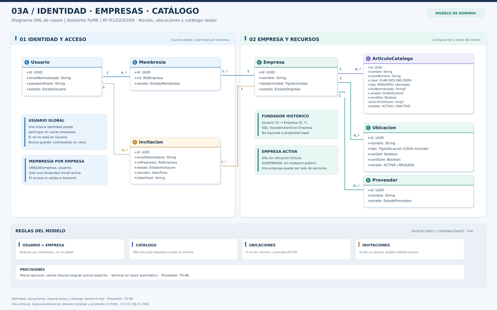

# 03A — Guía detallada: identidad, empresas y catálogo

**Proyecto:** Asistente PyME · **Documento asociado:** [Modelo de dominio y UML](../03_MODELO_DE_DOMINIO_Y_UML.md) · **Versión:** 0.4 (C.5, 08/11/2026) · **Estado:** UML conceptual conciliado con núcleo RF-01/RF-02 implementado; Ubicaciones, Artículos y Proveedores permanecen TO-BE.

[Ver SVG vectorial](03A_IDENTIDAD_EMPRESAS_CATALOGO_REDISENADO.svg) · [Ver fuente PlantUML](03A_CLASES_IDENTIDAD_Y_CATALOGO.puml) · [Documento 02: casos de uso](../02_CASOS_DE_USO.md).

## 1. Finalidad y organización

El diagrama responde tres preguntas: **quién usa la plataforma**, **a qué empresa tiene acceso** y **qué datos pertenecen a esa empresa**. Representa el núcleo de identidad y configuración, sin confundir a una persona con un único negocio ni con un rol global.

La lámina se divide en **Identidad y acceso** (izquierda) y **Empresa y recursos** (derecha). Las cajas son clases y sus atributos; las líneas indican asociaciones y cardinalidades. Los recuadros de reglas son notas editoriales, no entidades adicionales.

**Simplificación gráfica:** la asociación «fundador histórico» se presenta como nota en el SVG para evitar una conexión larga; en SQL ya está `businesses.founder_user_id`. El vínculo Usuario–Invitación que muestra el SVG representa al **emisor obligatorio**; el vínculo adicional del **aceptante opcional** consta en PlantUML y en esta guía, sin sobrecargar la lámina editorial.

## 2. Entidades y responsabilidades

| Clase | Propósito | Regla principal |
|---|---|---|
| **Usuario** | Identidad personal y global: correo normalizado, hash de contraseña y estado | Puede formar parte de cero, una o varias empresas; no contiene un rol empresarial global |
| **Membresia** | Relación real Usuario–Empresa con rol, estado y puesto opcional | UNIQUE por empresa/usuario; C.4b protege al titular y edita solo roles/estados operativos autorizados |
| **Empresa** | Espacio independiente de gestión (*tenant*) | Nace ACTIVA, con una membresía administrativa inicial; puede tener cero ubicaciones y cero artículos |
| **Invitacion** | `business_invitations` emitida por Usuario y dirigida a correo/rol | Emisor obligatorio y aceptante opcional; PENDIENTE no concede acceso, el secreto solo se conserva como SHA-256 |
| **Ubicacion** | Local, feria, depósito u otro espacio con capacidades de venta o almacenamiento | Pertenece a una empresa y no se crea automáticamente al crearla |
| **ArticuloCatalogo** | Bien físico o servicio, con SKU, unidad y precio/costo informativos | No crea existencias al registrarse; los servicios no consumen stock automáticamente en MVP |
| **Proveedor** | Referencia comercial para adquisiciones | Pertenece a una empresa y puede quedar inactivo sin borrar historial |

Las clases son conceptuales: Usuario, Empresa, Membresía e Invitación ya tienen sus FK reales en SQL; Ubicacion, ArticuloCatalogo y Proveedor siguen planificados para backend. Las FK no necesitan duplicarse en las cajas UML si la asociación es inequívoca.

## 3. Cómo leer las cardinalidades

- **Usuario 1 — 0..* Membresias:** cada membresía corresponde a un solo usuario. Un usuario puede no pertenecer todavía a ninguna empresa o estar vinculado a varias.
- **Empresa 1 — 1..* Membresias:** cada empresa válida tiene al menos una membresía, creada junto con la empresa para su titular administrativo inicial. Puede tener muchas otras. La pareja empresa–usuario no debe duplicarse.
- **Usuario 1 — 0..* Empresas como fundador:** cada empresa registra su fundador histórico; una persona puede fundar varias. Fundador no equivale a propietario legal ni implica permisos perpetuos.
- **Empresa 1 — 0..* Ubicaciones / Articulos / Proveedores:** los recursos empresariales pertenecen a una empresa, pero son opcionales inicialmente.
- **Empresa 1 — 0..* Invitaciones:** una empresa puede emitir invitaciones. Emitirlas no modifica membresías.
- **Usuario emisor 1 — 0..* Invitaciones:** cada invitación registra `invited_by_user_id NOT NULL`; el emisor es una cuenta global autenticada.
- **Usuario aceptante 0..1 — 0..* Invitaciones:** la invitación guarda `accepted_by_user_id` solo cuando fue consumida; una cuenta puede aceptar varias invitaciones, pero cada una tiene como máximo un aceptante.
- **Destinatario por email, sin asociación FK previa:** `email_normalizado` es un dato textual, no una FK a Usuario. Puede emitirse antes de que la persona tenga cuenta.

Convenciones: **0..1** = cero o uno; **1** = exactamente uno; **0..*** = cero o muchos; **1..*** = uno o muchos.

## 4. Recorridos operativos de principio a fin

### 4.1 Registro y creación de empresa (CU-01, CU-02, CU-03)

1. El visitante se registra e inicia sesión. El backend crea/consulta su identidad global, con contraseña almacenada mediante un hash seguro.
2. El usuario autenticado solicita crear un negocio. La API valida los datos de entrada.
3. En **una sola transacción** se guarda Empresa, el fundador histórico y una Membresia activa con responsabilidad administrativa inicial.
4. Si falla cualquier parte, no queda una empresa sin responsable. Si la creación tiene éxito, el usuario puede configurar su negocio.
5. **No aparecen depósitos, ubicaciones ni existencias ficticias**. Una empresa exclusivamente de servicios puede comenzar sin ellos.
6. En futuras solicitudes se comprueba la membresía correspondiente a la empresa indicada, no solo la identidad del token.

### 4.2 Ubicaciones y artículos (CU-04, CU-05)

1. Un administrador con autorización registra una ubicación indicando si permite vender, almacenar o ambas operaciones.
2. Registra un artículo del catálogo como bien físico o servicio. La API verifica el SKU dentro de esa empresa.
3. Un bien físico puede existir en catálogo con stock cero; solo recepciones/ajustes válidos incrementarán sus existencias.
4. Si un artículo tiene precio de referencia no informado, al vender se pide precio explícito en el renglón.
5. Un servicio puede venderse sin depósito; no descuenta insumos de forma automática durante el MVP.

### 4.3 Invitación y aceptación (CU-12, soporte propuesto)

1. Un administrador autorizado crea una invitación para un destinatario y rol permitido.
2. La invitación permanece PENDIENTE; el destinatario aún no puede consultar datos empresariales.
3. Si no existe cuenta, el invitado debe registrarse e iniciar sesión antes de aceptar.
4. Al aceptar, el servidor revisa identidad, token, vencimiento, empresa, rol y estado.
5. Una transacción consume la invitación y crea/activa la membresía una sola vez.

**Ejemplo multiempresa:** la misma persona puede administrar Empresa A y vender en Empresa B. Los permisos se resuelven por Membresia, no como subclases globales de Usuario.

## 5. Reglas de integridad y pruebas asociadas

| Requisito | Verificación esperada |
|---|---|
| Identidad global | Correo normalizado único; no crear usuarios duplicados por cambios de mayúsculas o espacios |
| Membresía por empresa | Unicidad de la pareja (business_id, user_id) |
| Permisos | Conocer un identificador empresarial ajeno nunca concede acceso a sus datos |
| SKU | Unicidad de (business_id, sku_normalizado) cuando se informó SKU; reutilizable en otra empresa |
| Integridad de tenant | FK compuestas y consultas acotadas por empresa; la integridad referencial **no reemplaza** la autorización del servidor |
| Historial | Desactivar ubicación, artículo o proveedor no elimina compras/ventas históricas |
| Invitaciones | Token pendiente o vencido no habilita acceso; dos aceptaciones no generan dos membresías |

## 6. Alcance y límites

Este diagrama **no** modela compras, recepciones, ventas ni movimientos: eso se explica en [03B](03B_EXPLICACION_COMPRAS_INVENTARIO_VENTAS.md). Tampoco es un DER físico ni una API desplegada. Transferencia de titularidad, suspensión empresarial completa, envío automático de invitaciones y consumo de insumos por servicio quedan sujetos a otras decisiones.

## 7. Preguntas para defenderlo

**¿Por qué separar Usuario y Membresia?** Porque la identidad es global y el rol es particular de cada empresa. Esto impide mezclar privilegios de negocios distintos.

**¿Por qué no crear siempre una ubicación?** Un prestador de servicios no necesariamente tiene depósito. Las operaciones físicas sí exigen una ubicación apta.

**¿Por qué SKU por empresa?** Distintas empresas pueden utilizar el mismo código, pero dentro de una debe identificar de forma inequívoca al artículo.

**Estado C.5:** 03A actualizado con entidades reales RF-01/RF-02; autenticación, empresa, membresías e invitación/aceptación son API implementada y probada. Ubicacion, ArticuloCatalogo y Proveedor no se convierten por ello en tablas existentes. El SVG es un resumen visual; el PlantUML conserva todas las asociaciones. No existe transferencia de titularidad ni verificación de email.

## 8. Contraste final con SQLAlchemy — C.5

Los modelos `User`, `Business`, `Membership` y `BusinessInvitation` se compararon con el esquema vigente de E2-1. `Membership` mantiene UNIQUE `(business_id,user_id)` y el índice `uq_memberships_one_active_owner` que garantiza **como máximo un titular administrativo ACTIVO** por empresa; la creación de empresa lo incorpora en su transacción y C.4b impide alterar titulares actuales o históricos.

`BusinessInvitation` exige `invited_by_user_id` (FK obligatoria), guarda `email_normalizado` como destinatario sin cuenta vinculada antes de aceptar y solo usa `accepted_by_user_id` (FK opcional) con `accepted_at` cuando el estado es ACEPTADA, según su CHECK. El token nunca se persiste en claro; la aceptación confirma membresía e invitación en un mismo commit. El SVG resume la relación con emisor y la fuente PUML incluye además el aceptante.

**Evidencias C.5:** en Windows `195 passed in 23.86s`, Alembic `e213c4_acceptance (head)` sin deriva, Docker API/DB `healthy` y `/ready` = `ready`/`ok`; CI funcional C.4b 3/3. C.5 solo actualiza documentos y diagramas, **sin repetir tests ni modificar SQL**.
