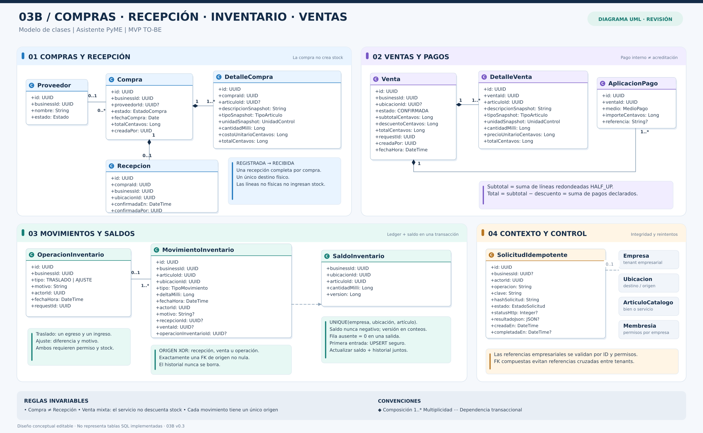

# 03B — Guía detallada: compras, recepción, inventario y ventas

**Proyecto:** Asistente PyME · **Documento asociado:** [Modelo de dominio y UML](../03_MODELO_DE_DOMINIO_Y_UML.md) · **Versión:** 0.3 · **Estado:** diseño conceptual del backend MVP TO-BE.

[Ver SVG vectorial](03B_COMERCIO_INVENTARIO_REDISENADO.svg) · [Ver PlantUML](03B_CLASES_COMERCIO_E_INVENTARIO.puml) · [Documento 02: casos de uso](../02_CASOS_DE_USO.md).

## 1. Qué problema resuelve

El diagrama representa los procesos comerciales que cambian la información de una empresa, manteniendo separados **registrar una compra**, **recibir bienes**, **vender**, **declarar pagos** y **mover existencias**. El objetivo es conservar los hechos históricos y permitir operaciones concurrentes sin stock negativo ni duplicaciones.

La lámina se distribuye en cuatro paneles:

1. **Compras y recepción:** lo adquirido no se considera físicamente disponible hasta recibirlo.
2. **Ventas y pagos:** una venta confirma renglones y medios declarados, no acreditaciones bancarias.
3. **Movimientos y saldos:** el historial de entradas/salidas se mantiene junto a un saldo transaccional.
4. **Contexto y control:** claves de idempotencia y referencias de empresa, artículo, ubicación y membresía.

Los paneles tienen una función **editorial**. No son tablas, servicios ni agregados DDD formalmente implementados. Para evitar cruces de decenas de líneas, algunas referencias entre paneles se muestran como atributos identificadores y se describen en este documento. **El 03B no pretende dibujar todas las FK del esquema futuro**.

## 2. Entidades y asociaciones principales

### 2.1 Compras

| Clase | Responsabilidad |
|---|---|
| **Proveedor** | Entidad comercial opcional de cada compra, vinculada a una empresa. |
| **Compra** | Encabezado de adquisición: empresa, fecha, proveedor opcional, total, estado y autor. |
| **DetalleCompra** | Renglones con cantidades, unidad, descripción, tipo, costo y total **congelados como snapshot**. |
| **Recepcion** | Hecho posterior que confirma la llegada física completa a una sola ubicación. |

**Cardinalidades:** una Compra tiene **1..*** DetalleCompra; cada detalle tiene una sola Compra. Una Compra tiene **0..1** Recepcion en el MVP; una Recepcion corresponde a exactamente una Compra. Un Proveedor puede estar asociado a muchas Compras, pero su participación en cada Compra es opcional.

**Ejemplo:** el 7 de noviembre se registran 20 unidades a un costo acordado. Mientras no se reciba la mercadería, Compra queda REGISTRADA y el stock no aumenta. Posteriormente el operador elige el depósito correspondiente, confirma la recepción completa de 20 unidades y Compra pasa a RECIBIDA. **No se admite una recepción parcial de 12 ni destinos múltiples en este MVP**.

Si la compra solo contiene servicios o conceptos no inventariables, se guarda CERRADA_SIN_RECEPCION; no se crea una recepción física sin líneas físicas. Las compras mixtas reciben únicamente sus líneas inventariables. Registrar una compra no demuestra que ya esté pagada.

### 2.2 Ventas y pagos

| Clase | Responsabilidad |
|---|---|
| **Venta** | Hecho comercial confirmado con empresa, ubicación opcional, totales, autor, fecha y requestId. |
| **DetalleVenta** | Cada artículo/servicio vendido, con cantidad, precio y snapshots históricos de nombre, tipo y unidad. |
| **AplicacionPago** | Importe asignado internamente a un medio de pago y referencia opcional. |

Una Venta confirmada tiene **1..*** DetalleVenta y **1..*** AplicacionPago. Una venta solo de servicios puede prescindir de ubicación; al vender bienes físicos se exige ubicación habilitada para el flujo operativo y disponibilidad suficiente.

**Pago declarado** significa que el sistema registra cómo el operador informó haber cobrado. **No verifica** que una transferencia haya sido acreditada por el banco ni que Mercado Pago confirme un cobro real.

La venta guarda snapshots para que cambiar el nombre, la unidad o el precio de lista del catálogo **no reescriba** el histórico. El artículo sigue referenciado por su ID para trazabilidad, aunque luego quede inactivo.

### 2.3 Inventario

| Clase | Responsabilidad |
|---|---|
| **OperacionInventario** | Agrupa una acción manual: traslado o ajuste justificado, con motivo, autor y requestId. |
| **MovimientoInventario** | Registro histórico de **delta positivo o negativo** por empresa, ubicación y artículo. |
| **SaldoInventario** | Proyección actual por **empresa–ubicación–artículo**, con cantidad y versión. |

Los MovimientosInventario constituyen el **historial auditable**; no se corrige el pasado cambiando sus cantidades, sino registrando una operación compensatoria justificada. El SaldoInventario es una vista materializada persistida para consultar y controlar concurrencia; no es un segundo stock editable.

Todo movimiento tiene **exactamente un origen**: Recepcion, Venta **u** OperacionInventario. Se propone representarlo con tres FK opcionales y un CHECK local de exclusividad, más FK compuestas que respeten la empresa. Un traslado es **una operación** que produce **dos movimientos** (salida de origen, entrada en destino), en la misma transacción.

### 2.4 Idempotencia y contexto

**SolicitudIdempotente** registra operación, actor, empresa cuando ya existe, clave, hash de solicitud, estado y respuesta HTTP. Su objetivo es que perder una respuesta de red y reintentar **no vuelva a recibir la compra, mover stock o confirmar la venta**.

La Empresa, Ubicación, ArticuloCatalogo y Membresia que se ven como referencias recuerdan que cada operación requiere datos válidos y permisos del tenant. Un ID válido de otro negocio no es un recurso autorizado.

## 3. Flujo completo: registrar compra y recepcionar (CU-06 y CU-07)

1. El usuario autorizado selecciona una empresa y carga fecha, proveedor opcional y renglones de compra. **Todavía no necesita elegir ubicación.**
2. La API valida artículos, unidades y cantidades, calcula cada subtotal exacto, conserva snapshots y persiste Compra más DetalleCompra. **No crea MovimientoInventario ni cambia SaldoInventario.**
3. La compra con bienes físicos queda REGISTRADA hasta una entrega futura. Una compra sin bienes queda CERRADA_SIN_RECEPCION.
4. Al recibir, el operador elige una **única** Ubicacion de la misma empresa, ACTIVA y con canStore habilitado.
5. La transacción bloquea Compra REGISTRADA (o usa transición condicional), comprueba que no haya una recepción previa, inserta Recepcion y entradas firmadas para **todos** los bienes físicos.
6. En ese mismo commit actualiza los saldos, marca Compra RECIBIDA y confirma la clave de idempotencia.
7. Si falla cualquier paso, se revierten **todos** los cambios; un reintento idéntico recupera la recepción existente sin repetir las entradas.

La restricción de unicidad de Recepcion.compraId refuerza la regla de **una recepción completa por compra**.

## 4. Flujo completo: confirmar venta (CU-10)

1. El operador arma la venta con renglones físicos y/o servicios, cantidades, precio de cada línea, descuento y medios de pago declarados.
2. El servidor verifica autenticación, pertenencia a la empresa, permisos, artículos activos/vendibles y capacidades de la ubicación. Los servicios no generan egreso físico.
3. Recalcula **cada total de renglón** y suma esos totales; después aplica el descuento. Verifica que los importes de las aplicaciones de pago coincidan exactamente con el total final.
4. Agrupa cantidades de un mismo artículo físico **solo para validar stock**. Esa agrupación no recalcula importes comerciales ya redondeados.
5. En una única transacción controla el saldo de cada trío empresa–ubicación–artículo afectado. Si falta stock para una sola línea, rechaza toda la venta.
6. Si alcanza, registra Venta, DetalleVenta, AplicacionesPago y MovimientosInventario de salida, actualiza los saldos y confirma la idempotencia en el **mismo commit**.
7. Devuelve comprobante interno y saldos resultantes. Un reintento con la misma clave/carga devuelve el resultado anterior; con distinta carga debe rechazarse por conflicto.

**Venta de servicios:** puede realizarse sin ubicación de almacenamiento; **no** descuenta shampoo, acondicionador u otros insumos automáticamente en el MVP. La gestión de consumos por prestación es futura.

## 5. Exactitud de dinero y cantidades

El frontend usa **centavos enteros de ARS** para precios e importes, y **milésimas enteras de la unidad** para cantidades físicas; el backend deberá formalizar la misma precisión sin usar Float.

Para cantidades y precios no negativos:

- **TotalRenglonCentavos = HALF_UP(cantidadMilli × precioUnitarioCentavos / 1000).**
- **Compra.totalCentavos = suma de los totales de sus detalles.**
- **Venta.subtotalCentavos = suma de DetalleVenta.totalCentavos.**
- **Venta.totalCentavos = subtotalCentavos − descuentoCentavos.**
- **Suma de AplicacionPago.importeCentavos = Venta.totalCentavos.**

Ejemplo: tres renglones separados de 0,333 kg a 1.050 centavos/kg producen **350 centavos por línea** y **1.050 centavos en total**. Consolidar las cantidades para facturarlas como un único renglón de 0,999 kg produciría 1.049 centavos: por eso la **validación de stock** y el **cálculo monetario** no son la misma operación.

**Precio cero:** un renglón bonificado puede tener precio unitario de cero. La política actual del MVP exige una **venta total estrictamente positiva**; un comprobante completo de importe cero requiere un caso de uso/regla adicional, no simplemente quitar esa validación.

## 6. Concurrencia, saldos e historial

### 6.1 Dos usuarios venden la última unidad

Con saldo inicial 1, dos usuarios autorizados envían dos ventas distintas y simultáneas por 1 unidad. El backend debe confirmar **exactamente una**, rechazar la otra por falta de stock y terminar con **saldo 0**, una salida física y ninguna venta/pago parcial del intento rechazado.

No basta con hacer un SELECT de disponibilidad y luego, fuera de su protección transaccional, descontar. Se necesita una actualización condicional sobre SaldoInventario, bloqueo de fila, aislamiento equivalente o estrategia comprobada en PostgreSQL con sesiones independientes. Las operaciones sobre varios saldos deben adoptar orden consistente para reducir bloqueos circulares.

### 6.2 Primera entrada: saldo que todavía no existe

- **Venta o salida:** una fila inexistente se interpreta como saldo **cero**; la salida se rechaza sin necesidad de crear una fila artificial.
- **Recepción o ajuste positivo:** si la fila no existe, el backend debe inicializarla mediante una inserción concurrente segura o UPSERT, agregando la cantidad y generando el movimiento en la **misma transacción**.
- **Regla permanente:** SaldoInventario nunca puede ser negativo; su valor debe conciliar con la suma de los movimientos firmados para esa misma empresa, ubicación y artículo.

### 6.3 Traslados y ajustes (CU-09 y CU-11)

Un traslado resta X en una ubicación y suma X en otra, **sin crear ni perder unidades**. Un ajuste justificado registra un delta y motivo; no finge que ocurrió una compra o venta. Para un conteo absoluto debe comprobarse la versión del saldo observado y rechazarse un conteo obsoleto.

## 7. Idempotencia: el caso de un mismo pedido repetido

- **Misma clave y misma carga, tras éxito:** recuperar la respuesta comercial previamente confirmada, sin repetir efectos.
- **Misma clave con otra carga:** conflicto, sin crear una nueva operación.
- **Dos solicitudes simultáneas con igual clave:** se serializan o reciben una respuesta controlada de «operación en proceso»; la política HTTP concreta se define en el Documento 05, sin imponer por adelantado 409 o 429.
- **Alta de Empresa sin businessId:** cuidado con un UNIQUE tradicional que permita varios NULL. Para PostgreSQL puede definirse una unicidad con NULLS NOT DISTINCT (según versión) **o índices parciales separados** para solicitudes con y sin empresa.
- **Expiración del resultado:** no fijar un TTL arbitrario de 48/72 h si ello permite repetir operaciones antiguas. La identidad comercial del comando o una garantía equivalente debe permanecer protegida.

## 8. Restricciones SQL propuestas, no implementadas

| Elemento | Restricción propuesta |
|---|---|
| SaldoInventario | UNIQUE(empresa, ubicación, artículo) y CHECK cantidad >= 0 |
| Recepcion | UNIQUE(compra_id), suficiente para una sola recepción MVP |
| MovimientoInventario | CHECK de exactamente una FK no nula entre recepción, venta y operación, más integridad referencial |
| Recursos entre empresas | FK compuestas con empresa, y autorización explícita en servidor |
| SKU | Único dentro de empresa cuando se informa |
| Idempotencia | Unicidad por ámbito, actor, operación y clave, con tratamiento correcto de businessId nulo |

**Importante:** una FK compuesta impide vínculos cruzados inválidos, pero no sustituye verificar si el usuario tiene permiso sobre la empresa. El 03B es un modelo conceptual, no prueba que estas restricciones existan en una migración Alembic.

## 9. Preguntas para la defensa

**¿Por qué Compra y Recepcion están separadas?** Porque adquirir un artículo no implica tenerlo físicamente disponible; recepcionar requiere un hecho posterior y una ubicación.

**¿Por qué existen MovimientoInventario y SaldoInventario?** El primero explica qué ocurrió; el segundo permite consultar y bloquear el estado actual sin recontar todo el historial en cada venta. Ambos se actualizan atómicamente.

**¿Por qué hay snapshots en DetalleVenta?** Para que editar el catálogo no modifique la historia de una transacción.

**¿Cómo se evita la sobreventa?** Revalidando y descontando dentro de la misma transacción de base de datos, con control real sobre el saldo afectado y pruebas de dos solicitudes concurrentes.

**Alcance:** pagos declarados, sin acreditación financiera; sin recepción parcial/multidestino ni consumo automático de insumos por servicios.
