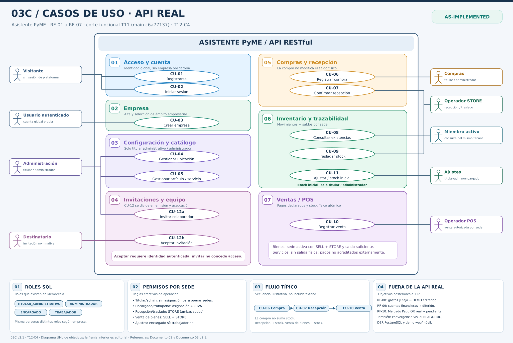

# 03C — Guía de casos de uso de la API REAL

**Proyecto:** Asistente PyME — plataforma generalista de gestión multiempresa y multirrubro.  
**Materia:** Programación 2 — UNSAM, segundo cuatrimestre de 2026.  
**Versión:** **2.1 / E2-7 T12-C4**, aprobada y publicada en rama documental.  
**Estado de representación:** **AS-IMPLEMENTED T11** del núcleo RF-01 a RF-07.  
**Corte funcional:** rama `main`, commit `c6a77137cf82dcb9aad225645e84b1265b1da3ec` (PR #45).  
**Rama documental:** `docs/e2-7-t12-cierre-academico` (PR #46, **DRAFT**); **los tres archivos 03C fueron aprobados y publicados**.  
**Documentos de referencia:** [01 — Requerimientos](../01_ANALISIS_DE_REQUERIMIENTOS.md), [02 — Casos de uso](../02_CASOS_DE_USO.md), [03 — Modelo de dominio v2.1](../03_MODELO_DE_DOMINIO_Y_UML.md) y [05 — Matriz API y trazabilidad](../05_MATRIZ_API_Y_TRAZABILIDAD.md).

[Ver lámina SVG vectorial](03C_CASOS_DE_USO_REDISENADO.svg) · [Ver PlantUML editable](03C_CASOS_DE_USO.puml) · [03A — Clases de identidad y catálogo](03A_EXPLICACION_IDENTIDAD_EMPRESAS_CATALOGO.md) · [03B — Comercio e inventario](03B_EXPLICACION_COMPRAS_INVENTARIO_VENTAS.md).

> **Cómo leer el diagrama:** la lámina presenta los **objetivos de los actores** de la API real, no las tablas de PostgreSQL ni el recorrido obligatorio de cada petición. Los perfiles operativos dibujados son *funciones contextuales*; las únicas denominaciones de rol persistidas en `Membership.role` son `TITULAR_ADMINISTRATIVO`, `ADMINISTRADOR`, `ENCARGADO` y `TRABAJADOR`. La autorización efectiva se comprueba en el backend según usuario, sesión, membresía, empresa y, cuando corresponda, sede. El estado REAL no significa que las capacidades diferidas ya estén desarrolladas.

## 1. Finalidad, alcance y correcciones frente a la versión anterior

El diagrama contesta tres preguntas: **quién interactúa con Asistente PyME**, **qué objetivos del MVP REAL puede alcanzar** y **qué controles de negocio separan esos objetivos**. Su frontera se rotula `Asistente PyME / API RESTful`; la API es **parte del sistema**, nunca un actor externo.

Esta versión reemplaza documentalmente el estado histórico `03C v0.3 / TO-BE` (diseño previo a la integración del backend) por una representación de los CU **efectivamente implementados** en FastAPI, SQLAlchemy/PostgreSQL y las pantallas React REAL al corte T11. El documento 03 rector v2.1 y los diagramas 03A y 03B constituyen su contexto arquitectónico; sus clases no se duplican como actores del diagrama de casos de uso.

La lámina editorial organiza los casos por áreas para facilitar la defensa oral. Los cuadros coloreados son **agrupaciones temáticas** y los óvalos son **casos de uso UML**. Las líneas de asociación indican una función actora que participa en el objetivo; **no** reemplazan el análisis de permisos. La franja inferior de flujo comercial representa una **secuencia ilustrativa**, no una relación UML «include», «extend», herencia ni obligación de completar todos los casos de uso.

### 1.1 Relación entre doce CU escritos y trece óvalos

El Documento 02 define **CU-01 a CU-12** (doce especificaciones). La lámina separa **CU-12a Invitar** y **CU-12b Aceptar** porque son objetivos iniciados por personas diferentes; por eso hay **trece óvalos**, sin inventar un CU-13. Otras ampliaciones ya implementadas (administrar ubicaciones, colaboradores, consultar comprobantes y estado de catálogo) son operaciones de los CU existentes y no requieren numeraciones artificiales.

## 2. Actores y su equivalencia con roles reales

| Actor funcional en 03C | Qué representa | Correspondencia comprobable en la implementación |
|---|---|---|
| **Visitante** | Persona sin sesión que desea registrarse o autenticarse | No necesita membresía empresarial; CU-01 y CU-02 |
| **Usuario autenticado** | Cuenta global activa que crea su primer negocio u otro adicional | `User` + `AuthSession`; CU-03 crea `Business` y la membresía titular inicial |
| **Administración** | Persona que gestiona configuración, catálogo e invitaciones dentro de una empresa | `TITULAR_ADMINISTRATIVO` o `ADMINISTRADOR`; membresía activa y empresa habilitada para escribir |
| **Compras** | Responsable que registra adquisiciones y sus renglones | **Solo** titular/administrador para crear compras; CU-06 **no** exige ubicación al registrar |
| **Operador STORE** | Función autorizada para recibir mercadería o trasladar bienes entre sedes | Titular/admin sin asignación individual; encargado/trabajador con `LocationAssignment` ACTIVA y sede apta para STORE |
| **Miembro activo** | Usuario que consulta saldos y movimientos del negocio | Los cuatro roles de membresía activos pueden consultar el inventario del mismo tenant (CU-08); la lectura no concede derecho de operar en otra sede |
| **Ajustes** | Responsable que realiza ajustes justificados o carga de stock inicial | Ajustes: titular/admin/**encargado**; **stock inicial exclusivamente titular/admin**; trabajador excluido de ambos |
| **Operador POS** | Persona autorizada para registrar ventas en su empresa | Titular/admin o encargado/trabajador con las condiciones de sede y política de precios correspondientes |
| **Destinatario** | Usuario autenticado cuyo correo coincide con la invitación dirigida | Acepta invitación válida y crea/reactiva su membresía una sola vez; no obtiene acceso solo por recibir el enlace |

**Importante:** un mismo usuario puede ser titular en una empresa y encargado en otra; no existen clases persistentes «OperadorCompras», «Vendedor» ni roles SQL con esos nombres. En la lámina el actor «Compras» es una *etiqueta de la función*, no la declaración de un quinto rol. **Proveedor** y **cliente comprador** tampoco son actores autenticados por el mero hecho de figurar como datos comerciales.

### 2.1 Matices de permisos que no deben perderse

- **Rol TITULAR_ADMINISTRATIVO:** autorización empresarial amplia; el sistema protege la titularidad frente a edición/revocación ordinaria. No debe confundirse fundador histórico con rol activo actual.
- **Rol ADMINISTRADOR:** gestiona empresa/configuración, catálogo, compras e invitaciones; **no equivale a titular** para toda gestión de membresías protegidas.
- **Rol ENCARGADO:** puede operar sedes asignadas para SELL o STORE y realizar ajustes justificados, pero no stock inicial ni override de precio de venta o descuento.
- **Rol TRABAJADOR:** puede operar sedes asignadas para SELL o STORE y ejecutar recepciones/traslados/ventas permitidas; **no puede registrar ajustes ni stock inicial**, ni modificar precio o descuento del POS.
- **Estado:** escritura exige empresa/membresía activas y, para operación por sede, ubicación ACTIVA. Titular y administrador **no requieren asignación personal**, aunque sí las capacidades requeridas de la sede. Encargado/trabajador requieren asignación ACTIVA a cada sede involucrada.

## 3. Matriz de casos de uso, roles y política por ubicación

| CU | Objetivo REAL | RF | Quién puede iniciarlo | Condición de autorización relevante |
|---|---|---|---|---|
| **CU-01** | Registrarse | RF-01 | Visitante | Correo único normalizado; no crea empresa ni membresía automáticamente |
| **CU-02** | Iniciar/cerrar sesión, consultar identidad | RF-01 | Visitante para login; titular de sesión para `/me` y logout | Autenticación Bearer opaca; token en memoria del frontend REAL |
| **CU-03** | Crear y gestionar empresa | RF-02 | Usuario global autenticado para crear; miembros autorizados para gestión posterior | Alta atómica Empresa + Membresía titular; idempotencia propia de alta empresarial |
| **CU-04** | Crear/editar/pausar sede y gestionar asignaciones | RF-03 | Titular o administrador para altas/ediciones | Aislamiento por empresa; indicadores `can_sell`, `can_store`; una principal activa como máximo |
| **CU-05** | Crear/editar/desactivar artículo o servicio | RF-04 | Titular o administrador para escritura | Ficha de catálogo por empresa; SKU/nombre controlados; **no crea stock** |
| **CU-06** | Registrar compra | RF-05 | **Titular o administrador** | No requiere sede al alta; snapshots; el alta no modifica existencias |
| **CU-07** | Confirmar recepción completa | RF-05, RF-06 | Titular, administrador, encargado o trabajador | **STORE** en sede destino; para encargado/trabajador, asignación ACTIVA; una recepción completa por compra |
| **CU-08** | Consultar saldos y movimientos | RF-06 | Los cuatro roles con membresía activa | Lectura del tenant; puede incluir saldos de varias sedes aun cuando el miembro no pueda operarlas |
| **CU-09** | Trasladar existencias | RF-06 | Titular, administrador, encargado o trabajador | **STORE en origen y destino**, sede(s) activa(s); asignación activa de operador a ambas; un débito y un crédito atómicos |
| **CU-10** | Registrar venta POS | RF-07 | Titular, administrador, encargado o trabajador | Para bienes físicos: misma sede **SELL + STORE**, stock suficiente y asignación si corresponde. Para encargado/trabajador: precio del catálogo obligatorio, sin cambio de precio ni descuento |
| **CU-11** | Registrar ajuste / stock inicial | RF-06 | Ajustes: titular/admin/**encargado**. Inicial: **solo titular/admin** | STORE en la sede; si rol operativo, asignación ACTIVA; ajuste con `expected_version`, motivo y control de saldo; inicial solo sin historial previo pertinente |
| **CU-12a** | Emitir invitación de colaboración | RF-02 | Titular o administrador | Invitación nominativa a correo normalizado; rol propuesto ENCARGADO o TRABAJADOR; sin conceder acceso todavía |
| **CU-12b** | Aceptar invitación | RF-02 | Destinatario autenticado | Correo de sesión coincidente, invitación vigente/pendiente, aceptación atómica y sin duplicar membresía |

**Caso especial CU-10:** una venta de **solo servicios** puede no tener ubicación, pero en el backend esa modalidad sin sede está restringida a **titular/administrador**. Un encargado o trabajador requiere una sede habilitada para vender incluso si no descuenta stock físico. Una venta de bienes físicos exige además capacidad STORE en esa misma sede. Declarar `MERCADO_PAGO_DECLARADO` es únicamente registrar lo informado por el operador; **no valida una acreditación externa**.

**Alcance de CU-11:** `expected_version` pertenece al comando/DTO de control optimista, **no** a una columna de `inventory_operations`; el saldo persistido usa `stock_balances.version`. Un ajuste con versión obsoleta devuelve conflicto controlado, sin crear movimiento. La interfaz no debe tratar una respuesta de conflicto como éxito.

## 4. Casos de uso y contratos representativos

Todas las rutas siguientes se entienden bajo `/api/v1`; para endpoints por negocio se usa `B = /api/v1/businesses/{business_id}` y en el frontend REAL `E = /real/empresas/{business_id}`. Los contratos completos y cualquier actualización de método/estado HTTP corresponden al **Documento 05 y al código fuente**, no a esta lámina.

| CU | API REAL representativa | UI REAL principal | Resultado observable |
|---|---|---|---|
| CU-01 | `POST /auth/register` | `/real/registro` | Usuario global creado |
| CU-02 | `POST /auth/login`, `GET /auth/me`, `POST /auth/logout` | `/real/login`, `/real/perfil` | Sesión activa/revocada |
| CU-03 | `POST/GET /businesses`, `GET/PATCH B` | `/real/empresas`, `/real/empresas/nueva` | Empresa y titular persistidos |
| CU-04 | `POST/GET B/locations`, `PATCH .../status`, `PUT .../primary`, `GET/PUT .../assignments` | `E/ubicaciones` | Sede/aptitudes/asignaciones persistidas |
| CU-05 | `POST/GET B/catalog`, `GET/PATCH B/catalog/{item_id}`, `PATCH .../status` | `E/catalogo` | Alta/edición/estado del catálogo |
| CU-06 | `POST/GET B/purchases`, `GET .../{purchase_id}` | `E/compras` | Compra histórica, stock intacto |
| CU-07 | `POST B/purchases/{purchase_id}/receive`, `GET .../receipt` | `E/compras` | Entrada física completa y única |
| CU-08 | `GET B/inventory/balances`, `GET B/inventory/movements` | `E/inventario` | Saldo versionado e historial firmado |
| CU-09 | `POST B/inventory/transfers`, `GET .../transfers/{transfer_id}` | `E/inventario` | Dos movimientos de traslado atómico |
| CU-10 | `POST/GET B/sales`, `GET B/sales/{sale_id}`, `GET B/sales/by-request/{request_id}` | `E/pos`, `E/ventas` | Venta confirmada, pagos declarados, stock coherente |
| CU-11 | `POST B/inventory/adjustments`, `GET .../adjustments/{adjustment_id}` | `E/inventario` | Ajuste/stock inicial auditable y controlado |
| CU-12 | `POST B/invitations`, `POST /invitations/accept`, endpoints de membresías y asignaciones | `E/equipo`, `/real/invitaciones/aceptar` | Invitación emitida/aceptada, membresía única |

**Complementos reales que no se duplican como óvalos:** Proveedores (`suppliers`) con alta/edición/estado dentro de RF-05; consulta y gestión de membresías dentro de CU-12; gestión de ubicación principal y asignaciones dentro de CU-04; y recuperación de venta por `request_id` dentro de CU-10. Esta es una **vista de objetivos** con la nomenclatura original de la cátedra, no una lista exhaustiva de las 46 rutas documentadas en T12-B.

## 5. Lectura gráfica y semántica UML

1. **Actores fuera de la frontera:** representan funciones o sujetos externos al sistema; la API no es un actor.
2. **Óvalos dentro de la frontera:** representan un objetivo del usuario. El total es 13 óvalos para CU-01…CU-12, por la bifurcación CU-12a/b.
3. **Líneas continuas actor–CU:** indican asociación, no flujo de datos, llamada HTTP, FK ni herencia de roles.
4. **Paneles coloreados:** son una distribución editorial por dominio, sin imponer una arquitectura de despliegue.
5. **No se utilizan `<<include>>` ni `<<extend>>`:** registrar compra, confirmar recepción, emitir invitación y aceptar invitación pueden ocurrir en distintos momentos y con actores distintos. Dibujarlos como dependencia UML obligatoria induciría conclusiones incorrectas.
6. **Franja inferior «flujo típico»:** muestra una historia de negocio en tres pasos (compra → recepción → venta), **fuera de la semántica de relaciones UML**.
7. **Guía como fuente de detalle:** los permisos exactos y condiciones se describen aquí, evitando cargar cada óvalo de hashes, UUID o reglas extensas.

En el archivo `.puml`, PlantUML puede ordenar los paquetes de forma diferente al SVG. El **SVG es una composición editorial vectorial reproducible**, no una exportación exacta del motor de PlantUML. Ambos deben preservar identificadores CU, asociaciones funcionales y alcance.

## 6. Recorridos principales (sin confundirlos con dependencias UML)

### 6.1 Empresa nueva con mercadería (CU-01/02/03/04/05/06/07/08/10)

El visitante se registra o inicia sesión; la cuenta global crea una empresa cuyo titular inicial queda asociado en la misma transacción. El titular/administrador configura una sede que almacene y venda, y un artículo físico en catálogo. **Registrar una compra no incrementa el saldo**. Al confirmarse una **recepción completa en una sede STORE**, se crean movimientos de entrada y cambia el saldo. Una venta de bienes posterior valida SELL + STORE, la disponibilidad por artículo, precio y pagos declarados; descuenta existencias y confirma comprobante, renglones y ledger juntos. El flujo no obliga a toda empresa a comprar antes de vender; el stock inicial y ajustes válidos también pueden generar existencias.

### 6.2 Empresa solo de servicios (CU-03/05/10)

Una empresa puede comenzar sin ubicación y ofrecer servicios en catálogo. La venta de servicios no genera movimiento de stock físico ni consumo automático de insumos. **Sin sede**, el backend reserva la operación a titular/administrador; un rol operativo necesitará una ubicación con SELL y asignación ACTIVA. No existe agenda/reserva con cobro QR REAL en este corte.

### 6.3 Trabajo con colaboradores (CU-12a/12b, CU-04, CU-07/09/10/11)

Titular/admin emite una invitación para ENCARGADO o TRABAJADOR; la invitación pendiente no crea permisos. El invitado se autentica con el correo apropiado y la acepta; la API crea/reactiva la membresía dentro de una transacción. Se habilitan asignaciones activas por sede. Luego el trabajador puede vender/recepcionar/trasladar según SELL/STORE, pero **no ajustar ni crear stock inicial**; el encargado sí puede ajustar, pero no generar stock inicial. Ninguno altera precios ni otorga descuentos en POS.

## 7. Reglas transversales y controles de integridad

| Control | Qué se espera del backend REAL |
|---|---|
| Multi-tenant | Todas las operaciones empresariales comprueban el tenant de la membresía y referencias; conocer el UUID de otra empresa no concede permisos |
| Autenticación | Sesión vigente y usuario activo; los comandos transaccionales revalidan autorizaciones en el servicio |
| Sedes | SELL y/o STORE según operación; activo en la sede y asignación del rol operativo cuando corresponda |
| Compras | Compra con líneas, snapshots e idempotencia; sin cambios de inventario al darla de alta |
| Recepciones | A lo sumo una recepción completa por compra; sin ingreso duplicado por reintento |
| Inventario | Saldos no negativos, traslados de dos movimientos, ajustes con versión y motivo, historial de eventos firmados |
| Ventas | Suma de pagos declarados igual al total, redondeo `HALF_UP` por renglón, limitación de override de precios, operación atómica para bienes físicos |
| Reintentos | UUID de comando y hash por agregado; no existe una tabla genérica `SolicitudIdempotente` para todos los casos |
| Invitaciones | Token guardado mediante hash; aceptación ligada a la identidad/correo y membresía sin duplicados |

La descripción de pruebas y rutas vigentes se encuentra en los Documentos 02 y 05, y su evidencia fue obtenida durante los bloques de integración previos a T12. **Preparar esta documentación no ejecuta nuevamente Pytest, Playwright, Docker o Alembic.**

## 8. Requerimientos incluidos y capacidades diferidas

| Requisito | Situación en este documento | Casos de uso asociados |
|---|---|---|
| RF-01 Identidad | REAL | CU-01/02 |
| RF-02 Empresa y equipo | REAL | CU-03/12a/12b |
| RF-03 Ubicaciones | REAL | CU-04 |
| RF-04 Catálogo | REAL | CU-05 |
| RF-05 Proveedores, compras y recepción | REAL | CU-06/07 |
| RF-06 Inventario | REAL | CU-07/08/09/11 |
| RF-07 Ventas y pagos declarados | REAL | CU-10 |
| **RF-08 Gastos y caja** | **DEMO / DIFERIDO del backend REAL** | No se dibuja como API REAL |
| **RF-09 Cuentas financieras** | **DEMO / DIFERIDO** | No se dibuja como API REAL |
| **RF-10 Mercado Pago QR de cobro** | **DEMO / DIFERIDO** | No se dibuja como cobro confirmado en backend REAL |

### 8.1 Evolución después de T12 (no incorporada al alcance realizado)

El proyecto prevé, en incrementos separados y validados, **(1)** converger la experiencia de uso REAL hacia las pantallas DEMO manteniendo su estética y funcionalidades pertinentes sin mezclar persistencias, **(2)** visualizar el esquema físico de PostgreSQL mediante un DER generado desde la BD (por ejemplo DBeaver, sin necesidad de migrar a Supabase), **(3)** preparar una demostración navegable y adaptable a web/móvil, y **(4)** incorporar Mercado Pago QR REAL: credenciales/conexión propia por empresa, separación entre QR de artículo y QR de cobro, órdenes de pago e idempotencia de notificaciones, reconciliación de eventos confiables y estados autenticados. **`MERCADO_PAGO_DECLARADO` sigue siendo un medio informado manualmente, no una aprobación externa.**

No forman parte del recorte actual: reservas con seña confirmada por MP, pagos bancarios acreditados, cierre de caja, recepción parcial/multidestino, fabricación con consumo automático o transferencia de titularidad sin flujo implementado.

## 9. Relación del 03C con 03A, 03B y el modelo rector

- **03A — Identidad, empresa, sedes y catálogo:** representa `User`, `Membership`, `Business`, `BusinessInvitation`, `Location`, `LocationAssignment`, `CatalogItem` y `Supplier`, que fundamentan los permisos y recursos manipulados por los CU.
- **03B — Compras, recepción, inventario y ventas:** describe las nueve entidades persistentes comerciales, los estados, snapshots, saldos y ledger utilizados por CU-06 a CU-11.
- **03B — Flujo explicativo complementario:** [SVG adicional](03B_FLUJO_COMERCIAL_EXPLICATIVO.svg) publicado en la rama documental sin reemplazar el diagrama 03B original; es un dibujo de exposición, no un segundo esquema físico.
- **03C — Casos de uso:** muestra la intención del actor y la frontera del sistema, no todas las claves foráneas ni la secuencia de consultas de backend.
- **Documento 03 v2.1:** define el inventario de modelos persistentes, restricciones vigentes, transacciones y criterios de conciliación.

## 10. Decisiones de diseño y justificación para defensa oral

**¿Por qué el actor «Compras» no se llama TRABAJADOR?** Porque el alta de una compra está restringida en el servicio a titular/admin. En cambio, una recepción física en una sede apta sí puede ser realizada por encargado/trabajador asignado. El dibujo separa responsabilidades que el antiguo modelo agrupaba erróneamente.

**¿Por qué «Ajustes» no equivale a todos los operarios?** Porque el código admite al encargado en ajustes y al titular/admin en stock inicial, mientras que no habilita al trabajador a realizarlos. Las dos reglas se explicitan en la matriz.

**¿Por qué CU-08 puede leer saldos de otra sede que no puede operar?** Porque la lectura del inventario se filtra por empresa y la autorización a modificar por sede es una capa adicional. Esta es la decisión actual del MVP, no una recomendación universal de producción.

**¿Por qué CU-12a no incluye a CU-12b?** Porque invitar no implica aceptación; puede vencer, cancelarse o ser rechazado. El receptor autenticado inicia una acción distinta y el backend no asocia un usuario a una invitación pendiente por adelantado.

**¿Por qué Mercado Pago no aparece como actor externo?** Porque el MVP REAL registra pagos *declarados* y no procesa webhooks ni cobros QR confirmados. Cuando se implemente RF-10, habrá que actualizar casos, actores y contratos, pero no presentarlos como ya existentes.

**¿Qué evidencia representa “REAL”?** Los endpoints y flujos conectados antes de T12, respaldados por el código y las suites identificadas en la matriz T12-B, no una suposición fundada en imágenes DEMO.

## 11. Validación documental y límites de la publicación

Para cerrar T12-C4 se comprobaron documentalmente: nombres CU-01 a CU-12 (con CU-12a/b), roles y permisos concordantes con los servicios, ausencia de falsos `include/extend`, SVG legible con texto de color explícito, un `.puml` sintácticamente consistente, rutas y enlaces relativos correctos, y límites RF-08/RF-09/RF-10 claros.

**Controles de esta entrega:** reconciliación por lectura de Documento 02 T12-B, Documento 03 v2.1 y servicios de permisos, compras, recepciones, inventario y ventas; cotejo de los 13 óvalos con las 13 declaraciones PlantUML; XML del SVG validado y vista previa generada. **La compilación con PlantUML en un motor real permanece pendiente si no está disponible**: validar el texto y generar el SVG editorial no son equivalentes a ejecutar `plantuml.jar`.

**Estado:** **T12-C4 APROBADO Y PUBLICADO EN LA RAMA DOCUMENTAL**. Por aprobación expresa se reemplazaron exclusivamente los tres archivos canónicos `03C_CASOS_DE_USO.puml`, `03C_CASOS_DE_USO_REDISENADO.svg` y `03C_EXPLICACION_CASOS_DE_USO.md` en `docs/e2-7-t12-cierre-academico` (PR #46). El PR continúa **DRAFT**; esta publicación no autoriza ni ejecuta un merge a `main`, y no modifica frontend, backend ni PostgreSQL. La compilación con PlantUML continúa pendiente, por no haberse ejecutado el motor.
